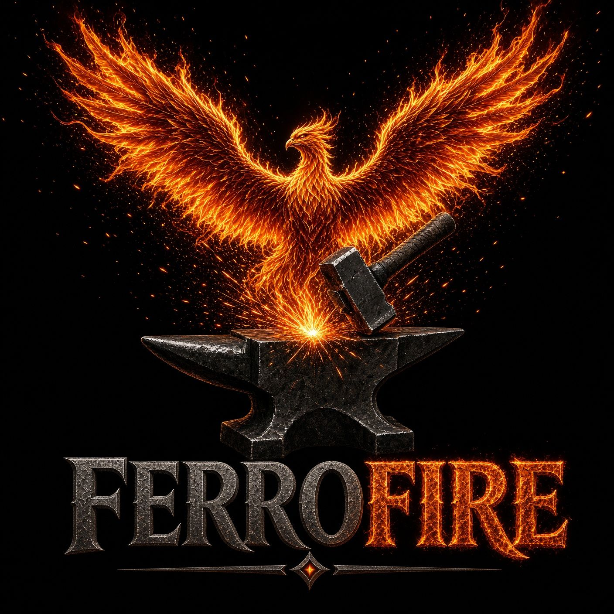
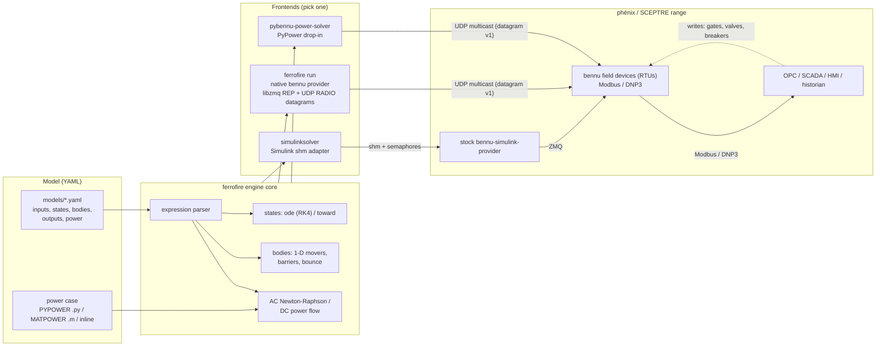

<p align="center">
  
</p>

# ferrofire

**The fire phēnix rises from.**

ferrofire is the **F**ield-to-**I**nfrastructure **R**untime **E**ngine: the simulated plant behind a
[phēnix](https://github.com/sandialabs/sceptre-phenix) / SCEPTRE cyber range.

## What we are building

A SCEPTRE range has three layers:

1. **The process**: a simulator (a *provider*) that computes what the physical plant is doing, such as water
   levels, valve positions or bus voltages, many times a second.
2. **The field devices**: the RTUs and PLCs. Each one is a VM that takes the values it cares about from the
   provider, runs the device's own logic, and serves them to the control system over real industrial protocols
   (Modbus, DNP3, IEC 60870-5-104 and others). Commands from the control system (open a valve, trip a breaker)
   go back through the device to the provider.
3. **The control system**: OPC, SCADA, HMI and historian VMs that talk to the field devices exactly as they would
   to real hardware, and that red and blue teams attack and defend.

[**bennu**](https://github.com/sandialabs/sceptre-bennu) is SCEPTRE's toolkit for layers 1 and 2: its
**field device** (`bennu-field-deviced`) is the software RTU, and it also ships providers (a Simulink bridge and
Python power-flow solvers) that layer 1 runs.

ferrofire covers both layers, in Rust, as drop-ins for bennu's pieces:

| | Replaces | Status |
|---|---|---|
| **Provider** (`ferrofire run`): a simple, fast process and power-flow simulator from a YAML model, no MATLAB, Simulink or PowerWorld | bennu's Simulink provider and PyPower solver | **Working**: runs the waterway range today with stock bennu RTUs |
| **Field device**: the software RTU, speaking the same protocols and config files as `bennu-field-deviced`, plus more OT protocols | `bennu-field-deviced` | **In progress**: [spec](docs/field-device-spec.md); DNP3, IEC 61850 and ICCP first |
| **Tools** (`probe`, `top`, `doctor`, `log`): read and write tags, watch live values and staleness, check a range's health | `bennu-probe`, reading log files | **In progress** |

The wire between layers 1 and 2 is documented as [datagram v1](docs/datagram-v1.md), and every claim about it is
measured: see [Results at a glance](docs/results.md).

## The name

- **Ferro** is iron, the metal that rusts. ferrofire is written in Rust.
- **Fire** is the forge, where raw iron becomes something useful.
- **phēnix** is named for the phoenix, which rises from fire. ferrofire is the
  process that a phēnix range rises from: the simulated plant behind the RTUs,
  SCADA and HMI.

_Formerly rustbelt._

## What it is

- One Rust binary that simulates a physical process and its power system in real time.
- Models are plain YAML files. No MATLAB, Simulink or PowerWorld.
- It serves its values to stock bennu field devices (RTUs), exactly like the providers SCEPTRE ships today.
- Built for **simple** processes: tanks, pipes, valves, pumps, locks, and steady-state AC power flow.

## What it is not

- Not an electromagnetic-transient or transient-stability simulator.
- Not a full Simulink replacement for complex models.
- No optimal power flow (OPF), no generator reactive-power limit loop (yet), no `.mat` case files.

## System diagram



## Features

| Area | What you get |
|---|---|
| Process models | `states` integrated with RK4 (`ode:`) or a rate-limited approach (`toward:`); `min`/`max` clamps |
| Moving things | `bodies`: 1-D movers with gate `barriers` and end `bounce` (the waterway boat) |
| Expressions | `+ - * / % ^`, comparisons (1/0), `&& \|\|`, `c ? a : b`, `if()`, `min max abs sqrt exp ln pow clamp sign step floor` |
| Power | AC Newton-Raphson and DC power flow, ported from PYPOWER 5.1.19 |
| Power cases | PYPOWER `.py` (literal subset), MATPOWER `.m`, or `inline:` in the model |
| Coupling | `power.drive`: process values set loads, e.g. pump flow sets a bus load in MW |
| Islands | `deenergize` (zero the voltage on dead buses) or `fail` (raise `bus-alert`, PyPower behaviour) |
| Tags | Waterway tags and the full PYPOWER/pybennu tag vocabulary (`bus-N.voltage`, `branch-1_F-T.active`, ...) |

## Frontends

| Frontend | How it starts | Protocol | Replaces |
|---|---|---|---|
| Native bennu provider | `ferrofire run model.yaml` | REP on tcp + UDP RADIO/DISH multicast | any bennu provider |
| Simulink adapter | `simulinksolver -tf inf` (or `ferrofire simulink`) | SysV shm + POSIX semaphores to stock `bennu-simulink-provider` | the Simulink solver binary |
| PyPower drop-in | `pybennu-power-solver start -c config.ini` (or `ferrofire pypower`) | same INI, pidfile, logs and ZMQ as pybennu | `pybennu-power-solver` |

## Transports

Requests (`QUERY=`, `READ=tag`, `WRITE=tag:value`, answered `ACK=...` / `ERR=...`) are ZeroMQ REQ/REP (pure-Rust `zeromq` crate, wire-compatible with stock libzmq clients and servers; the interop tests run a libzmq peer; no libzmq in the binary). Updates (`tag:value,...`,
NUL-terminated) are UDP datagrams in libzmq's RADIO framing, split into whole-point datagrams of at most 1400 bytes, each ending
in `_ff.seq`, `_ff.cyc` and `_ff.t` pseudo-tags. The wire is owned by ferrofire and specified in
[docs/datagram-v1.md](docs/datagram-v1.md) (byte layout, group hash, chunking, loss model, failure behaviour; Wireshark dissector in
`tools/wireshark/`). It is byte-compatible with stock bennu DISH subscribers and bennu-probe, so nothing depends on libzmq's DRAFT
RADIO/DISH API. Defaults: `tcp://0.0.0.0:5555`, `udp://*;239.0.0.1:40000`; the image is `bennu-ferrofire-arm64`.

NNG was evaluated as a second transport and dropped on 2026-11-09: see the
[historical comparison](docs/bench/transport-comparison.md); loss, reordering, fan-out, restart and fault numbers for datagram v1: [docs/bench/datagram-v1-bench.md](docs/bench/datagram-v1-bench.md). Loss is not healed within one period (a cycle of D datagrams is complete with probability (1-p)^D; per-tag staleness p99 is about 2-3 periods at 1 % loss, 3-9 at 5 %), and without IGMP snooping on the switch every port gets the whole stream; see [the refresh and loss model](docs/datagram-v1.md#refresh-and-loss-model). Where multicast is not available use the pull-bridge below.

### Per-RTU endpoints

`publish_slices:` in the model YAML (or `--publish-tags ENDPOINT=a,b,c` / `ENDPOINT=@config.xml`, repeatable) publishes named tag
slices to separate endpoints, one RADIO group each; a tag may appear in several slices. `--publish` stays the all-tags endpoint
(used alone when no slice is given).

### Pull instead of push (prototype)

Push sends every tag to every subscriber; without multicast N RTUs would cost N copies of the whole tag list.
A `READ` may name several tags, `READ=a,b,c`, and is answered with one `ACK=a:1,b:2,c:3,` (the update format, request order;
an unknown tag fails the whole request with `ERR=Tag 'x' not found`; `READ=tag` is unchanged). `ferrofire pull-bridge` runs next to
a field device, asks for just that device's tags once per tick, and republishes the reply on a local endpoint, so a stock
(push-subscribing) bennu field device needs no change:

```
ferrofire pull-bridge --server tcp://provider:5555 --rate 100 \
    --tags-from /etc/sceptre/config.xml --publish udp://127.0.0.1:40000
```

`--tags-from` takes the names of the `<analog>`/`<binary>` points in the config's `<input>` (or give `--tags a,b,c`); `--rate` is
in ms; `--publish` must be the same string as the field device's `<input><endpoint>` (point the device at the loopback endpoint; a stock bennu field device accepts a plain unicast `udp://127.0.0.1:40000`, checked live on the waterway range).
At startup the bridge asks the provider for its tag list (`QUERY`) and exits 1 naming any tag the provider does not have (an
unknown tag would otherwise fail every batch, so nothing would ever be published); tags repeated in the list or config are asked for once.
More than 200 tags are split over several `READ`s, published together as one update. A request that times out is retried once; if
that fails too (or the provider answers `ERR`) nothing is published (the field device keeps its last values, as when a push
provider goes quiet) and the failure is logged with the provider's text, then repeated every 10 s while it lasts. Ticks missed
while a slow request was pending are skipped, not replayed back to back. Writes are untouched: the device still `WRITE`s to the provider.
Numbers: [docs/bench/transport-comparison.md](docs/bench/transport-comparison.md#pull-bridge-prototype-ww-otj11).

## Probe

`ferrofire probe` is the operator's view of a provider (the bennu-probe equivalent). `--server` (default `tcp://127.0.0.1:5555`),
`--json` (one JSON object per line) and `--timeout-ms` go before or after the subcommand.

```
ferrofire probe query                          # the tag list
ferrofire probe read lock.height,lowergate.open
ferrofire probe write lowervalve.open=1 --confirm
ferrofire probe watch --listen 'udp://*;239.0.0.1:40000' [--tags a,b] [--stale-after 3]
ferrofire probe record --out run.csv [--tags a,b*] [--duration 60] [--listen ...] [--stale-after 3]
ferrofire probe play inject.yaml [--confirm] [--dry-run] [--keep-going] [--model m.yaml]
```

`play` runs a script of timed writes (exercise injects): a YAML list of steps, each `at` seconds after the start (default 0, never
earlier than the step before) with a `write: tag=val[,tag=val]` (globs as in `write`) and an optional `wait_for: "tag >= 3"` (`>= <= == != > <`,
a number or `true`/`false`) that holds the step until the tag satisfies it (polled every 200 ms, fails after 60 s):

```yaml
- at: 0
  write: lowervalve.open=1
- at: 30
  wait_for: lowerwater.height >= 4
  write: lowervalve.open=0
```

It asks `[y/N]` once for the whole script unless `--confirm`, and every write prints the same audit line as `write`. The first step that
fails (an `ERR=` from the provider, a `wait_for` that times out) stops the run; `--keep-going` plays on and exits non-zero at the end.
`--dry-run` prints `dry run, at <t>s [once <cond>] would send WRITE=...` per step and sends nothing; `--model` checks every step first.

`record` listens like `watch` and writes a CSV with one row per publish cycle: `cycle,t,<tag>,<tag>_stale,..` (`t` is seconds since the
first datagram, `_stale` is 1 once a tag missed `--stale-after` cycles, cells are empty until a tag has a value). It stops after `--duration`
seconds or on SIGINT/SIGTERM, and a rejected datagram adds nothing. To replay a recording into an offline model, turn each change of a
value into a `check --write tag=value@t`:

```
awk -F, 'NR==1{for(i=3;i<=NF;i++)h[i]=$i;next}{for(i=3;i<=NF;i++)if(h[i]!~/_stale$/&&$i!=""&&$i!=p[i]){print "--write";print h[i]"="$i"@"$2;p[i]=$i}}' run.csv |
  xargs ferrofire check models/waterway.yaml --steps 400
```

`read`, `write` and `watch`/`record --tags` accept globs (`*`, `?`) expanded against the provider's QUERY: `read 'bus-*.voltage'`,
`write --confirm 'valve-*.open=0'` (the value goes to every match). A glob that matches nothing is an error; plain names are
left to the provider (and its `did you mean`). Every QUERY probe makes is cached in `$XDG_CACHE_HOME/ferrofire/tags` (the last
provider queried), and `ferrofire completions bash|zsh|fish` completes tag names from it after `probe read|write|watch`.

`read` and `write` surface the provider's `did you mean` errors. A request that times out is retried once (a write is not).
`write` asks `[y/N]` on stdin unless `--confirm`, and prints one audit line on stderr whether the provider accepted it or not:
`audit: write t=<unix ms> by=<user>@pid<N> server=<endpoint> points=a=1 result=ACK`.
`write --dry-run` prints `dry run, would send WRITE=...` and sends nothing (no question, no audit line). `write --model m.yaml` first checks
each value against the model: a binary tag takes `true`/`false`/`0`/`1`, an analog tag a number, and an analog input declared with
`min:`/`max:` must be inside them; the error names the limit. The provider enforces the same rules itself and answers
`ERR=Tag 'sp' value 11 is above its max 10`, so a probe without `--model` is still safe.
`watch` decodes datagram v1 and prints a line whenever a tag's value or stale flag changes: `lock.height=4.2 age=0 ok gaps=0`.
`age` is in publish periods (how far the tag is behind the newest `_ff.cyc`), `STALE` appears after `--stale-after` missed periods
(the value is held, not live), `gaps` counts datagrams missing from the `_ff.seq` run. With no `--tags` it watches every tag
the provider has (`QUERY`). Limit: it binds the publish port without `SO_REUSEADDR`, so it cannot run on a host where another
subscriber already holds that port.

## Quick start

- The compiler is pinned in `rust-toolchain.toml` (exact version, with `rust-version` in `Cargo.toml` and `docker/Dockerfile` kept in step; `tests/toolchain.rs` checks it). To bump: change all three, then `docker build -t ff-rust:22.04 docker`.
- Requirements: Docker. Cargo is **not** needed on the host.
- `make test`: builds the `ff-rust:22.04` container and runs every unit and integration test.
- `make golden`: generates PYPOWER 5.1.19 reference results into `target/golden` (needs `uv`; never committed). `make test` runs it first.
- `make linux`: builds glibc aarch64 binaries into `dist/ferrofire` and `dist/simulinksolver`.
- Run a model offline and print a snapshot:

```
ferrofire check models/waterway.yaml --steps 400 --write uppervalve.open=1@2
ferrofire check models/pump-station.yaml --steps 600 --write pump.run=true@0 --write 'branch-1_2-3.active=false@30'
```

- Serve a model to a range: `ferrofire run models/waterway.yaml --server tcp://0.0.0.0:5555 --publish 'udp://*;239.0.0.1:40000'`
- Every subcommand has `--help` (clap); a mistyped subcommand or flag gets a "did you mean" suggestion, and a malformed command line exits 2. `ferrofire completions bash|zsh|fish|elvish|powershell` prints a completion script, e.g. `ferrofire completions bash > /etc/bash_completion.d/ferrofire`. `simulink` and `log` pass their arguments through unparsed (simulink ignores the legacy solver flags such as `-tf inf`).
- Logging uses `tracing` (`src/trace.rs`): lines are `Warn: text` / `Info: text` on stderr, info and up, as before (warns that can repeat stay rate-limited). The level and the destination (stderr or a file) are reload-able while the process runs (`trace::set_level`, `trace::set_output`).
- `ferrofire log` switches logging on a running `run`, `pull-bridge`, `pypower` or `simulink` with no restart: each opens a private control socket (`<name>-<pid>.sock`, mode 0600, in `/run/ferrofire`, else `$XDG_RUNTIME_DIR/ferrofire`, else `/tmp/ferrofire-<uid>`; `$FERROFIRE_RUN_DIR` overrides; never on the network).
  `ferrofire log [--pid N | --name NAME] status | on [--file PATH] [--level L] [--max-size 50M] [--keep 3] | off | level L [--for 10m] | tail [--level L]`.
  The process is found automatically when only one is running. Files rotate at the size cap (default 50M, 3 kept). `level debug --for 10m` reverts by itself. `tail` streams live lines with no file (it can narrow the process level, not widen it).
  Idempotent: `on` for the file already in use says `already logging to <path>` and touches nothing; `on --file OTHER` closes the old file; `off` when off says `already off`. Every command prints `ferrofire <name> (pid N): logging to <abs path | stderr>, level L`.

## Model format (short)

```yaml
version: 1
dt: 0.05
inputs:
  uppervalve.open: {type: analog, bool: true, default: 0}
states:
  lock.height:
    toward: {target: "uppervalve.open ? 15 : 5", rate: 0.5}   # fill to 15 while the upper valve is open
    init: 5
outputs:
  lock.height: {type: analog}
```

- Full examples: `models/waterway.yaml`, `models/pump-station.yaml`.
- Full design: `docs/provider-spec.md` in the [range repo](https://github.com/adamsrnmsu) and `docs/field-device-spec.md` here.

## SCEPTRE integration today

- **Simulink branch:** inject ferrofire as `simulinksolver` with `simulator: Simulink`. Works with stock bennu, no app changes.
- **PyPower branch:** install as `pybennu-power-solver` (`deploy/`). `simulator: PyPower` scenarios run unchanged.
- **Native type:** a new `simulator:` type in sceptre-phenix-apps is planned (phase 5).

## Testing

- Unit tests: expression parser, model loading, shm contract, wire framing, group hash.
- Waterway: trace-equality golden (`tests/golden/waterway_trace.csv`) and a full boat transit with the RTU logic.
- Power: matches PYPOWER 5.1.19 on case9, 14, 30, 57, 118 and 300 (goldens generated at test time).
- Properties: per-bus power balance, barrier behaviour, write latching, a tank against its closed form.
- Conformance (in a VM with `bennu:arm64`): `ipc-test.sh`, `tests/conformance.sh`, `tests/pypower-conformance.sh`.
- Binaries: `tests/cli.rs` drives `ferrofire run` (REP, UDP, SIGTERM) and `check`; `tests/simulink.rs` drives `simulinksolver` against real SysV shm, POSIX semaphores and the updates FIFO.
- `make check` runs the [ub-mode](https://github.com/unclebob/ub-mode) gates, all in the container: `cargo fmt --check`, `clippy -D warnings`, the tests, then
  - `make crap` ([crapper](https://github.com/unclebob/crapper)): every function CRAP < 10 (`--threshold 9.99`);
  - `make deny` ([cargo-deny](https://github.com/EmbarkStudios/cargo-deny), `deny.toml`): licence allowlist, RustSec advisories, yanked crates, wildcard deps, crate sources. Needs network for the advisory db.
  - `make dry` ([dryer](https://github.com/unclebob/dryer)): no duplicate candidate scoring 0.8 or more.
- `make mutate` ([mutator](https://github.com/unclebob/mutator)): mutation testing, slow (each mutant reruns the suite), so it is not part of `make check`. Exit 3 means a mutant survived.
- Numbers before and after the quality pass: [docs/quality.md](docs/quality.md). CI runs `make check` on every push.

## Status

- Done: phase 0 (engine, waterway model), 1 (power flow), 2 (native provider), 3 (PyPower drop-in).
- Next: phase 4 (pump station with power in a live range), phase 5 (upstream sceptre-phenix-apps type).
- Then: a Rust drop-in for `bennu-field-deviced` (spec in `docs/field-device-spec.md`).

## Known differences from stock

- After a `WRITE`, stock PyPower turns every non-slack bus into PQ; ferrofire keeps generator buses PV.
- Load and shunt writes change the solve in ferrofire; in stock PyPower they do not.
- Initial values match stock to 1e-10.

## Licence

- MIT, Copyright (c) 2026 Ryan Adams.
- Ported PYPOWER code (`src/power/pf.rs`, `src/power/case.rs`) keeps PYPOWER's BSD-3 notice (PSERC); see `NOTICE`.
- No MATPOWER case files are shipped: their licence excludes them.
- bennu/pybennu are GPL-3. ferrofire matches their wire formats and behaviour only; no bennu code is translated.
