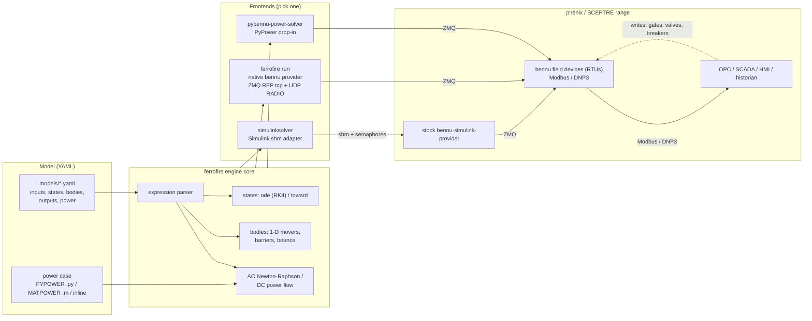

# ferrofire

**The fire phēnix rises from.**

ferrofire is the **F**ield-to-**I**nfrastructure **R**untime **E**ngine: the simulated plant behind a
[phēnix](https://github.com/sandialabs/sceptre-phenix) / SCEPTRE cyber range.

## The name

- **Ferro** is iron, the metal that rusts. ferrofire is written in Rust.
- **Fire** is the forge, where raw iron becomes something useful.
- **phēnix** is named for the phoenix, which rises from fire. ferrofire is the
  process that a phēnix range rises from: the simulated plant behind the RTUs,
  SCADA and HMI.

_Formerly rustbelt._

## What it is

- One Rust binary that simulates a physical process and its power system in real time.
- Models are plain YAML files. No MATLAB, Simulink or PowerWorld.
- It serves its values to stock bennu field devices (RTUs), exactly like the providers SCEPTRE ships today.
- Built for **simple** processes: tanks, pipes, valves, pumps, locks, and steady-state AC power flow.

## What it is not

- Not an electromagnetic-transient or transient-stability simulator.
- Not a full Simulink replacement for complex models.
- No optimal power flow (OPF), no generator reactive-power limit loop (yet), no `.mat` case files.

## System diagram



## Features

| Area | What you get |
|---|---|
| Process models | `states` integrated with RK4 (`ode:`) or a rate-limited approach (`toward:`); `min`/`max` clamps |
| Moving things | `bodies`: 1-D movers with gate `barriers` and end `bounce` (the waterway boat) |
| Expressions | `+ - * / % ^`, comparisons (1/0), `&& \|\|`, `c ? a : b`, `if()`, `min max abs sqrt exp ln pow clamp sign step floor` |
| Power | AC Newton-Raphson and DC power flow, ported from PYPOWER 5.1.19 |
| Power cases | PYPOWER `.py` (literal subset), MATPOWER `.m`, or `inline:` in the model |
| Coupling | `power.drive`: process values set loads, e.g. pump flow sets a bus load in MW |
| Islands | `deenergize` (zero the voltage on dead buses) or `fail` (raise `bus-alert`, PyPower behaviour) |
| Tags | Waterway tags and the full PYPOWER/pybennu tag vocabulary (`bus-N.voltage`, `branch-1_F-T.active`, ...) |

## Frontends

| Frontend | How it starts | Protocol | Replaces |
|---|---|---|---|
| Native bennu provider | `ferrofire run model.yaml` | ZMQ REP on tcp + UDP RADIO/DISH multicast | any bennu provider |
| Simulink adapter | `simulinksolver -tf inf` (or `ferrofire simulink`) | SysV shm + POSIX semaphores to stock `bennu-simulink-provider` | the Simulink solver binary |
| PyPower drop-in | `pybennu-power-solver start -c config.ini` (or `ferrofire pypower`) | same INI, pidfile, logs and ZMQ as pybennu | `pybennu-power-solver` |

## Quick start

- Requirements: Docker. Cargo is **not** needed on the host.
- `make test`: builds the `ff-rust:22.04` container and runs every unit and integration test.
- `make golden`: generates PYPOWER 5.1.19 reference results into `target/golden` (needs `uv`; never committed). `make test` runs it first.
- `make linux`: builds glibc aarch64 binaries into `dist/ferrofire` and `dist/simulinksolver`.
- Run a model offline and print a snapshot:

```
ferrofire check models/waterway.yaml --steps 400 --write uppervalve.open=1@2
ferrofire check models/pump-station.yaml --steps 600 --write pump.run=true@0 --write 'branch-1_2-3.active=false@30'
```

- Serve a model to a range: `ferrofire run models/waterway.yaml --server tcp://0.0.0.0:5555 --publish 'udp://*;239.0.0.1:40000'`

## Model format (short)

```yaml
version: 1
dt: 0.05
inputs:
  uppervalve.open: {type: analog, bool: true, default: 0}
states:
  lock.height:
    toward: {target: "uppervalve.open ? 15 : 5", rate: 0.5}   # fill to 15 while the upper valve is open
    init: 5
outputs:
  lock.height: {type: analog}
```

- Full examples: `models/waterway.yaml`, `models/pump-station.yaml`.
- Full design: `docs/provider-spec.md` in the [range repo](https://github.com/adamsrnmsu) and `docs/field-device-spec.md` here.

## SCEPTRE integration today

- **Simulink branch:** inject ferrofire as `simulinksolver` with `simulator: Simulink`. Works with stock bennu, no app changes.
- **PyPower branch:** install as `pybennu-power-solver` (`deploy/`). `simulator: PyPower` scenarios run unchanged.
- **Native type:** a new `simulator:` type in sceptre-phenix-apps is planned (phase 5).

## Testing

- Unit tests: expression parser, model loading, shm contract, wire framing, group hash.
- Waterway: trace-equality golden (`tests/golden/waterway_trace.csv`) and a full boat transit with the RTU logic.
- Power: matches PYPOWER 5.1.19 on case9, 14, 30, 57, 118 and 300 (goldens generated at test time).
- Properties: per-bus power balance, barrier behaviour, write latching, a tank against its closed form.
- Conformance (in a VM with `bennu:arm64`): `ipc-test.sh`, `tests/conformance.sh`, `tests/pypower-conformance.sh`.
- Planned: `make check` with formatting, clippy, and [ub-mode](https://github.com/unclebob/ub-mode) quality gates (CRAP < 10, duplication < 0.8, mutation testing).

## Status

- Done: phase 0 (engine, waterway model), 1 (power flow), 2 (native provider), 3 (PyPower drop-in).
- Next: phase 4 (pump station with power in a live range), phase 5 (upstream sceptre-phenix-apps type).
- Then: a Rust drop-in for `bennu-field-deviced` (spec in `docs/field-device-spec.md`).

## Known differences from stock

- After a `WRITE`, stock PyPower turns every non-slack bus into PQ; ferrofire keeps generator buses PV.
- Load and shunt writes change the solve in ferrofire; in stock PyPower they do not.
- Initial values match stock to 1e-10.

## Licence

- MIT, Copyright (c) 2026 Ryan Adams.
- Ported PYPOWER code (`src/power/pf.rs`, `src/power/case.rs`) keeps PYPOWER's BSD-3 notice (PSERC); see `NOTICE`.
- No MATPOWER case files are shipped: their licence excludes them.
- bennu/pybennu are GPL-3. ferrofire matches their wire formats and behaviour only; no bennu code is translated.
