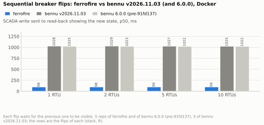
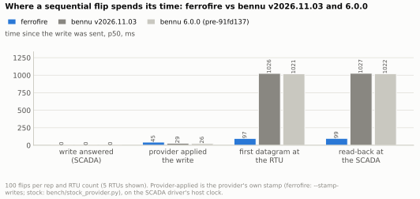
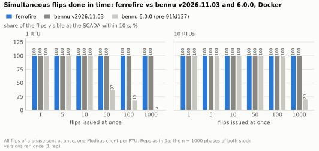
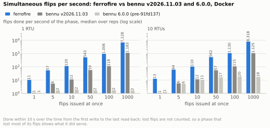
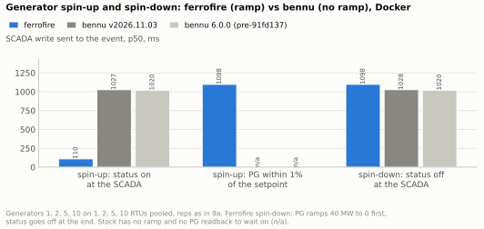
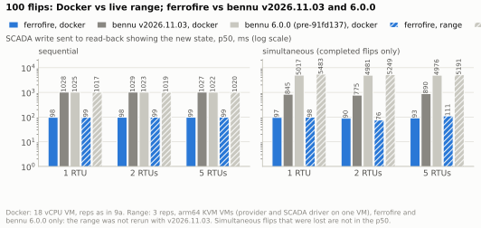
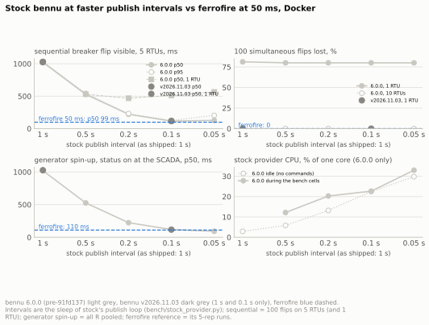
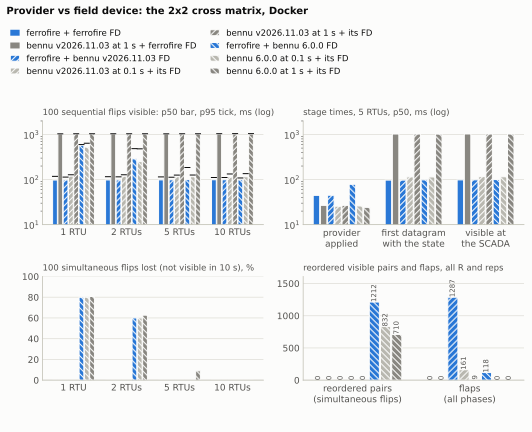

# Control latency: breaker flips and generator spin-up and spin-down, ferrofire vs stock bennu (v2026.11.03, and 6.0.0 for history)

*Generated by `bench/charts.py` (`make charts`) from the raw runs under [results/control/](results/control/); every number below is computed from those files. Tables
are also saved as CSVs next to the SVGs in [docs/img/charts/](../img/charts/); every (stack, cell, RTUs) group is in
[09h-control-all-cells.csv](../img/charts/09h-control-all-cells.csv). Harness, columns and definitions: [bench/README.md](../../bench/README.md), "Control-latency harness".*

## What was measured

A SCADA driver (`ffcontrol`, one process, one clock) writes a command to an RTU's Modbus coil and times it until it is visible. Two stacks run the same grid
(1 250 branches, 10 generators, partitioned round-robin over R = 1, 2, 5 or 10 RTUs) and the same driver; stock bennu is measured in two versions:

- **ferrofire**: `ferrofire run` (provider) + `ferrofire field-device` per RTU.
- **bennu v2026.11.03** (the current stock, the main comparison; dark grey in the charts): `pybennu-power-solver` (PyPower) + `bennu-field-deviced` per RTU, built from the sceptre-bennu release tag `v2026.11.03` (`01d35c4`, 2026-11-04) by `bench/stock_image.sh` (image `ffc-stock-2026.11.03:22.04`).
- **bennu 6.0.0 (pre-91fd137)** (the historical stock; light grey): the same two programs from the phenix-waterway-range overlay image (sceptre-bennu `c9c2cf6`, image `ffc-stock:22.04`), which every stock result before ww-1df.47 used. pybennu's version string says 6.0.0 in both, so the labels are the sceptre-bennu tag and commit.

**Which stock bennu (version note, ww-1df.47).** Upstream `91fd137` ("batch field-device writes", release v2026.11.03) is what separates the two. In 6.0.0 the field device's `Client::send` sleeps a fixed 500 ms per request (`src/bennu/distributed/Client.cpp:62`), its output module sends one blocking request per tag, and its queued writes are a `std::map` keyed by tag name;
91fd137 removed the sleep, sends one batched WRITE per scan and added compare-and-erase of the queued tags. Every earlier version of this report measured 6.0.0 and attributed its burst losses, reordering and 0.5 s floor on 1 and 2 RTUs to that sleep by reading the source and from the cross matrix (section 9); the stock side was rerun with v2026.11.03 (ww-1df.47) to measure it:

| measure | bennu 6.0.0 (pre-91fd137) | bennu v2026.11.03 |
|---|---|---|
| 100 sequential flips, p50 ms, 1 / 2 / 5 / 10 RTUs at 1 s | 1025 / 1023 / 1022 / 1022 | 1028 / 1029 / 1027 / 1025 |
| 100 simultaneous flips lost, %, 1 / 2 / 5 / 10 RTUs at 1 s | 81 / 63 / 7 / 0 | 0 / 0 / 0 / 0 |
| 1 000 simultaneous flips lost, %, 1 / 2 / 5 / 10 RTUs at 1 s | 98 / 96 / 91 / 80 | 0 / 0 / 0 / 0 |
| 1 000 simultaneous flips, flips done per s, 1 / 10 RTUs at 1 s | 2 / 18 | 1 183 / 1 125 |
| reordered pairs / chunk-skew pairs, simultaneous breaker flips at 1 s | 1105 / 85 | 0 / 1832 |
| flaps (read-back new, old, new) / commands at 1 s | 0 / 16080 | 35 / 12848 |
| 100 sequential flips, p50 ms, 1 / 2 / 5 / 10 RTUs at 0.1 s | 512 / 247 / 116 / 115 | 119 / 120 / 115 / 115 |
| 100 simultaneous flips lost, %, 1 / 2 / 5 / 10 RTUs at 0.1 s | 80 / 60 / 0 / 0 | 0 / 0 / 0 / 0 |
| 1 000 simultaneous flips lost, %, 1 / 2 / 5 / 10 RTUs at 0.1 s | 98 / 96 / 90 / 80 | 0 / 0 / 0 / 0 |
| 1 000 simultaneous flips, flips done per s, 1 / 10 RTUs at 0.1 s | 2 / 19 | 5 994 / 5 181 |
| reordered pairs / chunk-skew pairs, simultaneous breaker flips at 0.1 s | 1262 / 0 | 0 / 1758 |
| flaps (read-back new, old, new) / commands at 0.1 s | 0 / 16080 | 198 / 12848 |
| 100 sequential flips with that field device, p50 ms, 1 / 2 / 5 / 10 RTUs (ferrofire provider, 50 ms) | 576 / 289 / 100 / 99 | 98 / 98 / 99 / 99 |
| 100 simultaneous flips lost with that field device, %, 1 / 2 / 5 / 10 RTUs (ferrofire provider, 50 ms) | 80 / 60 / 0 / 0 | 0 / 0 / 0 / 0 |
| reordered pairs / chunk-skew pairs with that field device (ferrofire provider, 50 ms) | 1212 / 0 | 0 / 105 |
| flaps / commands with that field device (ferrofire provider, 50 ms) | 118 / 15360 | 1287 / 15360 |
| 100 sequential flips with that field device, p50 ms, 1 / 2 / 5 / 10 RTUs (stock provider, 1 s) | 1029 / 1027 / 1024 / 1021 | 1029 / 1028 / 1026 / 1025 |
| 100 simultaneous flips lost with that field device, %, 1 / 2 / 5 / 10 RTUs (stock provider, 1 s) | 81 / 63 / 9 / 0 | 0 / 0 / 0 / 0 |
| reordered pairs / chunk-skew pairs with that field device (stock provider, 1 s) | 710 / 53 | 0 / 1744 |
| flaps / commands with that field device (stock provider, 1 s) | 0 / 7360 | 9 / 7360 |
| 100 sequential flips with that field device, p50 ms, 1 / 2 / 5 / 10 RTUs (stock provider, 0.1 s) | 525 / 250 / 116 / 116 | 119 / 119 / 116 / 114 |
| 100 simultaneous flips lost with that field device, %, 1 / 2 / 5 / 10 RTUs (stock provider, 0.1 s) | 80 / 60 / 0 / 0 | 0 / 0 / 0 / 0 |
| reordered pairs / chunk-skew pairs with that field device (stock provider, 0.1 s) | 832 / 0 | 0 / 1649 |
| flaps / commands with that field device (stock provider, 0.1 s) | 0 / 7360 | 161 / 7360 |
| field-device microbench: rapid writes (one per 60-150 ms) forwarded to the provider, of 100, range over the runs | 34 to 35 | 100 to 100 |
| field-device microbench: write to WRITE= at the provider, spaced writes, p50 ms, profiles S / M / L | 28 / 33 / 26 | 30 / 29 / 30 |

What it changed, plainly:

- **Burst loss is gone.** Not one command of v2026.11.03 was lost in any phase, 1 000 simultaneous flips on 1 RTU included, where 6.0.0 lost 81% of 100 (and 98% of 1 000) on 1 RTU. Its field device now forwards a whole burst in one WRITE per scan, so the rate of a burst is the burst size over the wait for the next publish (about 0.85 s at 1 s, section 4), not two commands per RTU per second.
- **The 0.5 s floor on 1 and 2 RTUs is gone.** At a 0.1 s publish a sequential flip on 1 RTU is 119 ms (6.0.0: 512 ms) and on 2 RTUs 120 ms (247 ms); with a ferrofire provider in front, the stock field device is as fast as ferrofire's on every R (section 9). At the shipped 1 s publish the floor was hidden anyway and nothing changed (1 027 against 1 022 ms on 5 RTUs).
- **Reordering is gone**: 0 reordered pairs in every phase of v2026.11.03 (6.0.0: 1 105 in Docker). What remains is chunk skew, which got larger because a burst now arrives as one publish that the 2 ms read-back catches half way (section 7).
- **Quick writes**: see the field-device report, [field-device.md](field-device.md); the last rows of the table give the forwarded share of rapid writes.
- **What did not change: the latency that comes from pybennu's 1 s publish** (sections 1, 2, 5, 6): a sequential flip still takes about 1 025 ms whatever the number of RTUs, and the provider still applies a command in under 30 ms.
- **New with v2026.11.03: flaps.** The read-back showed the new state, then the old one, then the new one again for 35 of 1 498 sequential breaker commands on 10 RTUs at 1 s (none anywhere else at 1 s; 6.0.0 had none) and for 198 of 12 848 commands at 0.1 s, 186 of them on 10 RTUs, most in the simultaneous phases (section 8). The cause was not traced. The pattern, a point set when the provider ACKs a write and taken back by a datagram published before the provider applied it, is the one the ferrofire field device had before ww-1df.32 and now suppresses with its ACK hold; that is a hypothesis about v2026.11.03, not a finding.
- Not separated here: the release has 19 commits more than 6.0.0's `c9c2cf6`, and the bench measures the whole upgrade of stock bennu, not the field-device batching alone. Besides 91fd137 the ones that can touch these numbers are `62822a1` (pybennu: logging, publisher chunking, batched writes), `e00008e` (a configurable MTU for publish datagrams), `e59691f` (the C++ simulink provider's updates FIFO sized for a full write batch: what ends the C++ provider's burst loss in [cpp-provider.md](cpp-provider.md)), `a17b391` (DNP3 control points as output status) and `1907d2b` (libzmq built by CMake FetchContent instead of a vendored x86 archive). `bench/stock_provider.py` still applies unchanged (the one line that logs a publish error differs: loguru instead of print). v2026.11.03 is the latest release; upstream main has 9 unreleased commits after it, which were not used.

Per command, all in milliseconds since the write was sent (`t_cmd`): **ack** (write answered), **applied** (the provider applied the write; the provider's own stamp),
**stream** (first datagram carrying the new state at the RTU), **visible** (a 2 ms read-back at the SCADA shows it), **setpoint** (generators: PG within 1% of the setpoint).
A command is *done* at visible (and setpoint for a generator). *Sequential* = the next command goes out when the previous is done; *simultaneous* = all commands at once, one
Modbus client per RTU. *Lost* = not done within 10 s (12 s for a generator). *Wrong* = the final state differs, the provider disagrees, an uncommanded point changed, or two
adjacent commands of one RTU became visible in the opposite order and the later one's state also reached the stream a publish earlier (section 7 splits this).

Two environments. **Docker**: 5 reps for ferrofire and bennu 6.0.0, **3 for bennu v2026.11.03** (and its 1 000-flip cells 1 rep, as 6.0.0's), the full matrix (breaker flips 1, 5, 10, 50, 100, 1000; generators 1, 2, 5, 10; R = 1, 2, 5, 10; both modes), in containers on Docker Desktop's
Linux VM (18 vCPU, 7.7 GB) of an Apple Silicon Mac. **Range**: 3 reps, a subset (R = 1, 2, 5; breaker flips 1, 10, 100; generators 1, 5) on the phenix `ctlbench` experiment, six arm64 KVM VMs.
Differences that matter when reading the numbers:

- Stock bennu (both versions) has **no generator ramp**: its generator cells are status flips only, so it has no `setpoint` time, and a stock status flip does not bring PG back (spin-down writes PG to 0 and spin-up leaves it at 0,
  [pg-after-status-flip.txt](results/control/stock/pg-after-status-flip.txt), measured on 6.0.0; v2026.11.03 has no setpoint time either). Ferrofire ramps PG at 40 MW/s.
- Stock runs a fresh stack per cell (a stock provider that falls behind keeps applying a backlog). The two n = 1000 breaker cells of stock ran **1 rep** (not 5, or 3) at every R, for both versions. Every other cell has 5 reps (Docker; 3 for bennu v2026.11.03) or 3 (range). **The range was not rerun with v2026.11.03**: its stock series is bennu 6.0.0 only.
- Stock publishes once a second as shipped; section 8 reruns it at 0.5, 0.2, 0.1 and 0.05 s for 6.0.0 and at 0.1 s for v2026.11.03 (a one-line patch of its publish loop, Docker only). Sections 1 to 7 compare against stock as shipped; "What the numbers do not say" states the comparison against both.
- Every cell of the Docker matrix ran on all three stacks (ferrofire, bennu v2026.11.03, bennu 6.0.0); nothing was skipped. The range ran the subset above only: no R = 10, no 5, 50 or 1000 flips, no 2 or 10 generators.
- Contention: no run started with another cargo, ff-rust or mutator container present (`contended_at_start False` in all 40 Docker and 18 range `env.txt` files of ferrofire and bennu 6.0.0, and in all 24 control runs of bennu v2026.11.03, 1 s and 0.1 s). The Docker host was not idle: its 1-minute load average at run start
  ranged from 3.1 to 17.1 (bennu v2026.11.03: 2.3 to 6.5; `host_load_start` in each `.env.txt`, `vm_load1_start_end` in each `.cells.csv`) on an 18-vCPU VM, and stock uses about one CPU, so Docker latencies include some host noise. The range host's load at run start was at most 4.5.
- Ferrofire's read-back can flip early and flip back: a field device sets a point when the provider ACKs the write, before the provider applies it, and a still-old datagram could take it back (**flaps**, section 7).
  Since ww-1df.32 the field device holds an ACKed point for up to 2 s against stream values that differ from it, so the flaps are gone (0 in the re-run); the "before ww-1df.32" rows are the earlier run kept in `results/control/ferrofire-before-ww-1df.32/`.
  The driver counts a command as done only when the state is also seen on the stream, so a flap is not an error, but a SCADA polling at 2 ms sees it.

Solve time of the power flow at 1 250 branches, ferrofire in a container on a contended host: about 9.7 ms per solve ([solve-time.txt](results/control/solve-time.txt)). Stock's re-solve of the same grid (PyPower) was
measured from the provider's stamps in section 8: about 16 ms p50; the stock provider applies a command in about 26 ms p50 (section 2).

## 1. Sequential breaker flips: ferrofire vs stock bennu

100 flips per run, one at a time, each issued when the previous is visible, on 1, 2, 5 and 10 RTUs; ferrofire vs bennu v2026.11.03 and 6.0.0 in Docker, 5 reps (500 flips per bar; 300 for v2026.11.03, 3 reps). Unit: milliseconds from the SCADA write to the read-back showing the new state, p50.

| stack | RTUs | flips done | p50 ms | p95 ms | p99 ms | max ms |
|---|---|---|---|---|---|---|
| ferrofire | 1 | 500 | 98 | 118 | 125 | 128 |
| ferrofire | 2 | 500 | 98 | 117 | 125 | 126 |
| ferrofire | 5 | 500 | 99 | 112 | 119 | 126 |
| ferrofire | 10 | 500 | 99 | 110 | 114 | 115 |
| bennu v2026.11.03 | 1 | 300 | 1028 | 1039 | 1041 | 1042 |
| bennu v2026.11.03 | 2 | 300 | 1029 | 1038 | 1041 | 1042 |
| bennu v2026.11.03 | 5 | 300 | 1027 | 1040 | 1043 | 1047 |
| bennu v2026.11.03 | 10 | 300 | 1025 | 1047 | 1054 | 1063 |
| bennu 6.0.0 (pre-91fd137) | 1 | 500 | 1025 | 1033 | 1035 | 1036 |
| bennu 6.0.0 (pre-91fd137) | 2 | 500 | 1023 | 1032 | 1035 | 1037 |
| bennu 6.0.0 (pre-91fd137) | 5 | 500 | 1022 | 1035 | 1041 | 1046 |
| bennu 6.0.0 (pre-91fd137) | 10 | 500 | 1022 | 1044 | 1051 | 1060 |

Ferrofire shows a flip in about 100 ms and stock bennu in about 1 025 ms (v2026.11.03: 1 025 to 1 029 ms, 6.0.0: 1 022 to 1 025 ms) whatever the number of RTUs, and none lost one. Both stock versions publish their whole model once a second and a flip waits for the next publish; 91fd137 does not touch that. Ferrofire's new state reaches the RTU about 50 ms after the provider applies it (section 2).
Throughput follows: 1 000 sequential flips take about 100 s on ferrofire (10 per s), 1 026 to 1 031 s on v2026.11.03 and 1 023 to 1 026 s on 6.0.0 (1 per s), from the `span_s` of the n = 1000 phases.

## 2. Where the time goes

The same sequential flips, 100 per run on 5 RTUs, ferrofire vs bennu v2026.11.03 and 6.0.0 in Docker, 5 reps (500 flips each; v2026.11.03: 3 reps, 300). Unit: milliseconds since the SCADA write was sent, p50, at four points of the path.

| stack | stage | commands | p50 ms | p95 ms | p99 ms | max ms |
|---|---|---|---|---|---|---|
| ferrofire | ack | 500 | 0 | 0 | 0 | 1 |
| ferrofire | applied | 500 | 45 | 93 | 100 | 104 |
| ferrofire | stream | 500 | 97 | 112 | 118 | 125 |
| ferrofire | visible | 500 | 99 | 112 | 119 | 126 |
| bennu v2026.11.03 | ack | 300 | 0 | 0 | 0 | 0 |
| bennu v2026.11.03 | applied | 300 | 29 | 47 | 50 | 51 |
| bennu v2026.11.03 | stream | 300 | 1026 | 1039 | 1042 | 1045 |
| bennu v2026.11.03 | visible | 300 | 1027 | 1040 | 1043 | 1047 |
| bennu 6.0.0 (pre-91fd137) | ack | 500 | 0 | 0 | 0 | 0 |
| bennu 6.0.0 (pre-91fd137) | applied | 500 | 26 | 48 | 52 | 58 |
| bennu 6.0.0 (pre-91fd137) | stream | 500 | 1021 | 1034 | 1039 | 1044 |
| bennu 6.0.0 (pre-91fd137) | visible | 500 | 1022 | 1035 | 1041 | 1046 |

All providers apply a command in under 50 ms (ferrofire 45, bennu v2026.11.03 29, bennu 6.0.0 26 ms p50); the difference is how long the new state takes to reach the RTU: about 50 ms later on ferrofire, about 1 s later on both bennu versions.
(Ack is 0 ms to the rounding: the field device answers the write before the provider is involved.)

## 3. Simultaneous breaker flips: done in time

All flips of a phase sent at once, spread evenly over the RTUs with one Modbus client each; ferrofire vs bennu v2026.11.03 and 6.0.0 in Docker, 1 RTU and 10 RTUs, 1 to 1 000 flips, 5 reps (v2026.11.03: 3; both stock versions at n = 1 000: 1 rep). Unit: percent of the flips visible at the SCADA within 10 s.

| stack | RTUs | flips issued at once | commands issued | done within 10 s | lost | phases |
|---|---|---|---|---|---|---|
| ferrofire | 1 | 1 | 5 | 5 | 0 | 5 |
| ferrofire | 1 | 5 | 25 | 25 | 0 | 5 |
| ferrofire | 1 | 10 | 50 | 50 | 0 | 5 |
| ferrofire | 1 | 50 | 250 | 250 | 0 | 5 |
| ferrofire | 1 | 100 | 500 | 500 | 0 | 5 |
| ferrofire | 1 | 1000 | 5000 | 5000 | 0 | 5 |
| bennu v2026.11.03 | 1 | 1 | 3 | 3 | 0 | 3 |
| bennu v2026.11.03 | 1 | 5 | 15 | 15 | 0 | 3 |
| bennu v2026.11.03 | 1 | 10 | 30 | 30 | 0 | 3 |
| bennu v2026.11.03 | 1 | 50 | 150 | 150 | 0 | 3 |
| bennu v2026.11.03 | 1 | 100 | 300 | 300 | 0 | 3 |
| bennu v2026.11.03 | 1 | 1000 | 1000 | 1000 | 0 | 1 |
| bennu 6.0.0 (pre-91fd137) | 1 | 1 | 5 | 5 | 0 | 5 |
| bennu 6.0.0 (pre-91fd137) | 1 | 5 | 25 | 25 | 0 | 5 |
| bennu 6.0.0 (pre-91fd137) | 1 | 10 | 50 | 50 | 0 | 5 |
| bennu 6.0.0 (pre-91fd137) | 1 | 50 | 250 | 93 | 157 | 5 |
| bennu 6.0.0 (pre-91fd137) | 1 | 100 | 500 | 94 | 406 | 5 |
| bennu 6.0.0 (pre-91fd137) | 1 | 1000 | 1000 | 19 | 981 | 1 |
| ferrofire | 10 | 1 | 5 | 5 | 0 | 5 |
| ferrofire | 10 | 5 | 25 | 25 | 0 | 5 |
| ferrofire | 10 | 10 | 50 | 50 | 0 | 5 |
| ferrofire | 10 | 50 | 250 | 250 | 0 | 5 |
| ferrofire | 10 | 100 | 500 | 500 | 0 | 5 |
| ferrofire | 10 | 1000 | 5000 | 5000 | 0 | 5 |
| bennu v2026.11.03 | 10 | 1 | 3 | 3 | 0 | 3 |
| bennu v2026.11.03 | 10 | 5 | 15 | 15 | 0 | 3 |
| bennu v2026.11.03 | 10 | 10 | 30 | 30 | 0 | 3 |
| bennu v2026.11.03 | 10 | 50 | 150 | 150 | 0 | 3 |
| bennu v2026.11.03 | 10 | 100 | 300 | 300 | 0 | 3 |
| bennu v2026.11.03 | 10 | 1000 | 1000 | 1000 | 0 | 1 |
| bennu 6.0.0 (pre-91fd137) | 10 | 1 | 5 | 5 | 0 | 5 |
| bennu 6.0.0 (pre-91fd137) | 10 | 5 | 25 | 25 | 0 | 5 |
| bennu 6.0.0 (pre-91fd137) | 10 | 10 | 50 | 50 | 0 | 5 |
| bennu 6.0.0 (pre-91fd137) | 10 | 50 | 250 | 250 | 0 | 5 |
| bennu 6.0.0 (pre-91fd137) | 10 | 100 | 500 | 500 | 0 | 5 |
| bennu 6.0.0 (pre-91fd137) | 10 | 1000 | 1000 | 200 | 800 | 1 |

Ferrofire completed every flip in every phase (up to 5 000 flips at once over the reps), and so did **bennu v2026.11.03**, 1 000 at once on 1 and on 10 RTUs included. Bennu 6.0.0 served about two commands per RTU per second (the 500 ms sleep of the version note): on 1 RTU 50 flips at once lost 63% and 100 lost 81%; on 10 RTUs only the 1 000-flip phase lost flips (80%).
Counts for R = 2 and 5 are in [09h-control-all-cells.csv](../img/charts/09h-control-all-cells.csv); the range shows the same loss (section 7).

## 4. Throughput of simultaneous breaker flips

Same phases as section 3. Unit: flips done per second between the first write and the last read-back, median over the reps, log scale; lost flips are not counted (only 6.0.0 has any).

| stack | RTUs | flips issued at once | phases | median flips per s |
|---|---|---|---|---|
| ferrofire | 1 | 1 | 5 | 11.0 |
| ferrofire | 1 | 5 | 5 | 57.1 |
| ferrofire | 1 | 10 | 5 | 119.5 |
| ferrofire | 1 | 50 | 5 | 542.9 |
| ferrofire | 1 | 100 | 5 | 1006.0 |
| ferrofire | 1 | 1000 | 5 | 7128.1 |
| bennu v2026.11.03 | 1 | 1 | 3 | 1.2 |
| bennu v2026.11.03 | 1 | 5 | 3 | 5.8 |
| bennu v2026.11.03 | 1 | 10 | 3 | 11.8 |
| bennu v2026.11.03 | 1 | 50 | 3 | 59.5 |
| bennu v2026.11.03 | 1 | 100 | 3 | 117.9 |
| bennu v2026.11.03 | 1 | 1000 | 1 | 1182.9 |
| bennu 6.0.0 (pre-91fd137) | 1 | 1 | 5 | 1.2 |
| bennu 6.0.0 (pre-91fd137) | 1 | 5 | 5 | 1.8 |
| bennu 6.0.0 (pre-91fd137) | 1 | 10 | 5 | 2.1 |
| bennu 6.0.0 (pre-91fd137) | 1 | 50 | 5 | 1.8 |
| bennu 6.0.0 (pre-91fd137) | 1 | 100 | 5 | 1.9 |
| bennu 6.0.0 (pre-91fd137) | 1 | 1000 | 1 | 1.7 |
| ferrofire | 10 | 1 | 5 | 13.3 |
| ferrofire | 10 | 5 | 5 | 63.6 |
| ferrofire | 10 | 10 | 5 | 110.5 |
| ferrofire | 10 | 50 | 5 | 562.1 |
| ferrofire | 10 | 100 | 5 | 1129.6 |
| ferrofire | 10 | 1000 | 5 | 8318.3 |
| bennu v2026.11.03 | 10 | 1 | 3 | 1.2 |
| bennu v2026.11.03 | 10 | 5 | 3 | 6.0 |
| bennu v2026.11.03 | 10 | 10 | 3 | 12.1 |
| bennu v2026.11.03 | 10 | 50 | 3 | 57.2 |
| bennu v2026.11.03 | 10 | 100 | 3 | 114.8 |
| bennu v2026.11.03 | 10 | 1000 | 1 | 1124.6 |
| bennu 6.0.0 (pre-91fd137) | 10 | 1 | 5 | 1.4 |
| bennu 6.0.0 (pre-91fd137) | 10 | 5 | 5 | 5.5 |
| bennu 6.0.0 (pre-91fd137) | 10 | 10 | 5 | 11.2 |
| bennu 6.0.0 (pre-91fd137) | 10 | 50 | 5 | 17.2 |
| bennu 6.0.0 (pre-91fd137) | 10 | 100 | 5 | 20.1 |
| bennu 6.0.0 (pre-91fd137) | 10 | 1000 | 1 | 18.2 |

Ferrofire's rate grows with the burst (about 7 100 per s for 1 000 flips on 1 RTU, 8 300 on 10); **bennu v2026.11.03 grows with it too**: 1.2 per s for one flip, 118 for 100 and 1 183 for 1 000 on 1 RTU (115 and 1 125 on 10 RTUs), about a sixth of ferrofire's rate at 1 000 flips. A burst is served by the next publish, so its rate is about the burst size over the 0.85 s the phase takes (1 000 flips on 1 RTU: 0.845 s from the first write to the last read-back, 1 183 per s; visible p50 816 ms in its one rep) and not over the 0.1 s of ferrofire. Bennu 6.0.0 stayed at about 2 per s on 1 RTU and reached 17 to 20 per s on 10 RTUs once the burst was 50 flips or more (20.1 for 100 flips, 18.2 for the one rep of 1 000): about two commands per RTU per second whatever the burst (version note).

## 5. Generator spin-up and spin-down

Sequential generator commands, 1, 2, 5 and 10 generators on 1, 2, 5 and 10 RTUs pooled (360 spin-ups and 360 spin-downs for ferrofire and bennu 6.0.0, 216 each for v2026.11.03: 3 reps), ferrofire (PG ramps at 40 MW/s) vs stock bennu (status flip only, both versions), Docker.
Unit: milliseconds from the SCADA write to the status being on (spin-up), PG within 1% of the setpoint (spin-up), or the status being off (spin-down), p50.

| stack | event | generators done | p50 ms | p95 ms | p99 ms | max ms |
|---|---|---|---|---|---|---|
| ferrofire | status on | 360 | 110 | 118 | 123 | 127 |
| ferrofire | PG at setpoint | 360 | 1098 | 1106 | 1109 | 1110 |
| ferrofire | status off | 360 | 1098 | 1107 | 1115 | 1134 |
| bennu v2026.11.03 | status on | 216 | 1027 | 1036 | 1039 | 1041 |
| bennu v2026.11.03 | PG at setpoint | 0 |  |  |  |  |
| bennu v2026.11.03 | status off | 216 | 1028 | 1038 | 1041 | 1047 |
| bennu 6.0.0 (pre-91fd137) | status on | 360 | 1020 | 1031 | 1035 | 1038 |
| bennu 6.0.0 (pre-91fd137) | PG at setpoint | 0 |  |  |  |  |
| bennu 6.0.0 (pre-91fd137) | status off | 360 | 1020 | 1033 | 1037 | 1048 |

Ferrofire reports the unit on after about 110 ms and has PG at the setpoint 1.1 s later (the ramp); it turns the status off only when the ramp reaches 0 (1.1 s). Stock's status changes at its publish (about 1 s: v2026.11.03 1 027 ms on, 1 028 ms off; 6.0.0 1 020 ms for both) in both directions and PG never ramps,
so there is no stock number for the setpoint. Simultaneous generator commands (10 at once on 10 RTUs) are the same: ferrofire p50 78 ms (status on) and 1 076 ms (status off), bennu v2026.11.03 914 and 856 ms, bennu 6.0.0 907 and 709 ms, none lost ([09h-control-all-cells.csv](../img/charts/09h-control-all-cells.csv)).

## 6. Docker vs live range

100 breaker flips on 1, 2 and 5 RTUs, sequential (left) and simultaneous (right), ferrofire vs stock bennu, Docker (5 reps, 3 for v2026.11.03; solid) vs the live range (3 reps, hatched; ferrofire and bennu 6.0.0 only, v2026.11.03 was not run there). Unit: milliseconds from the SCADA write to the read-back, p50, log scale.

| stack | where | mode | RTUs | flips done | p50 ms | p95 ms | p99 ms | max ms |
|---|---|---|---|---|---|---|---|---|
| ferrofire | docker | seq | 1 | 500 | 98 | 118 | 125 | 128 |
| ferrofire | docker | seq | 2 | 500 | 98 | 117 | 125 | 126 |
| ferrofire | docker | seq | 5 | 500 | 99 | 112 | 119 | 126 |
| bennu v2026.11.03 | docker | seq | 1 | 300 | 1028 | 1039 | 1041 | 1042 |
| bennu v2026.11.03 | docker | seq | 2 | 300 | 1029 | 1038 | 1041 | 1042 |
| bennu v2026.11.03 | docker | seq | 5 | 300 | 1027 | 1040 | 1043 | 1047 |
| bennu 6.0.0 (pre-91fd137) | docker | seq | 1 | 500 | 1025 | 1033 | 1035 | 1036 |
| bennu 6.0.0 (pre-91fd137) | docker | seq | 2 | 500 | 1023 | 1032 | 1035 | 1037 |
| bennu 6.0.0 (pre-91fd137) | docker | seq | 5 | 500 | 1022 | 1035 | 1041 | 1046 |
| ferrofire | range | seq | 1 | 300 | 99 | 105 | 109 | 112 |
| ferrofire | range | seq | 2 | 300 | 99 | 111 | 117 | 122 |
| ferrofire | range | seq | 5 | 300 | 99 | 110 | 115 | 153 |
| bennu 6.0.0 (pre-91fd137) | range | seq | 1 | 300 | 1017 | 1062 | 1080 | 2031 |
| bennu 6.0.0 (pre-91fd137) | range | seq | 2 | 300 | 1019 | 1047 | 1060 | 1074 |
| bennu 6.0.0 (pre-91fd137) | range | seq | 5 | 300 | 1020 | 1046 | 1058 | 1061 |
| ferrofire | docker | sim | 1 | 500 | 97 | 109 | 110 | 110 |
| ferrofire | docker | sim | 2 | 500 | 90 | 107 | 108 | 108 |
| ferrofire | docker | sim | 5 | 500 | 93 | 99 | 100 | 101 |
| bennu v2026.11.03 | docker | sim | 1 | 300 | 845 | 890 | 891 | 892 |
| bennu v2026.11.03 | docker | sim | 2 | 300 | 775 | 895 | 896 | 896 |
| bennu v2026.11.03 | docker | sim | 5 | 300 | 890 | 902 | 904 | 904 |
| bennu 6.0.0 (pre-91fd137) | docker | sim | 1 | 94 | 5017 | 9130 | 9996 | 9996 |
| bennu 6.0.0 (pre-91fd137) | docker | sim | 2 | 184 | 4981 | 9093 | 9096 | 9096 |
| bennu 6.0.0 (pre-91fd137) | docker | sim | 5 | 464 | 4976 | 9081 | 9952 | 9953 |
| ferrofire | range | sim | 1 | 300 | 98 | 147 | 159 | 163 |
| ferrofire | range | sim | 2 | 300 | 76 | 135 | 141 | 145 |
| ferrofire | range | sim | 5 | 300 | 111 | 150 | 159 | 163 |
| bennu 6.0.0 (pre-91fd137) | range | sim | 1 | 59 | 5483 | 9741 | 9848 | 9848 |
| bennu 6.0.0 (pre-91fd137) | range | sim | 2 | 114 | 5249 | 9334 | 9390 | 9397 |
| bennu 6.0.0 (pre-91fd137) | range | sim | 5 | 295 | 5191 | 9797 | 9874 | 9882 |

The range gives the same sequential p50s as Docker for both stacks it ran (ferrofire 99 ms, bennu 6.0.0 1 017 to 1 020 ms), so the Docker matrix is a fair stand-in for the range (bennu v2026.11.03 is Docker only); the range's simultaneous ferrofire p95 is higher (135 to 150 ms against 99 to 109 ms).
For simultaneous flips only the completed flips are timed (bennu 6.0.0: 59, 114, 295 of 300 per R = 1, 2, 5 on the range, 94, 184, 464 of 500 in Docker): its p50 of about 5 s says how late the flips that did arrive were. Bennu v2026.11.03 completed all 300 per R in Docker, at 775 to 890 ms p50 (one publish).

## 7. Lost and wrong commands

Every phase of every run, ferrofire vs bennu v2026.11.03 and 6.0.0, Docker (full matrix) and range (subset; no v2026.11.03). Unit: commands (a command is one flip or one generator spin-up or spin-down; a "phase" is one cell run once).

| where | stack | family | commands | lost | wrong final | wrong at provider | wrong collateral | reordered | chunk skew | flaps | write errors | phases |
|---|---|---|---|---|---|---|---|---|---|---|---|---|
| docker | ferrofire before ww-1df.32 | breaker seq | 23320 | 0 | 0 | 0 | 0 | 0 | 0 | 1 | 0 | 120 |
| docker | ferrofire before ww-1df.32 | breaker sim | 23320 | 0 | 0 | 0 | 0 | 0 | 200 | 3831 | 0 | 120 |
| docker | ferrofire before ww-1df.32 | gen seq | 720 | 0 | 0 | 0 | 0 | 0 | 0 | 360 | 0 | 160 |
| docker | ferrofire before ww-1df.32 | gen sim | 720 | 0 | 0 | 0 | 0 | 0 | 0 | 360 | 0 | 160 |
| docker | ferrofire | breaker seq | 23320 | 0 | 0 | 0 | 0 | 0 | 0 | 0 | 0 | 120 |
| docker | ferrofire | breaker sim | 23320 | 0 | 0 | 0 | 0 | 0 | 110 | 0 | 0 | 120 |
| docker | ferrofire | gen seq | 720 | 0 | 0 | 0 | 0 | 0 | 0 | 0 | 0 | 160 |
| docker | ferrofire | gen sim | 720 | 0 | 0 | 0 | 0 | 0 | 0 | 0 | 0 | 160 |
| docker | bennu v2026.11.03 | breaker seq | 5992 | 0 | 0 | 0 | 0 | 0 | 0 | 35 | 0 | 64 |
| docker | bennu v2026.11.03 | breaker sim | 5992 | 0 | 0 | 0 | 0 | 0 | 1832 | 0 | 0 | 64 |
| docker | bennu v2026.11.03 | gen seq | 432 | 0 | 0 | 0 | 0 | 0 | 0 | 0 | 0 | 96 |
| docker | bennu v2026.11.03 | gen sim | 432 | 0 | 0 | 0 | 0 | 0 | 0 | 0 | 0 | 96 |
| docker | bennu 6.0.0 (pre-91fd137) | breaker seq | 7320 | 0 | 0 | 0 | 0 | 0 | 0 | 0 | 0 | 104 |
| docker | bennu 6.0.0 (pre-91fd137) | breaker sim | 7320 | 4635 | 0 | 0 | 0 | 1105 | 85 | 0 | 0 | 104 |
| docker | bennu 6.0.0 (pre-91fd137) | gen seq | 720 | 0 | 0 | 0 | 0 | 0 | 0 | 0 | 0 | 160 |
| docker | bennu 6.0.0 (pre-91fd137) | gen sim | 720 | 0 | 0 | 0 | 0 | 0 | 0 | 0 | 0 | 160 |
| range | ferrofire before ww-1df.32 | breaker seq | 999 | 0 | 0 | 0 | 0 | 0 | 0 | 0 | 0 | 27 |
| range | ferrofire before ww-1df.32 | breaker sim | 999 | 0 | 0 | 0 | 0 | 0 | 110 | 194 | 0 | 27 |
| range | ferrofire before ww-1df.32 | gen seq | 108 | 0 | 0 | 0 | 0 | 0 | 0 | 54 | 0 | 36 |
| range | ferrofire before ww-1df.32 | gen sim | 108 | 0 | 0 | 0 | 0 | 0 | 0 | 54 | 0 | 36 |
| range | ferrofire | breaker seq | 999 | 0 | 0 | 0 | 0 | 0 | 0 | 0 | 0 | 27 |
| range | ferrofire | breaker sim | 999 | 0 | 0 | 0 | 0 | 0 | 105 | 0 | 0 | 27 |
| range | ferrofire | gen seq | 108 | 0 | 0 | 0 | 0 | 0 | 0 | 0 | 0 | 36 |
| range | ferrofire | gen sim | 108 | 0 | 0 | 0 | 0 | 0 | 0 | 0 | 0 | 36 |
| range | bennu 6.0.0 (pre-91fd137) | breaker seq | 999 | 0 | 0 | 0 | 0 | 0 | 0 | 0 | 0 | 27 |
| range | bennu 6.0.0 (pre-91fd137) | breaker sim | 999 | 432 | 0 | 0 | 0 | 221 | 19 | 0 | 0 | 27 |
| range | bennu 6.0.0 (pre-91fd137) | gen seq | 108 | 0 | 0 | 0 | 0 | 0 | 0 | 0 | 0 | 36 |
| range | bennu 6.0.0 (pre-91fd137) | gen sim | 108 | 0 | 0 | 0 | 0 | 0 | 0 | 0 | 0 | 36 |

- **Lost**: ferrofire none, bennu v2026.11.03 none (0 of 5 992 simultaneous breaker commands). Bennu 6.0.0 lost 4 635 of 7 320 simultaneous breaker commands in Docker and 432 of 999 on the range, none of the sequential ones. "Lost" is the definition above, not visible within 10 s (12 s for a generator): the driver stops watching then, so it does not say that the command was never applied later.
- **Wrong final state, wrong at the provider, wrong collateral, write errors**: none in any phase of any stack.
- **Reordered / chunk skew**: the driver counts adjacent commands of one RTU (issue order) that became visible in the opposite order (simultaneous mode only; the raw `order_violations` column of cells.csv). That is two different things, so the report splits it by the pair's stream stamps. *Reordered*: the later command's state reached the stream at least half a publish period before the earlier one's (25 ms for ferrofire, dt 0.05 s; 500 ms for stock, one publish a second), or a stamp is missing. *Chunk skew*: the rest, i.e. both states went out in the same publish and the 2 ms read-back caught one chunk first.
  ferrofire reordered none in any phase, Docker or range, before or after ww-1df.32. Its chunk skew (raw violations before the split): before ww-1df.32 200 in Docker (180 on 1 RTU, 19 on 2, 1 on 5, none on 10) and 110 on the range (57, 42, 11); after the hold 110 in Docker (18 on 1 RTU, 5 on 2, 24 on 5, 63 on 10) and 105 on the range (53, 47, 5). Ack and echo order held; the two points' stream stamps differ by at most 0.19 ms in Docker and 4.3 ms on the range (the cycle went out as several datagrams) and every visible inversion is at most 2.9 ms (range 4.2 ms). This is a property of multi-datagram publishes polled at 2 ms, not a reordering; the ACK hold did not change it (it moved where the inversions fall, not their number).
  Bennu v2026.11.03 reordered none in any phase; its 1 832 chunk-skew pairs have stream stamps at most 27 ms apart, so they are the same-publish effect (more of them than 6.0.0's 85 because a whole burst now leaves in one publish, which the 2 ms read-back catches half way).
  Bennu 6.0.0 reordered 1 105 in Docker and 221 on the range (chunk skew 85 and 19; the raw `order_violations` are the sums, 1 190 and 240): the later command's state reached the stream 0.99 to 10.19 s before the earlier one's in Docker (median 2.06 s; range: 0.97 to 10.18 s, median 2.07 s), one to ten publishes and not "about 1 s". Its field device sends the queued writes one per 500 ms in tag-name order, not in the order issued (version note).
- **Flaps** (ferrofire and, new, bennu v2026.11.03): the read-back showed the new state, then the old, then the new again. Bennu 6.0.0 had none in any phase; bennu v2026.11.03 had 35 in the 3-rep 1 s run, all on 10 RTUs, all in sequential breaker phases (the version note; the 0.1 s run in section 8). Ferrofire: Before ww-1df.32: 3 831 in the simultaneous breaker phases, 1 in a sequential breaker phase and 720 in the generator phases (360 sequential, 360 simultaneous) in Docker; 194 and 108 on the range. After the ACK hold (field device ignores a differing stream value for up to 2 s after a provider ACK, ww-1df.32): none in any phase, Docker or range. Bennu 6.0.0 has none in any phase.
  Latency did not change beyond run-to-run noise: sequential breaker p50 98.7 ms before and 98.5 ms after in Docker (99 and 99 on the range), p95 109.6 and 114.4 (108.5 and 108.2); simultaneous p95 141.3 and 133.5 (150.6 and 145.2). The sequential p95 rise in Docker is in the stream stamp (driver-side, before the field device), not in visible minus stream. An A/B of the 1 000-flip simultaneous cell with the pre-fix and the fixed binary on the same host (alternating runs) showed no difference.

## 8. Stock bennu at faster publish intervals

Sections 1 to 7 measure stock as shipped: it publishes its whole model once a second, hard-coded (`PyPower.periodic_publish` ends in `time.sleep(1)` in pybennu 6.0.0 and in v2026.11.03; there is no config option), and its seconds-level latency tracks that interval. So the stock side was rerun with bennu 6.0.0 at 0.5, 0.2, 0.1 and 0.05 s
and, in ww-1df.47, with bennu v2026.11.03 at 0.1 s (the best interval of the 6.0.0 sweep; its 1 s run is the one of sections 1 to 7), against ferrofire's 50 ms publish, to see how much of the gap is the interval. **Deviation from stock as shipped**: `bench/stock_provider.py` swaps `PyPower.periodic_publish` for a verbatim copy (of either version) whose only change is `time.sleep(1)` -> `time.sleep(STOCK_PUBLISH_S)` (plus timing counters and one `Publish-stats:` log line every 10 s);
nothing else of the provider, and no field device, is changed. Same grid, harness and driver as the 1 s baseline (`STACK=stock STOCK_PUBLISH_S=<interval> python3 bench/run_control.py`): a fresh stack per cell, R = 1, 2, 5, 10, **5 reps** of every cell of bennu 6.0.0 (an interval took about 100 minutes) and **3 reps** of bennu v2026.11.03, except the two n = 1000 breaker cells (1 rep, as in the baseline).
Raw: `results/control/stock-<interval>s/` (bennu 6.0.0; its 1 s baseline stays in `results/control/stock/`) and `results/control/stock-v2026.11.03[-0.1s]/` (bennu v2026.11.03). Docker only: the range was not rerun, since Docker matched it for both stacks (section 6). The ferrofire results are untouched and are the reference.

**Can the stock provider keep up?** At 1 250 branches one publish costs 21 to 29 ms (pack 17 to 24 ms, send 4 to 5 ms) and a write re-solve about 16 ms p50 (p95 20 ms at 1 s, 29 to 36 ms at the faster intervals; bennu v2026.11.03 at 1 s: 11 ms (p95 15)). Stock's loop sleeps *after* it publishes, so its real period is the interval plus the work: it never skips a publish or builds a backlog,
but at 0.05 s it publishes every 72 ms in the bench cells (14 per s, not 20) and every 79 ms idle (12.7 per s, the table below). Idle CPU grows from 3% of a core at 1 s to 30% at 0.05 s; in the bench cells the median provider reaches 33% and the busiest cell 93%. It is one Python process, so publishing and solving share one interpreter lock. Measured idle, one provider, no RTUs, bennu 6.0.0 only ([stock-capacity.txt](results/control/stock-capacity.txt); v2026.11.03's idle cost was not re-measured); the solve columns are the provider's own stamps over every bench run of that interval:

| interval s | pack ms | send ms | one publish ms | effective period ms | publishes per s | CPU % of a core (idle) | solve p50 ms | solve p95 ms |
|---|---|---|---|---|---|---|---|---|
| 1 | 23.0 | 4.9 | 27.9 | 1035 | 1.0 | 2.9 | 16 | 20 |
| 0.5 | 23.4 | 5.1 | 28.5 | 535 | 1.9 | 5.8 | 18 | 29 |
| 0.2 | 23.7 | 5.1 | 28.7 | 236 | 4.2 | 13.2 | 16 | 35 |
| 0.1 | 22.9 | 5.0 | 27.9 | 135 | 7.4 | 22.5 | 15 | 34 |
| 0.05 | 17.0 | 4.4 | 21.4 | 79 | 12.7 | 29.8 | 16 | 35 |

Latency, loss and order per interval, Docker, 5 reps for bennu 6.0.0, 3 for v2026.11.03 (n = 1 000 cells: 1 rep). Sequential = 100 flips on 5 RTUs and on 1 RTU; "100 sim lost" is the share of 100 simultaneous breaker flips not visible within 10 s; reordered and chunk skew are as in section 7 (simultaneous breaker phases, all R); the generator column is spin-up status on, p50, all R pooled;
"bench CPU" is the provider process over the cells that ran at least 20 s, median, % of one core (the 1 s runs have no stats lines; its idle CPU is in the table above). The last row is ferrofire as measured in sections 1 to 7 (its CPU was not measured). The first column says which stock bennu a row is; the chart draws bennu 6.0.0 light and bennu v2026.11.03 dark (two intervals only, so markers).

| stock bennu | publish interval s | reps | effective period ms | seq p50 ms (5 RTUs) | seq p95 ms (5 RTUs) | seq p50 ms (1 RTU) | seq p95 ms (1 RTU) | 100 sim lost % (1 RTU) | 100 sim lost % (10 RTUs) | reordered | chunk skew | gen status-on p50 ms | idle CPU % | bench CPU % |
|---|---|---|---|---|---|---|---|---|---|---|---|---|---|---|
| bennu 6.0.0 | 1 (as shipped) | 5 | 1000 (nominal) | 1022 | 1035 | 1025 | 1033 | 81 | 0 | 1105 | 85 | 1020 | 3 |  |
| bennu 6.0.0 | 0.5 | 5 | 530 | 528 | 542 | 531 | 1052 | 80 | 0 | 1243 | 1 | 526 | 6 | 12 |
| bennu 6.0.0 | 0.2 | 5 | 231 | 220 | 232 | 468 | 708 | 80 | 0 | 1261 | 0 | 223 | 13 | 20 |
| bennu 6.0.0 | 0.1 | 5 | 124 | 116 | 125 | 512 | 638 | 80 | 0 | 1262 | 0 | 118 | 22 | 23 |
| bennu 6.0.0 | 0.05 | 5 | 72 | 127 | 204 | 564 | 601 | 80 | 0 | 1271 | 0 | 91 | 30 | 33 |
| bennu v2026.11.03 | 1 (as shipped) | 3 | 1000 (nominal) | 1027 | 1040 | 1028 | 1039 | 0 | 0 | 0 | 1832 | 1027 | not measured |  |
| bennu v2026.11.03 | 0.1 | 3 | 121 | 115 | 125 | 119 | 128 | 0 | 0 | 0 | 1758 | 117 | not measured | 35 |
| ferrofire | 0.05 | 5 | 50 | 99 | 112 | 98 | 118 | 0 | 0 | 0 | 110 | 110 | not measured | not measured |

- **On many RTUs the sequential gap closes with the interval**: on 5 RTUs p50 is 1 022, 528, 220, 116 ms at 1, 0.5, 0.2, 0.1 s, and at 0.1 s stock is within 20 ms of ferrofire (99 ms); bennu v2026.11.03 at 0.1 s is 115 ms on 5 RTUs and 115 on 10, the same. At 0.05 s it does not improve on 5 RTUs (p50 127 ms, p95 204 ms against ferrofire's 99 and 112): a publish and a re-solve now compete, so the tail grows. On 10 RTUs 0.05 s gives 86 ms p50, a little below ferrofire's 99 ms.
- **One or two RTUs stayed slow at any interval with bennu 6.0.0, and no longer do with v2026.11.03.** On 1 RTU the sequential p50 stays at 470 to 570 ms and on 2 RTUs at 225 to 250 ms once the interval is 0.2 s or less: the provider's `Applied:` stamps of one RTU are 0.5 s apart (the bennu 6.0.0 field device hands writes to the provider about two per second per RTU: the fixed 500 ms sleep in its `Client::send`, removed upstream by 91fd137, see the version note; its `cycle-time` in the generated config is 50 ms, so it is not that),
  so a sequential flip on one RTU waits about 0.5 s for its turn whatever the publish interval. Ferrofire: 98 ms on any R. **Bennu v2026.11.03 at 0.1 s: 119 ms on 1 RTU and 120 on 2** (6.0.0: 512 and 247 ms), so with the batched writes of 91fd137 a stock provider at 0.1 s is within about 20 ms of ferrofire on every R (115 to 120 ms against 98 to 99); the 0.5 s floor was the 6.0.0 field device's sleep, as the cross matrix of section 9 showed.
- **Simultaneous commands were not helped by the interval with bennu 6.0.0, and are served with v2026.11.03.** The same two writes per second per RTU capped a burst of 6.0.0: 100 simultaneous flips lose 80% on 1 RTU (400 of 500 over the reps) and 60% on 2, and 1 000 flips lose 80 to 98% on every R, at every interval (1 s as shipped: 81%, 63%, 7% on 1, 2, 5 RTUs and 0 on 10). Ferrofire lost none. **Bennu v2026.11.03 lost none** of 100 or of 1 000 simultaneous flips, at 1 s or 0.1 s, on any R; at 0.1 s the 1 000-flip burst completes at 5 200 to 9 700 flips per s (1 RTU: 5 994, 10 RTUs: 5 181), at 1 s at 1 100 to 1 300 (section 4).
  The provider-applied time of a burst of 6.0.0 did not move with the interval either (10 flips on 1 RTU: 2.5 s p50 at every interval); with v2026.11.03 it is a few tens of ms.
- **Reordering stayed with bennu 6.0.0 and is gone with v2026.11.03**: 1 105 reordered pairs at 1 s, 1 243 to 1 271 at the faster intervals (6.0.0); none for v2026.11.03 at 1 s or 0.1 s (1 758 chunk-skew pairs at 0.1 s, 1 832 at 1 s); ferrofire none. The order is set by when the provider applies each write, before anything is published, and that by the order in which the 6.0.0 field device sends them (tag-name order, version note).
- **Generators**: stock's status-on p50 is 1 020, 526, 223, 118 and 91 ms at 1, 0.5, 0.2, 0.1 and 0.05 s; ferrofire's is 110 ms and its PG reaches the setpoint at 1.1 s (the ramp stock does not have), so section 5's comparison holds with stock's status time now following its interval (v2026.11.03 at 0.1 s: 117 ms on, 116 ms off).
- **No command lost or wrong in any sequential phase** at any interval (wrong final, wrong at the provider, wrong collateral, write and poll errors: 0 in every phase of every directory; flaps: 0 in all 528 phases of each bennu 6.0.0 directory). **Flaps are new with v2026.11.03**: 35 commands at 1 s (sequential flips on 10 RTUs) and 198 of 12 848 at 0.1 s, 186 of them on 10 RTUs (145 of the 1 498 simultaneous breaker commands there, 36 sequential) and 12 on 5 RTUs. The faster the publish, the more of them; the cause was not traced (see the version note).

The faster stock costs about ten times the idle CPU for a publish rate 13 times higher (idle: 12.7 per s against 1.0). One run (0.1 s, R = 10, rep 2) failed to start a cell (`gen:seq:5`: "baseline never reached" right after the stack started) and was run again whole; the failed attempt is not in the results.

## 9. Provider vs field device (2x2)

Sections 1 to 8 always paired a provider with its own field device (ferrofire with `ferrofire field-device`, pybennu with stock `bennu-field-deviced`), so they cannot say which of the two causes a number. The pairings with a stock side were run with both stock versions: bennu 6.0.0 (the 2x2 cross of ww-1df.40, which located the burst losses and the 1-2 RTU floor in the field device) and bennu v2026.11.03 (ww-1df.47, which confirms it). The two are wire-compatible, so this section pairs them crosswise: provider {ferrofire, pybennu-power-solver} x field device {ferrofire, stock `bennu-field-deviced`}, same grid, same `ffcontrol` driver, on the same Docker host and VM (`PROVIDER=... FD=... python3 bench/run_control.py`, [README](../../bench/README.md)). Ferrofire + ferrofire and the bennu 6.0.0 pairings ran together, rep by rep; the v2026.11.03 pairings ran in a later session, rep by rep among themselves, with the same ferrofire binary (`ferrofire_sha256` `ca74c126025ab217` in every `env.txt`) and the same harness. Stock's publish interval is the shipped 1 s and the best tuned interval of section 8, 0.1 s (within 20 ms of ferrofire on 5 and 10 RTUs with 6.0.0 and on every R with v2026.11.03; 0.05 s no longer improves on 5 RTUs).

**The fourth cell was measured with the fix of ww-y87.** The stock provider with the ferrofire field device could not run: ferrofire's `Receiver::body_of` (`src/datagram.rs`) demanded a terminating NUL that pybennu never sends (its source says "pybennu sends no NUL"; a listener on the bench network sees a body that ends in `,`: [stock-datagram-sample.txt](results/control/cross-stock-ferrofire/stock-datagram-sample.txt)), so the field device dropped every stock datagram, its points never left their initial values and the driver's baseline check ("every breaker closed") timed out ([driver.log](results/control/cross-stock-ferrofire/R1_rep1.driver.log), bennu 6.0.0, kept as the evidence of the failure). The NUL is now optional, and a body whose last point lacks its comma is still refused as cut short; the golden test `a_real_pybennu_datagram_without_a_nul_is_accepted` runs on a datagram captured from the v2026.11.03 `Publisher`. The cell `cross-stock-ferrofire-v2026.11.03` (3 reps, 12 runs, all `driver_exit 0`, none contended) is in the tables below. It ran in a later session than the other cells, with the post-fix ferrofire binary (`ferrofire_sha256` `f52030651d3824f4`, commit 77494f0; the other cells: `ca74c126025ab217`; the change touches the field device's receive path only, which the ferrofire provider and the stock field device never use). The other direction always worked: the stock field device parses ferrofire's datagram v1 stream (the NUL is harmless to it) and speaks the REQ/REP of ferrofire's provider. So the matrix is complete for v2026.11.03; for 6.0.0 the cell stays unmeasured.

**Setup and deviations.** A mixed pairing starts the field device from a copy of its generated config whose stream endpoint is the provider's (ferrofire publishes one group per RTU, stock the whole model on one group; the stock field device takes the tags it needs from whichever stream). The driver flags follow the provider (stock: one tag per READ, status-only generators, no restore) and every pairing with a stock side runs a fresh stack per cell, as in section 8; ferrofire + ferrofire shares one stack per run and restores, as in sections 1 to 7. Cells: breaker sequential 100, simultaneous 10, 50, 100, 1 000, generator sequential and simultaneous 5; R = 1, 2, 5, 10; **3 reps** of each pairing, run rep by rep over the pairings (the stock provider + ferrofire field device cell in its own later session), except the stock-provider 1 000-flip cells (1 rep, as before). Not the full matrix of sections 1 to 8, so the numbers are not pooled with it; they agree with it (ferrofire + ferrofire sequential p50 98 ms, stock 1 s 1 021 to 1 029 ms, v2026.11.03 1 025 to 1 029 ms).
Raw: `results/control/cross-<provider>-<fd>[-v2026.11.03][-<interval>s]/` (no version = bennu 6.0.0). None of the 48 v2026.11.03 cross runs, nor of its 24 control runs, started with another `ff-rust`, cargo or mutator container present (`contended_at_start False`); of the 48 bennu 6.0.0 runs, 15 started while another session's `ff-rust` container (`cargo test`, `cargo fmt` or `crapper`) was running on the shared VM (`contended_at_start True` in their `env.txt`); the same cell differs by a few percent between contended and quiet reps (sequential p50 at 5 RTUs: stock 1 s 1 027, 1 018, 1 026 ms over the three reps), so none was rerun. The exception is the 2-RTU ferrofire provider + stock field device cell, whose rep medians are 290, 192 and 289 ms (bimodal: the headline 289 is two reps out of three), and stock 0.1 s on 1 RTU (526, 516, 580 ms); the 1 and 2 RTU rows carry about that much uncertainty.

Sequential breaker flips (100 per run; unit ms since the SCADA write was sent; "applied" = the provider's own stamp, "stream" = first datagram carrying the new state, "seq" = visible at the SCADA):

| provider + field device | reps | RTUs | seq p50 ms | seq p95 ms | applied p50 ms | stream p50 ms |
|---|---|---|---|---|---|---|
| ferrofire + ferrofire FD | 3 | 1 | 98 | 118 | 51 | 97 |
| ferrofire + ferrofire FD | 3 | 2 | 98 | 116 | 45 | 97 |
| ferrofire + ferrofire FD | 3 | 5 | 98 | 115 | 45 | 97 |
| ferrofire + ferrofire FD | 3 | 10 | 99 | 111 | 44 | 98 |
| bennu v2026.11.03 at 1 s + ferrofire FD | 3 | 1 | 1027 | 1037 | 30 | 1026 |
| bennu v2026.11.03 at 1 s + ferrofire FD | 3 | 2 | 1028 | 1038 | 29 | 1026 |
| bennu v2026.11.03 at 1 s + ferrofire FD | 3 | 5 | 1028 | 1037 | 27 | 1026 |
| bennu v2026.11.03 at 1 s + ferrofire FD | 3 | 10 | 1026 | 1041 | 25 | 1025 |
| ferrofire + bennu v2026.11.03 FD | 3 | 1 | 98 | 114 | 47 | 97 |
| ferrofire + bennu v2026.11.03 FD | 3 | 2 | 98 | 115 | 46 | 97 |
| ferrofire + bennu v2026.11.03 FD | 3 | 5 | 99 | 113 | 45 | 97 |
| ferrofire + bennu v2026.11.03 FD | 3 | 10 | 99 | 111 | 44 | 98 |
| bennu v2026.11.03 at 0.1 s + its FD | 3 | 1 | 119 | 128 | 37 | 118 |
| bennu v2026.11.03 at 0.1 s + its FD | 3 | 2 | 119 | 128 | 27 | 117 |
| bennu v2026.11.03 at 0.1 s + its FD | 3 | 5 | 116 | 126 | 26 | 115 |
| bennu v2026.11.03 at 0.1 s + its FD | 3 | 10 | 114 | 133 | 24 | 113 |
| bennu v2026.11.03 at 1 s + its FD | 3 | 1 | 1029 | 1038 | 29 | 1028 |
| bennu v2026.11.03 at 1 s + its FD | 3 | 2 | 1028 | 1038 | 28 | 1027 |
| bennu v2026.11.03 at 1 s + its FD | 3 | 5 | 1026 | 1039 | 27 | 1025 |
| bennu v2026.11.03 at 1 s + its FD | 3 | 10 | 1025 | 1047 | 27 | 1025 |
| ferrofire + bennu 6.0.0 FD | 3 | 1 | 576 | 598 | 522 | 575 |
| ferrofire + bennu 6.0.0 FD | 3 | 2 | 289 | 486 | 232 | 287 |
| ferrofire + bennu 6.0.0 FD | 3 | 5 | 100 | 185 | 79 | 98 |
| ferrofire + bennu 6.0.0 FD | 3 | 10 | 99 | 108 | 44 | 98 |
| bennu 6.0.0 at 0.1 s + its FD | 3 | 1 | 525 | 641 | 472 | 524 |
| bennu 6.0.0 at 0.1 s + its FD | 3 | 2 | 250 | 481 | 188 | 249 |
| bennu 6.0.0 at 0.1 s + its FD | 3 | 5 | 116 | 126 | 26 | 114 |
| bennu 6.0.0 at 0.1 s + its FD | 3 | 10 | 116 | 136 | 24 | 114 |
| bennu 6.0.0 at 1 s + its FD | 3 | 1 | 1029 | 1040 | 29 | 1028 |
| bennu 6.0.0 at 1 s + its FD | 3 | 2 | 1027 | 1039 | 26 | 1026 |
| bennu 6.0.0 at 1 s + its FD | 3 | 5 | 1024 | 1040 | 24 | 1023 |
| bennu 6.0.0 at 1 s + its FD | 3 | 10 | 1021 | 1048 | 26 | 1020 |

Bursts, order and flaps (100 and 1 000 simultaneous flips, "lost" = not visible within 10 s; reordered, chunk skew and flaps as in section 7, summed over all R and reps; generator = spin-up status on, p50, all R):

| provider + field device | reps | 100 sim lost % 1 RTU | 2 RTUs | 5 RTUs | 10 RTUs | 1000 sim lost % 1 RTU | 10 RTUs | reordered | chunk skew | flaps | gen status-on p50 ms |
|---|---|---|---|---|---|---|---|---|---|---|---|
| ferrofire + ferrofire FD | 3 | 0 | 0 | 0 | 0 | 0 | 0 | 0 | 126 | 0 | 110 |
| bennu v2026.11.03 at 1 s + ferrofire FD | 3 | 0 | 0 | 0 | 0 | 0 | 0 | 0 | 4241 | 0 | 1025 |
| ferrofire + bennu v2026.11.03 FD | 3 | 0 | 0 | 0 | 0 | 0 | 0 | 0 | 105 | 1287 | 109 |
| bennu v2026.11.03 at 0.1 s + its FD | 3 | 0 | 0 | 0 | 0 | 0 | 0 | 0 | 1649 | 161 | 117 |
| bennu v2026.11.03 at 1 s + its FD | 3 | 0 | 0 | 0 | 0 | 0 | 0 | 0 | 1744 | 9 | 1026 |
| ferrofire + bennu 6.0.0 FD | 3 | 80 | 60 | 0 | 0 | 98 | 80 | 1212 | 0 | 118 | 111 |
| bennu 6.0.0 at 0.1 s + its FD | 3 | 80 | 60 | 0 | 0 | 98 | 80 | 832 | 0 | 0 | 118 |
| bennu 6.0.0 at 1 s + its FD | 3 | 81 | 63 | 9 | 0 | 98 | 82 | 710 | 53 | 0 | 1025 |

**Attribution.** The rows of bennu 6.0.0 are the earlier findings, kept as history; the rows of v2026.11.03 are the current stock.

- **Sequential latency on 5 and 10 RTUs is the provider's publish interval, not the field device, with either version.** With the ferrofire provider the stock field device is as fast as ferrofire's (10 RTUs: 99 ms for both; 5 RTUs: p50 99 vs 98 ms with v2026.11.03, p95 113 vs 115; 6.0.0 had p95 185 ms there). Swapping the provider with the v2026.11.03 field device kept: 1 025 to 1 029 ms at a 1 s publish, 114 to 119 ms at 0.1 s, 98 to 99 ms with ferrofire. The whole gap of section 1 on 10 RTUs (about 920 ms) is the 1 s publish; the stream stage is the same figure as the visible stage in every row, the field device adds 1 to 2 ms after the stream at every R (section 2).
- **The 1 and 2 RTU floor was the 6.0.0 field device and is gone.** With the ferrofire provider, which applies a command in 45 ms, the 6.0.0 field device made the sequential p50 576 ms on 1 RTU and 289 ms on 2: its `applied` stamp was 522 ms after the write, the field device handing a write to the provider about every 0.5 s per RTU (the 500 ms sleep of 6.0.0's `Client::send`, version note), and the flip waited for its turn. **With the v2026.11.03 field device the same pairing is 98 ms on 1 RTU and 98 ms on 2** (applied 47 and 46 ms), ferrofire's own number. A slower provider did not add to the floor: at 0.1 s the 6.0.0 stock pairing was 525 ms on 1 RTU, v2026.11.03 is 119. At the shipped 1 s publish the floor was hidden (1 029 ms on 1 RTU, both versions).
- **Burst losses were entirely the 6.0.0 stock field device and are gone.** 100 simultaneous flips lost 80% on 1 RTU and 60% on 2 with the 6.0.0 field device whatever provider drove it (ferrofire 80 / 60, stock 0.1 s 80 / 60, stock 1 s 81 / 63), and 1 000 flips lost 98% (80 to 82% on 10 RTUs). **With the v2026.11.03 field device nothing was lost** in any pairing, 100 or 1 000 flips at once on 1 to 10 RTUs (table above), behind the ferrofire provider and behind pybennu at 1 s and 0.1 s. The 5-RTU margin effect of the 1 s publish (9% of 100 flips lost with 6.0.0, 20 flips per RTU at 0.5 s each ending exactly at the deadline) is gone with it.
- **Reordering was the 6.0.0 stock field device and is gone**: 0 reordered pairs with the ferrofire field device and with the v2026.11.03 one, in every pairing (6.0.0: 1 212 behind the ferrofire provider, 832 behind stock 0.1 s, 710 behind stock 1 s). The ferrofire provider's own `applied` stamps say the same thing: with the 6.0.0 field device 1 318 of 2 606 adjacent simultaneous flips of one RTU (51%, the two orders equally likely) were applied in the opposite order to the one issued; with the v2026.11.03 field device 0 of 13 704, as with the ferrofire field device (6.0.0 kept its queued writes in a `std::map` keyed by tag name and sent them one per 500 ms in that order; 91fd137 sends them as one batch). The counts are not comparable between rows: the judge is half a publish period of the stream stamp (25 ms, 50 ms, 500 ms) and lost commands drop out of the pairs. What the v2026.11.03 field device has instead is chunk skew: 105 pairs behind the ferrofire provider (ferrofire + ferrofire: 126), 1 744 behind stock at 1 s and 1 649 at 0.1 s, the same-publish effect of section 7.
- **Flaps are a pairing effect, and with v2026.11.03 they are bigger.** Behind the ferrofire provider, v2026.11.03's field device flapped on 1 287 commands (6.0.0: 118; ferrofire + ferrofire: 0). 120 of them are the generator spin-down phases, all of them as with 6.0.0: the stock field device sets the point when the provider ACKs the write (SPEC 3.2), ferrofire's provider keeps the status on while PG ramps 40 MW to 0, so the next datagrams still say "on" and the status flips back before it finally goes off. **The other 1 167 are new: simultaneous breaker flips, pooled over the 10, 50, 100 and 1 000-flip phases and the 3 reps: 11 of 3 480 commands on 1 RTU, none on 2, 1 099 on 5 RTUs (32%; by phase 27% of the 100-flip ones, 80 of 300, and 33% of the 1 000-flip ones, 1 004 of 3 000, in each of the three reps) and 57 on 10**, where a ferrofire datagram published before the provider applied the write (50 ms publish) can take back the point the v2026.11.03 field device set at the ACK; 6.0.0 answered half a second later and never showed it. That is a reading, not a traced cause; the ferrofire field device holds an ACKed point against stale stream values for 2 s (ww-1df.32) and had none. Behind the stock provider the same field device flaps on 9 commands at 1 s (sequential flips on 10 RTUs) and 161 at 0.1 s (126 of 1 480 simultaneous flips on 10 RTUs, 19 on 5).
- **The stock provider with the ferrofire field device (ww-y87, v2026.11.03) behaves like the stock field device on latency and better on flaps.** Sequential p50 is 1 026 to 1 028 ms on 1, 2, 5 and 10 RTUs (the stock field device behind the same provider: 1 025 to 1 029), the stream stage is the same figure again (the field device adds 1 to 2 ms), 100 and 1 000 simultaneous flips lost 0 and reordered 0, and the generator status-on p50 is 1 025 ms. **No flap in the whole cell** (0 commands, against 9 for the stock field device behind the same 1 s provider); chunk skew is 4 241 pairs against that field device's 1 744. Whatever the stock provider does, the field device does not change its 1 s: the interval is the provider's.
- **Generators**: status-on p50 is 110 ms (ferrofire + ferrofire), 109 (ferrofire + v2026.11.03 field device; 111 with 6.0.0), 117 (stock v2026.11.03 at 0.1 s) and 1 026 ms (stock 1 s): the provider's publish interval again, the field device not at all.

In short: of the 1 s of latency that separates stock from ferrofire on many RTUs, all is the provider's publish interval (a stock provider at 0.1 s keeps 17 ms of it). Of the burst losses, the reordering and the one-RTU latency floor, all was the field device of stock bennu 6.0.0 (before the upstream batched-write fix 91fd137): with the v2026.11.03 field device behind a ferrofire provider, 100 and 1 000 simultaneous flips are all delivered, in order, at ferrofire's latency on every R, so **against current bennu those three are not ferrofire advantages any more**. What the current stock field device does show in these runs that ferrofire's does not is flaps under bursts (section 7, and above) and chunk skew. Isolating the field device with a scripted provider is ww-1df.41 and a C++ bennu provider ww-1df.42. A ferrofire field device behind the stock provider adds nothing to the 1 s and flaps on nothing (section 9).

## What the numbers do not say

- The order columns count adjacent visible inversions, not commands, and only pairs where both commands were seen. "Reordered" is judged on the stream stamps (first datagram carrying the state), so it means the stack published the later command's state first; "chunk skew" is not an error in the state sequence, only in when two points of one publish were read. A threshold of half the publish period separates them cleanly here (ferrofire's largest stream gap is 0.19 ms in Docker and 4.3 ms on the range, against 25 ms).
- Sections 1 to 7 measure stock bennu as shipped (publish once a second): bennu v2026.11.03 (current) and bennu 6.0.0 (the phenix overlay's, historical); its seconds-level latency tracks that interval (its provider applies a command in about 26 to 29 ms), not Modbus or the solver. Section 8 reruns it at 0.5, 0.2, 0.1 and 0.05 s (6.0.0) and 0.1 s (v2026.11.03) with the one patch described there (Docker only, not on the range). Against that tuned stock **with bennu v2026.11.03**: at 0.1 s it is within about 20 ms of ferrofire on sequential flips on every R (114 to 120 ms against 98 to 99), it loses nothing in a burst of 100 or 1 000 and it reorders nothing; what remains is its 0.1 s publish (ferrofire's 50 ms was not tuned either), 1 000 simultaneous flips completing at 5 200 to 9 700 per s against ferrofire's 7 100 to 8 300 (1 s as shipped: about 1 100 to 1 300), and its flaps. With bennu 6.0.0 the same tuned stock was still 5 to 6 times slower on 1 RTU and 2 to 3 times on 2 RTUs, lost 80% of 100 simultaneous flips on 1 RTU and reordered: the write rate of its field device (about two per RTU per second, section 8), the 500 ms sleep that upstream removed in 91fd137 (release v2026.11.03). So the ferrofire-is-about-ten-times-faster claim holds against stock as shipped (1 s publish, either version) and does not hold for sequential flips against a stock tuned to 0.1 s on v2026.11.03; the burst, one-RTU and reordering advantages measured against 6.0.0 are not advantages over current bennu. The faster provider costs up to 10 times the idle CPU (ferrofire's CPU was not measured; v2026.11.03's was not re-measured).
- No generator number for stock includes the ramp (stock has none). The generator comparison is therefore: ferrofire spin-up status 110 ms and PG at setpoint 1.1 s, against stock status at 1.0 s with PG left at 0.
- The Docker runs share one VM with the host's other workloads (load 3 to 17 at the start of a run); the range host's load at run start was at most 4.5. The range numbers agree with Docker's.
