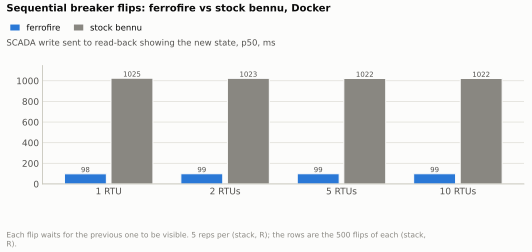
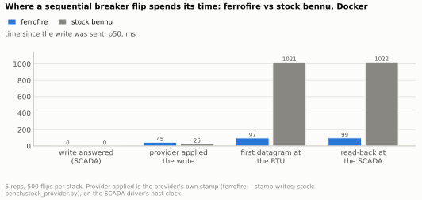
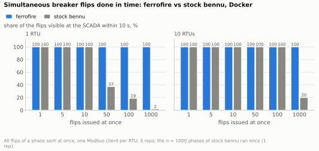
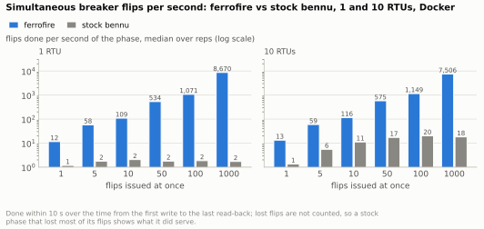
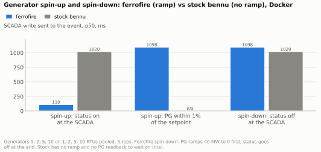
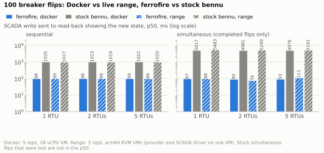

# Control latency: breaker flips and generator spin-up and spin-down, ferrofire vs stock bennu

*Generated by `bench/charts.py` (`make charts`) from the raw runs under [results/control/](results/control/); every number below is computed from those files. Tables
are also saved as CSVs next to the SVGs in [docs/img/charts/](../img/charts/); every (stack, cell, RTUs) group is in
[09h-control-all-cells.csv](../img/charts/09h-control-all-cells.csv). Harness, columns and definitions: [bench/README.md](../../bench/README.md), "Control-latency harness".*

## What was measured

A SCADA driver (`ffcontrol`, one process, one clock) writes a command to an RTU's Modbus coil and times it until it is visible. Two stacks run the same grid
(1 250 branches, 10 generators, partitioned round-robin over R = 1, 2, 5 or 10 RTUs) and the same driver:

- **ferrofire**: `ferrofire run` (provider) + `ferrofire field-device` per RTU.
- **stock bennu**: `pybennu-power-solver` (PyPower, pybennu 6.0.0) + stock `bennu-field-deviced` per RTU, from the same phenix-waterway-range overlay.

Per command, all in milliseconds since the write was sent (`t_cmd`): **ack** (write answered), **applied** (the provider applied the write; the provider's own stamp),
**stream** (first datagram carrying the new state at the RTU), **visible** (a 2 ms read-back at the SCADA shows it), **setpoint** (generators: PG within 1% of the setpoint).
A command is *done* at visible (and setpoint for a generator). *Sequential* = the next command goes out when the previous is done; *simultaneous* = all commands at once, one
Modbus client per RTU. *Lost* = not done within 10 s (12 s for a generator). *Wrong* = the final state differs, the provider disagrees, an uncommanded point changed, or two
adjacent commands of one RTU became visible in the opposite order.

Two environments. **Docker**: 5 reps, the full matrix (breaker flips 1, 5, 10, 50, 100, 1000; generators 1, 2, 5, 10; R = 1, 2, 5, 10; both modes), in containers on Docker Desktop's
Linux VM (18 vCPU, 7.7 GB) of an Apple Silicon Mac. **Range**: 3 reps, a subset (R = 1, 2, 5; breaker flips 1, 10, 100; generators 1, 5) on the phenix `ctlbench` experiment, six arm64 KVM VMs.
Differences that matter when reading the numbers:

- Stock bennu has **no generator ramp**: its generator cells are status flips only, so it has no `setpoint` time, and a stock status flip does not bring PG back (spin-down writes PG to 0 and spin-up leaves it at 0,
  [pg-after-status-flip.txt](results/control/stock/pg-after-status-flip.txt)). Ferrofire ramps PG at 40 MW/s.
- Stock runs a fresh stack per cell (a stock provider that falls behind keeps applying a backlog). The two n = 1000 breaker cells of stock ran **1 rep** (not 5) at every R. Every other cell has 5 reps (Docker) or 3 (range).
- Every cell of the Docker matrix ran on both stacks; nothing was skipped. The range ran the subset above only: no R = 10, no 5, 50 or 1000 flips, no 2 or 10 generators.
- Contention: no run started with another cargo, ff-rust or mutator container present (`contended_at_start False` in all 40 Docker and 18 range `env.txt` files). The Docker host was not idle: its 1-minute load average at run start
  ranged from 3.1 to 17.1 (`host_load_start` in each `.env.txt`, `vm_load1_start_end` in each `.cells.csv`) on an 18-vCPU VM, and stock uses about one CPU, so Docker latencies include some host noise. The range host's load at run start was at most 4.5.
- Ferrofire's read-back can flip early and flip back: a field device sets a point when the provider ACKs the write, before the provider applies it, and a still-old datagram could take it back (**flaps**, section 7).
  Since ww-1df.32 the field device holds an ACKed point for up to 2 s against stream values that differ from it, so the flaps are gone (0 in the re-run); the "before ww-1df.32" rows are the earlier run kept in `results/control/ferrofire-before-ww-1df.32/`.
  The driver counts a command as done only when the state is also seen on the stream, so a flap is not an error, but a SCADA polling at 2 ms sees it.

Solve time of the power flow at 1 250 branches, ferrofire in a container on a contended host: about 9.7 ms per solve ([solve-time.txt](results/control/solve-time.txt)). Pybennu is not installed offline, so
its solve time is not measured; the stock provider applies a command in about 26 ms p50 (section 2).

## 1. Sequential breaker flips: ferrofire vs stock bennu

100 flips per run, one at a time, each issued when the previous is visible, on 1, 2, 5 and 10 RTUs; ferrofire vs stock bennu in Docker, 5 reps (500 flips per bar). Unit: milliseconds from the SCADA write to the read-back showing the new state, p50.

| stack | RTUs | flips done | p50 ms | p95 ms | p99 ms | max ms |
|---|---|---|---|---|---|---|
| ferrofire | 1 | 500 | 98 | 118 | 125 | 128 |
| ferrofire | 2 | 500 | 98 | 117 | 125 | 126 |
| ferrofire | 5 | 500 | 99 | 112 | 119 | 126 |
| ferrofire | 10 | 500 | 99 | 110 | 114 | 115 |
| stock bennu | 1 | 500 | 1025 | 1033 | 1035 | 1036 |
| stock bennu | 2 | 500 | 1023 | 1032 | 1035 | 1037 |
| stock bennu | 5 | 500 | 1022 | 1035 | 1041 | 1046 |
| stock bennu | 10 | 500 | 1022 | 1044 | 1051 | 1060 |

Ferrofire shows a flip in about 100 ms and stock bennu in about 1 020 ms whatever the number of RTUs, and neither lost one. Stock publishes its whole model once a second and a flip waits for the next publish; ferrofire's new state reaches the RTU about 50 ms after the provider applies it (section 2).
Throughput follows: 1 000 sequential flips take about 100 s on ferrofire (10 per s) and 1 023 to 1 026 s on stock (1 per s), from the `span_s` of the n = 1000 phases.

## 2. Where the time goes

The same sequential flips, 100 per run on 5 RTUs, ferrofire vs stock bennu in Docker, 5 reps (500 flips each). Unit: milliseconds since the SCADA write was sent, p50, at four points of the path.

| stack | stage | commands | p50 ms | p95 ms | p99 ms | max ms |
|---|---|---|---|---|---|---|
| ferrofire | ack | 500 | 0 | 0 | 0 | 1 |
| ferrofire | applied | 500 | 45 | 93 | 100 | 104 |
| ferrofire | stream | 500 | 97 | 112 | 118 | 125 |
| ferrofire | visible | 500 | 99 | 112 | 119 | 126 |
| stock bennu | ack | 500 | 0 | 0 | 0 | 0 |
| stock bennu | applied | 500 | 26 | 48 | 52 | 58 |
| stock bennu | stream | 500 | 1021 | 1034 | 1039 | 1044 |
| stock bennu | visible | 500 | 1022 | 1035 | 1041 | 1046 |

Both providers apply a command in under 50 ms (ferrofire 46, stock 26 ms p50); the difference is how long the new state takes to reach the RTU: about 50 ms later on ferrofire, about 1 s later on stock.
(Ack is 0 ms to the rounding: the field device answers the write before the provider is involved.)

## 3. Simultaneous breaker flips: done in time

All flips of a phase sent at once, spread evenly over the RTUs with one Modbus client each; ferrofire vs stock bennu in Docker, 1 RTU and 10 RTUs, 1 to 1 000 flips, 5 reps (stock n = 1 000: 1 rep). Unit: percent of the flips visible at the SCADA within 10 s.

| stack | RTUs | flips issued at once | commands issued | done within 10 s | lost | phases |
|---|---|---|---|---|---|---|
| ferrofire | 1 | 1 | 5 | 5 | 0 | 5 |
| ferrofire | 1 | 5 | 25 | 25 | 0 | 5 |
| ferrofire | 1 | 10 | 50 | 50 | 0 | 5 |
| ferrofire | 1 | 50 | 250 | 250 | 0 | 5 |
| ferrofire | 1 | 100 | 500 | 500 | 0 | 5 |
| ferrofire | 1 | 1000 | 5000 | 5000 | 0 | 5 |
| stock bennu | 1 | 1 | 5 | 5 | 0 | 5 |
| stock bennu | 1 | 5 | 25 | 25 | 0 | 5 |
| stock bennu | 1 | 10 | 50 | 50 | 0 | 5 |
| stock bennu | 1 | 50 | 250 | 93 | 157 | 5 |
| stock bennu | 1 | 100 | 500 | 94 | 406 | 5 |
| stock bennu | 1 | 1000 | 1000 | 19 | 981 | 1 |
| ferrofire | 10 | 1 | 5 | 5 | 0 | 5 |
| ferrofire | 10 | 5 | 25 | 25 | 0 | 5 |
| ferrofire | 10 | 10 | 50 | 50 | 0 | 5 |
| ferrofire | 10 | 50 | 250 | 250 | 0 | 5 |
| ferrofire | 10 | 100 | 500 | 500 | 0 | 5 |
| ferrofire | 10 | 1000 | 5000 | 5000 | 0 | 5 |
| stock bennu | 10 | 1 | 5 | 5 | 0 | 5 |
| stock bennu | 10 | 5 | 25 | 25 | 0 | 5 |
| stock bennu | 10 | 10 | 50 | 50 | 0 | 5 |
| stock bennu | 10 | 50 | 250 | 250 | 0 | 5 |
| stock bennu | 10 | 100 | 500 | 500 | 0 | 5 |
| stock bennu | 10 | 1000 | 1000 | 200 | 800 | 1 |

Ferrofire completed every flip in every phase (up to 5 000 flips at once over the reps). Stock serves about one command per RTU per second: on 1 RTU 50 flips at once lose 63% and 100 lose 81%; on 10 RTUs only the 1 000-flip phase loses flips (80%).
Counts for R = 2 and 5 are in [09h-control-all-cells.csv](../img/charts/09h-control-all-cells.csv); the range shows the same loss (section 7).

## 4. Throughput of simultaneous breaker flips

Same phases as section 3. Unit: flips done per second between the first write and the last read-back, median over the reps, log scale; lost flips are not counted.

| stack | RTUs | flips issued at once | phases | median flips per s |
|---|---|---|---|---|
| ferrofire | 1 | 1 | 5 | 11.0 |
| ferrofire | 1 | 5 | 5 | 57.1 |
| ferrofire | 1 | 10 | 5 | 119.5 |
| ferrofire | 1 | 50 | 5 | 542.9 |
| ferrofire | 1 | 100 | 5 | 1006.0 |
| ferrofire | 1 | 1000 | 5 | 7128.1 |
| stock bennu | 1 | 1 | 5 | 1.2 |
| stock bennu | 1 | 5 | 5 | 1.8 |
| stock bennu | 1 | 10 | 5 | 2.1 |
| stock bennu | 1 | 50 | 5 | 1.8 |
| stock bennu | 1 | 100 | 5 | 1.9 |
| stock bennu | 1 | 1000 | 1 | 1.7 |
| ferrofire | 10 | 1 | 5 | 13.3 |
| ferrofire | 10 | 5 | 5 | 63.6 |
| ferrofire | 10 | 10 | 5 | 110.5 |
| ferrofire | 10 | 50 | 5 | 562.1 |
| ferrofire | 10 | 100 | 5 | 1129.6 |
| ferrofire | 10 | 1000 | 5 | 8318.3 |
| stock bennu | 10 | 1 | 5 | 1.4 |
| stock bennu | 10 | 5 | 5 | 5.5 |
| stock bennu | 10 | 10 | 5 | 11.2 |
| stock bennu | 10 | 50 | 5 | 17.2 |
| stock bennu | 10 | 100 | 5 | 20.1 |
| stock bennu | 10 | 1000 | 1 | 18.2 |

Ferrofire's rate grows with the burst (about 7 100 per s for 1 000 flips on 1 RTU, 8 300 on 10); stock stays at about 2 per s on 1 RTU and about 20 per s on 10 RTUs, one command per RTU per publish.

## 5. Generator spin-up and spin-down

Sequential generator commands, 1, 2, 5 and 10 generators on 1, 2, 5 and 10 RTUs pooled (360 spin-ups and 360 spin-downs per stack), ferrofire (PG ramps at 40 MW/s) vs stock bennu (status flip only), Docker, 5 reps.
Unit: milliseconds from the SCADA write to the status being on (spin-up), PG within 1% of the setpoint (spin-up), or the status being off (spin-down), p50.

| stack | event | generators done | p50 ms | p95 ms | p99 ms | max ms |
|---|---|---|---|---|---|---|
| ferrofire | status on | 360 | 110 | 118 | 123 | 127 |
| ferrofire | PG at setpoint | 360 | 1098 | 1106 | 1109 | 1110 |
| ferrofire | status off | 360 | 1098 | 1107 | 1115 | 1134 |
| stock bennu | status on | 360 | 1020 | 1031 | 1035 | 1038 |
| stock bennu | PG at setpoint | 0 |  |  |  |  |
| stock bennu | status off | 360 | 1020 | 1033 | 1037 | 1048 |

Ferrofire reports the unit on after about 110 ms and has PG at the setpoint 1.1 s later (the ramp); it turns the status off only when the ramp reaches 0 (1.1 s). Stock's status changes at its publish (about 1 s) in both directions and PG never ramps,
so there is no stock number for the setpoint. Simultaneous generator commands (10 at once on 10 RTUs) are the same: ferrofire p50 78 ms (status on) and 1 076 ms (status off), stock 907 and 709 ms, none lost ([09h-control-all-cells.csv](../img/charts/09h-control-all-cells.csv)).

## 6. Docker vs live range

100 breaker flips on 1, 2 and 5 RTUs, sequential (left) and simultaneous (right), ferrofire vs stock bennu, Docker (5 reps, solid) vs the live range (3 reps, hatched). Unit: milliseconds from the SCADA write to the read-back, p50, log scale.

| stack | where | mode | RTUs | flips done | p50 ms | p95 ms | p99 ms | max ms |
|---|---|---|---|---|---|---|---|---|
| ferrofire | docker | seq | 1 | 500 | 98 | 118 | 125 | 128 |
| ferrofire | docker | seq | 2 | 500 | 98 | 117 | 125 | 126 |
| ferrofire | docker | seq | 5 | 500 | 99 | 112 | 119 | 126 |
| stock bennu | docker | seq | 1 | 500 | 1025 | 1033 | 1035 | 1036 |
| stock bennu | docker | seq | 2 | 500 | 1023 | 1032 | 1035 | 1037 |
| stock bennu | docker | seq | 5 | 500 | 1022 | 1035 | 1041 | 1046 |
| ferrofire | range | seq | 1 | 300 | 99 | 105 | 109 | 112 |
| ferrofire | range | seq | 2 | 300 | 99 | 111 | 117 | 122 |
| ferrofire | range | seq | 5 | 300 | 99 | 110 | 115 | 153 |
| stock bennu | range | seq | 1 | 300 | 1017 | 1062 | 1080 | 2031 |
| stock bennu | range | seq | 2 | 300 | 1019 | 1047 | 1060 | 1074 |
| stock bennu | range | seq | 5 | 300 | 1020 | 1046 | 1058 | 1061 |
| ferrofire | docker | sim | 1 | 500 | 97 | 109 | 110 | 110 |
| ferrofire | docker | sim | 2 | 500 | 90 | 107 | 108 | 108 |
| ferrofire | docker | sim | 5 | 500 | 93 | 99 | 100 | 101 |
| stock bennu | docker | sim | 1 | 94 | 5017 | 9130 | 9996 | 9996 |
| stock bennu | docker | sim | 2 | 184 | 4981 | 9093 | 9096 | 9096 |
| stock bennu | docker | sim | 5 | 464 | 4976 | 9081 | 9952 | 9953 |
| ferrofire | range | sim | 1 | 300 | 98 | 147 | 159 | 163 |
| ferrofire | range | sim | 2 | 300 | 76 | 135 | 141 | 145 |
| ferrofire | range | sim | 5 | 300 | 111 | 150 | 159 | 163 |
| stock bennu | range | sim | 1 | 59 | 5483 | 9741 | 9848 | 9848 |
| stock bennu | range | sim | 2 | 114 | 5249 | 9334 | 9390 | 9397 |
| stock bennu | range | sim | 5 | 295 | 5191 | 9797 | 9874 | 9882 |

The range gives the same sequential p50s as Docker for both stacks (ferrofire 99 ms, stock 1 017 to 1 020 ms), so the Docker matrix is a fair stand-in for the range; the range's simultaneous ferrofire p95 is higher (135 to 150 ms against 99 to 109 ms).
For simultaneous flips only the completed flips are timed (stock: 59, 114, 295 of 300 per R = 1, 2, 5 on the range, 94, 184, 464 of 500 in Docker): its p50 of about 5 s says how late the flips that did arrive were.

## 7. Lost and wrong commands

Every phase of every run, ferrofire vs stock bennu, Docker (full matrix) and range (subset). Unit: commands (a command is one flip or one generator spin-up or spin-down; a "phase" is one cell run once).

| where | stack | family | commands | lost | wrong final | wrong at provider | wrong collateral | order violations | flaps | write errors | phases |
|---|---|---|---|---|---|---|---|---|---|---|---|
| docker | ferrofire before ww-1df.32 | breaker seq | 23320 | 0 | 0 | 0 | 0 | 0 | 1 | 0 | 120 |
| docker | ferrofire before ww-1df.32 | breaker sim | 23320 | 0 | 0 | 0 | 0 | 200 | 3831 | 0 | 120 |
| docker | ferrofire before ww-1df.32 | gen seq | 720 | 0 | 0 | 0 | 0 | 0 | 360 | 0 | 160 |
| docker | ferrofire before ww-1df.32 | gen sim | 720 | 0 | 0 | 0 | 0 | 0 | 360 | 0 | 160 |
| docker | ferrofire | breaker seq | 23320 | 0 | 0 | 0 | 0 | 0 | 0 | 0 | 120 |
| docker | ferrofire | breaker sim | 23320 | 0 | 0 | 0 | 0 | 110 | 0 | 0 | 120 |
| docker | ferrofire | gen seq | 720 | 0 | 0 | 0 | 0 | 0 | 0 | 0 | 160 |
| docker | ferrofire | gen sim | 720 | 0 | 0 | 0 | 0 | 0 | 0 | 0 | 160 |
| docker | stock bennu | breaker seq | 7320 | 0 | 0 | 0 | 0 | 0 | 0 | 0 | 104 |
| docker | stock bennu | breaker sim | 7320 | 4635 | 0 | 0 | 0 | 1190 | 0 | 0 | 104 |
| docker | stock bennu | gen seq | 720 | 0 | 0 | 0 | 0 | 0 | 0 | 0 | 160 |
| docker | stock bennu | gen sim | 720 | 0 | 0 | 0 | 0 | 0 | 0 | 0 | 160 |
| range | ferrofire before ww-1df.32 | breaker seq | 999 | 0 | 0 | 0 | 0 | 0 | 0 | 0 | 27 |
| range | ferrofire before ww-1df.32 | breaker sim | 999 | 0 | 0 | 0 | 0 | 110 | 194 | 0 | 27 |
| range | ferrofire before ww-1df.32 | gen seq | 108 | 0 | 0 | 0 | 0 | 0 | 54 | 0 | 36 |
| range | ferrofire before ww-1df.32 | gen sim | 108 | 0 | 0 | 0 | 0 | 0 | 54 | 0 | 36 |
| range | ferrofire | breaker seq | 999 | 0 | 0 | 0 | 0 | 0 | 0 | 0 | 27 |
| range | ferrofire | breaker sim | 999 | 0 | 0 | 0 | 0 | 105 | 0 | 0 | 27 |
| range | ferrofire | gen seq | 108 | 0 | 0 | 0 | 0 | 0 | 0 | 0 | 36 |
| range | ferrofire | gen sim | 108 | 0 | 0 | 0 | 0 | 0 | 0 | 0 | 36 |
| range | stock bennu | breaker seq | 999 | 0 | 0 | 0 | 0 | 0 | 0 | 0 | 27 |
| range | stock bennu | breaker sim | 999 | 432 | 0 | 0 | 0 | 240 | 0 | 0 | 27 |
| range | stock bennu | gen seq | 108 | 0 | 0 | 0 | 0 | 0 | 0 | 0 | 36 |
| range | stock bennu | gen sim | 108 | 0 | 0 | 0 | 0 | 0 | 0 | 0 | 36 |

- **Lost**: ferrofire none. Stock lost 4 635 of 7 320 simultaneous breaker commands in Docker and 432 of 999 on the range, none of the sequential ones.
- **Wrong final state, wrong at the provider, wrong collateral, write errors**: none in any phase of either stack.
- **Order violations** (adjacent commands of one RTU that became visible in the opposite order, simultaneous mode only): ferrofire before ww-1df.32 200 in Docker (180 on 1 RTU, 19 on 2, 1 on 5, none on 10) and 110 on the range (57, 42, 11); after the hold 110 in Docker (18 on 1 RTU, 5 on 2, 24 on 5, 63 on 10) and 105 on the range (53, 47, 5); stock 1 190 and 240.
  The ACK hold did not remove them (it changed where they fall, not how many in total), so they do not share the flap cause. The cause is not established here (follow-up bead).
- **Flaps** (ferrofire only): the read-back showed the new state, then the old, then the new again. Before ww-1df.32: 3 831 in the simultaneous breaker phases, 1 in a sequential breaker phase and 720 in the generator phases (360 sequential, 360 simultaneous) in Docker; 194 and 108 on the range. After the ACK hold (field device ignores a differing stream value for up to 2 s after a provider ACK, ww-1df.32): none in any phase, Docker or range. Stock has none in any phase.
  Latency did not change beyond run-to-run noise: sequential breaker p50 98.7 ms before and 98.5 ms after in Docker (99 and 99 on the range), p95 109.6 and 114.4 (108.5 and 108.2); simultaneous p95 141.3 and 133.5 (150.6 and 145.2). The sequential p95 rise in Docker is in the stream stamp (driver-side, before the field device), not in visible minus stream. An A/B of the 1 000-flip simultaneous cell with the pre-fix and the fixed binary on the same host (alternating runs) showed no difference.

## What the numbers do not say

- Stock bennu is measured as the repo's phenix overlay ships it (publish once a second); its seconds-level latency tracks that interval (its provider applies a command in about 26 ms), not Modbus or the solver. Neither stack's publish rate was tuned.
- No generator number for stock includes the ramp (stock has none). The generator comparison is therefore: ferrofire spin-up status 110 ms and PG at setpoint 1.1 s, against stock status at 1.0 s with PG left at 0.
- The Docker runs share one VM with the host's other workloads (load 3 to 17 at the start of a run); the range host's load at run start was at most 4.5. The range numbers agree with Docker's.
