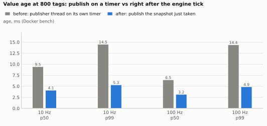
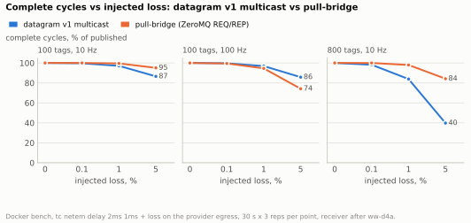
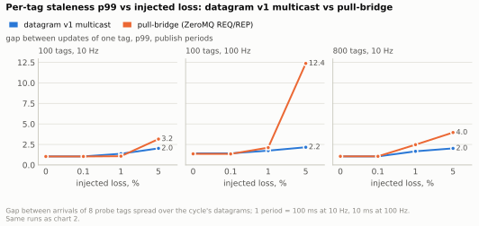
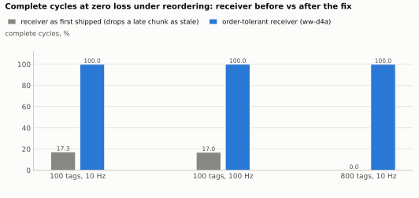
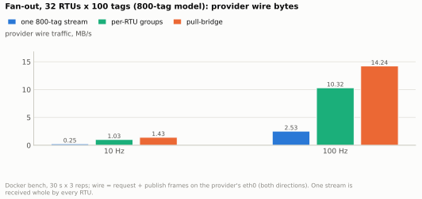
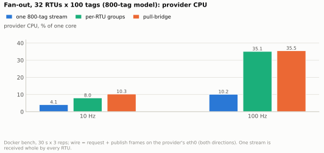
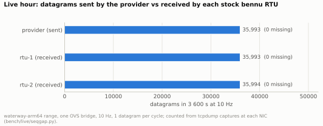
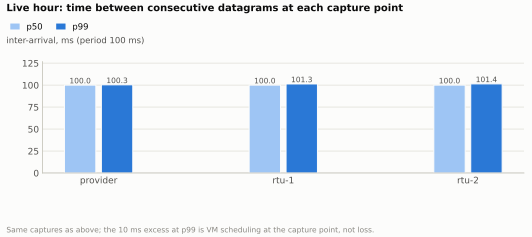
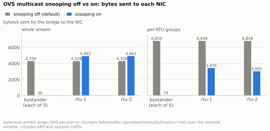

# ferrofire datagram v1: loss, fan-out, restarts and faults

*Generated by `bench/dg_report.py` from the 117 raw runs in `docs/bench/results/raw-datagram-v1/`; every table below is computed from those files.
The method and the client are in [bench/README.md](../../bench/README.md#datagram-v1-matrix-ww-otj18); the wire is [datagram-v1.md](../datagram-v1.md).
This is a separate report: the zmq-vs-NNG report ([transport-comparison.md](transport-comparison.md)) and its raw data are unchanged
(historical, NNG dropped).*

## What the numbers say

- **Sync publish halved the age (A).** At 800 tags the age p50 fell from 9.5 ms to 4.1 ms at 10 Hz and from 6.5 ms to 3.2 ms at 100 Hz; p99 from 14.5 ms to 5.3 ms
  and 4.9 ms. The old 14-15 ms ceiling was the publisher thread sampling a snapshot up to one engine step (10 ms) stale; now it publishes the snapshot it just took
  (cycle spread unchanged at 0.4 ms; transit from `_ff.t` is 0.3-0.4 ms p50, 0.5-0.7 ms p99 on the bridge). Different build and client than the "before" rows (see caveats).
- **`_ff.seq` measures datagram loss exactly (B).** netem 0.1 / 1 / 5 % came out as 0.10-0.17 / 1.07-1.34 / 5.07-5.14 % missing sequence numbers, in every cell, with no
  false loss from reordering or from the 100/s garbage (replays older than 10 s are ignored by the counter).
- **The receiver as first shipped broke under reordering, a real bug (ww-d4a, P1), fixed since: see "After ww-d4a" in section B and C (100 tags: 17 % -> 100 % complete at zero loss; 800 tags: 0 % -> 100 %; every loss cell now matches the order-tolerant count).** With netem `delay 2ms 1ms` and *zero* loss, `ferrofire::datagram::Receiver` completes only
  about 17 % of 100-tag cycles and 0.0 % of 800-tag cycles: the 3 (or 18) datagrams of a cycle leave back to back, jitter swaps them, and the monotonic-`seq` rule drops the
  late one as `stale` even though it carries different tags. The same datagrams reassembled order-tolerantly (dedupe by `_ff.seq`) complete 100 %. This was the benchmark's
  most important number: it was not the network that hurt, it was the stale rule. It will not show on a quiet switched LAN; it will on Wi-Fi, VPN or ECMP paths.
- **With order-tolerant reassembly, multicast loss behaves as the refresh model predicts, and gets bad with big cycles.** A cycle is complete with probability (1-p)^datagrams:
  100 tags (3 datagrams) at 1 % / 5 % loss: 96.2 % / 85.3 % complete (predicted 96.7 / 85.7); 800 tags (18 datagrams): 80.7 % / 36.9 % (83.4 / 39.6). Staleness is *not* bounded by one
  period: p50 stays at the period, but at 1 % the p99 is 2-3 periods (200-300 ms at 10 Hz) and at 5 % 3-9 periods (330 ms for 100 tags, 930 ms for 800 tags; worst rep 2 s). At 0.1 % the
  p99 is one to two periods (104 ms for 100 tags, 198 ms for 800). A reader of a single tag sees better numbers than "whole state complete"; per-RTU slices shrink the cycle and help the same way.
- **Pull-bridge under the same netem: better at 800 tags, worse at 100 Hz.** TCP retransmits inside the READ, so 800 tags at 10 Hz stay 98.9 % complete at 1 % loss and 82.7 % at 5 %
  (multicast, order-tolerant: 80.7 / 36.9). At 100 tags and 10 Hz the two are close (pull 99.3 / 95.6 %, multicast 96.2 / 85.3 %). At 100 Hz pull is worse than multicast (95.4 / 76.5 % vs 96.8 / 85.8 %)
  with retry stalls: max gap 229 ms at 1 % and 344 ms at 5 % (multicast 31 / 59 ms) and about 6 bridge warning lines per 30 s at 5 %, because a lost segment costs an RTO (200 ms+) against a bridge
  timeout of two periods (20 ms), after which the bridge recreates its socket and asks again. Pull never delivers a half-updated state; multicast always delivers something.
- **Per-RTU groups cost the provider less than pull and more than one big stream (D).** 32 RTUs x 100 tags at 10 Hz: 1.03 MB/s on the wire and 8.0 % of a core (slices), 1.43 MB/s and 10.3 % (pull), 0.25 MB/s and
  4.1 % (one 800-tag stream). At 100 Hz: 10.3 MB/s / 35 % (slices), 14.2 MB/s / 36 % (pull), 2.5 MB/s / 10 % (whole). Pull sends 1.4x the bytes and about 1.7x the packets of slices (requests, replies, ACKs).
  Slices grow with RTUs x tags, not with model size (8 RTUs x 50 tags: 135 kB/s; 32 x 100: 1026 kB/s, 7.6x for 8x the tag-slots), but each RTU then receives only its own 16-323 kB/s instead of the
  whole stream's 252 kB/s (10 Hz) or 2.5 MB/s (100 Hz). The single stream is the cheapest for the provider and the most expensive for every RTU. All modes delivered about 100 % of cycles to every RTU
  with no datagram loss on the bridge; the one exception is pull at 100 Hz x 32 RTUs x 50 tags (99.8 %, max gap 28 ms).
- **Subscriber restart is cheap (E).** A multicast subscriber has no state to rebuild: it waits for the next full cycle, 4-8 ms at 100 Hz and 8-70 ms at 10 Hz (mean 46 ms for 100 tags, 34 ms for 800), i.e. up to one period plus the 0.4 ms cycle spread.
  A respawned pull-bridge was ready in 3.3-6.3 ms (its first tick fires at once; process start, QUERY and one READ), but that is a process restart on a loopback-fast bridge; a stock field device's own startup is on top of either.
- **Faults do not wedge anything (F).** `kill -9` of the provider and a restart 3.0 s later: multicast subscribers had fresh complete cycles 3-4 ms after the restart command (outage seen 3.04 s; the sequence reset was
  detected as a provider restart, not stale), the pull-bridge 139-144 ms later (outage 3.18 s; one warning line, no bridge restart needed). Dropping every REP reply for 4 s: multicast untouched (longest gap 105 ms),
  the pull-bridge stalled 4.3 s and was fresh again 260 ms after the replies came back (one warning line, no wedge, the REQ socket recreated). 7,800 bad datagrams injected at 100/s: all 7,800 were counted by reason
  (garbage 3,327, truncated 2,229, wrong group 1,131, stale 1,113), the multicast stream delivered 100 % of cycles as in the control, no sequence loss, no crash. A misspelt tag in a WRITE or READ gets `ERR` with a
  suggestion; in a publish list or pull-bridge list the process refuses to start and names the tag and the nearest one.
- **Live range (G).** One hour of the sequenced stream across a real OVS bridge to two stock bennu RTUs: 35 993 datagrams, 0 `_ff.seq` gaps at the provider and at both RTUs, RTU registers within one device scan of the provider's own values in 100 % of samples, nothing in the device logs. Snooping off floods every multicast datagram to the whole segment (15.6 MB/h per bystander NIC); on, bystanders fall to 36-116 B/s with 0 datagrams lost and per-RTU groups reach only their RTU. Provider `kill -9` (5 s and 20 s) and `SIGSTOP` (10 s): both RTUs tracked again at the first sample after the restart, none wedged, the stock client's lazy pirate abandoned one write after 15 s. Malformed datagrams do not stop stock bennu but it applies the ones that parse (values flicker while garbage arrives). The stock Modbus server leaks an fd per closed connection and filled a guest disk with log lines (ww-1p6).
- **Not measured here:** loss on a real network, a second host's clock for transit time, many provider cores, more than two live RTUs.

## Caveats (read before quoting a number)

- **Docker bridge, one VM.** Provider, monitor and client are containers on one Linux bridge inside the Docker Desktop VM (Apple M5 Max, linuxkit
  7.0.14, aarch64). There is no switch, no IGMP querier worth the name and no second host; the only loss is the loss that `tc netem` injects. All
  containers share one kernel clock, so `_ff.t`-based transit times are real one-way times here and would not be on two hosts.
- **netem loss is independent per packet**, the best case for a refresh protocol and unlike a congested switch queue (bursty). Delay `2ms 1ms`
  also **reorders** packets (jitter larger than the spacing of chunks sent back to back); the receiver drops a datagram older than one it already
  accepted (`stale`), so at 800 tags the netem rows include some reordering damage on top of the injected loss, and the "datagram loss" column
  (from `_ff.seq`, order independent) is lower than the share of datagrams the receiver actually used.
- **netem is on the provider's whole egress**, so in the pull rows it also delays and drops the TCP replies of the REQ/REP path. The multicast and pull
  streams ran in the same cell at the same time against the same provider (the pull-bridge adds a few READs per period; its share of the provider is small).
- **Pull numbers are measured at the bridge's republished stream** on client-side loopback (what a stock field device behind the bridge sees), not at the
  REQ socket. A bridge tick that fails publishes nothing, so a failure shows as a gap.
- Per-RTU cells: the provider wire kB/s is request + publish frames seen on the provider's `eth0` (both directions of the TCP path), so in pull rows it
  includes the inbound READ requests. Multicast egress is one copy however many subscribers; Docker's bridge floods it to every port, which a real switch may not.
- The pull cells let the provider publish once per 10 s on loopback (nobody subscribes), as in the earlier pull report, so its work is the batched READs
  alone; the multicast cells publish at the cell's period.
- 3 repetitions per cell, 30 s window (+ 3 s warm-up) unless noted; tables show mean ± sample standard deviation over reps, "worst rep" for maxima. Three
  reps are enough to see the order of magnitude, not to rank two close numbers.
- The sync-publish "before" numbers are the already-published `zmq` rows of `raw/` (original build) and `raw-after-nng-fix/` measured with the old client;
  "after" uses the new client (`ffbench dg`), which computes the same age metric from cycles assembled by `_ff.cyc` instead of by `sim.t`. Different build,
  different client, same machine and method; not a controlled A/B of one commit.

## A. Age at 800 tags, before vs after publishing synchronously after the engine tick

Age = last-chunk receipt minus (`sim.t` + a constant chosen so the smallest age in the run is 0), i.e. freshness variation; `transit` = receipt minus `_ff.t`
(provider's send time), only available after this change.



*Charts: plotted numbers and the same charts with context in [results.md](../results.md).*

| Hz | build | reps | age p50 ms | age p99 ms | age max ms | cycle spread p50 ms | transit p50 ms | transit p99 ms |
|---|---|---|---|---|---|---|---|---|
| 10 | before (raw/, original build) | 3 | 9.5 ± 2.3 | 14.5 ± 0.7 | 14.8 ± 0.4 | 0.4 ± 0.0 | - | - |
| 10 | before (raw-after-nng-fix/) | 3 | 8.2 ± 1.9 | 14.9 ± 0.4 | 15.3 ± 0.3 | 0.4 ± 0.0 | - | - |
| 10 | **after (sync publish, this run)** | 3 | 4.1 ± 0.1 | 5.3 ± 0.0 | 5.4 ± 0.1 | 0.4 ± 0.0 | 0.4 ± 0.0 | 0.7 ± 0.0 |
| 100 | before (raw/, original build) | 3 | 6.5 ± 0.2 | 14.4 ± 0.2 | 15.1 ± 0.2 | 0.4 ± 0.0 | - | - |
| 100 | before (raw-after-nng-fix/) | 3 | 6.7 ± 0.5 | 14.7 ± 0.6 | 16.5 ± 2.1 | 0.4 ± 0.0 | - | - |
| 100 | **after (sync publish, this run)** | 3 | 3.2 ± 0.2 | 4.9 ± 0.0 | 5.5 ± 0.2 | 0.4 ± 0.0 | 0.3 ± 0.0 | 0.5 ± 0.0 |

## B and C. Datagram loss by `_ff.seq`, cycle loss and staleness under tc netem

`delay 2ms 1ms` on the provider's eth0 egress for every row; loss as marked. **Datagram loss** = missing `_ff.seq` values inside the range seen;
**complete %** = complete cycles / cycles the provider published in the window; **stale** = gap between consecutive complete cycles (what a reader of
"the latest complete state" sees; its floor is the period); **8-tag gap** = arrival gap of 8 probe tags spread over the chunks (what a reader of one point sees);
**chunks/cycle** = datagrams per cycle; expected complete % = (1 - loss)^chunks if each datagram were lost independently.







*Charts: plotted numbers and the same charts with context in [results.md](../results.md).*

### 100 tags, 10 Hz

| netem loss | datagram loss % (seq gaps) | datagrams/cycle (est.) | expected complete % (1-p)^chunks | mcast complete % (receiver as shipped) | stale p99 ms | stale max ms (worst rep) | mcast complete % (order-tolerant) | stale p50 ms | p99 | max | · | pull complete % | stale p50 ms | p99 | max (worst rep) | bridge warn lines/rep | reps |
|---|---|---|---|---|---|---|---|---|---|---|---|---|---|---|---|---|---|
| 0% | 0.03 ± 0.06 | 3.0 | 100.0 | 17.3 ± 2.7 | 1967 | 2898 | 100.0 ± 0.0 | 100 | 104 | 106 | · | 100.0 ± 0.0 | 100 | 104 | 105 | 0 ± 0 | 3 |
| 0.1% | 0.17 ± 0.12 | 3.0 | 99.7 | 17.1 ± 1.1 | 2368 | 3503 | 99.7 ± 0.0 | 100.0 | 104 | 203 | · | 100.0 ± 0.0 | 100.0 | 104 | 105 | 0 ± 0 | 3 |
| 1% | 1.34 ± 0.31 | 3.0 | 97.0 | 18.0 ± 2.4 | 1932 | 2699 | 96.2 ± 1.0 | 100 | 201 | 304 | · | 99.3 ± 0.0 | 100 | 109 | 318 | 0 ± 0 | 3 |
| 5% | 5.11 ± 0.97 | 3.0 | 85.8 | 15.1 ± 3.3 | 2666 | 3601 | 85.3 ± 2.3 | 101 | 332 | 402 | · | 95.6 ± 1.5 | 100 | 313 | 324 | 0 ± 1 | 3 |

### 100 tags, 100 Hz

| netem loss | datagram loss % (seq gaps) | datagrams/cycle (est.) | expected complete % (1-p)^chunks | mcast complete % (receiver as shipped) | stale p99 ms | stale max ms (worst rep) | mcast complete % (order-tolerant) | stale p50 ms | p99 | max | · | pull complete % | stale p50 ms | p99 | max (worst rep) | bridge warn lines/rep | reps |
|---|---|---|---|---|---|---|---|---|---|---|---|---|---|---|---|---|---|
| 0% | 0.01 ± 0.01 | 3.0 | 100.0 | 17.0 ± 0.7 | 263 | 431 | 100.0 ± 0.0 | 9.9 | 13.9 | 15.4 | · | 100.0 ± 0.0 | 10.1 | 13.6 | 15.3 | 0 ± 0 | 3 |
| 0.1% | 0.10 ± 0.03 | 3.0 | 99.7 | 17.8 ± 0.7 | 238 | 432 | 99.8 ± 0.1 | 9.9 | 14.0 | 23.3 | · | 99.5 ± 0.0 | 10.1 | 13.6 | 127 | 0 ± 0 | 3 |
| 1% | 1.07 ± 0.02 | 3.0 | 97.0 | 17.1 ± 0.4 | 245 | 488 | 96.8 ± 0.1 | 10.0 | 20.9 | 30.7 | · | 95.4 ± 0.7 | 10.2 | 20.2 | 229 | 1 ± 1 | 3 |
| 5% | 5.07 ± 0.16 | 3.0 | 85.8 | 14.9 ± 0.3 | 310 | 569 | 85.8 ± 0.5 | 10.2 | 30.2 | 58.9 | · | 76.5 ± 1.3 | 10.3 | 122 | 344 | 6 ± 2 | 3 |

### 800 tags, 10 Hz

| netem loss | datagram loss % (seq gaps) | datagrams/cycle (est.) | expected complete % (1-p)^chunks | mcast complete % (receiver as shipped) | stale p99 ms | stale max ms (worst rep) | mcast complete % (order-tolerant) | stale p50 ms | p99 | max | · | pull complete % | stale p50 ms | p99 | max (worst rep) | bridge warn lines/rep | reps |
|---|---|---|---|---|---|---|---|---|---|---|---|---|---|---|---|---|---|
| 0% | 0.10 ± 0.17 | 18.0 | 100.0 | 0.0 ± 0.0 | 30002 | 30003 | 100.0 ± 0.0 | 99.9 | 104 | 105 | · | 100.0 ± 0.0 | 100 | 106 | 108 | 0 ± 0 | 3 |
| 0.1% | 0.14 ± 0.05 | 18.0 | 98.2 | 0.0 ± 0.0 | 30001 | 30004 | 97.9 ± 0.8 | 100.0 | 198 | 205 | · | 99.6 ± 0.4 | 100.0 | 106 | 315 | 0 ± 0 | 3 |
| 1% | 1.13 ± 0.15 | 18.0 | 83.4 | 0.0 ± 0.0 | 30001 | 30002 | 80.7 ± 2.3 | 100 | 302 | 500 | · | 98.9 ± 0.4 | 100.0 | 120 | 319 | 0 ± 0 | 3 |
| 5% | 5.14 ± 0.27 | 18.1 | 39.6 | 0.0 ± 0.0 | 30002 | 30004 | 36.9 ± 3.1 | 201 | 933 | 1999 | · | 82.7 ± 1.9 | 100 | 506 | 736 | 4 ± 2 | 3 |

### After ww-d4a: the same netem cells with the order-tolerant `Receiver`

The receiver now accepts a chunk of a cycle that overtakes its neighbour (stale only on an exact repeat of a recent `_ff.seq`, or a value from an older `_ff.cyc` than the newest
applied for that tag). The reorder-and-loss cells of B and C (`delay 2ms 1ms`, 100 tags at 10 and 100 Hz, 800 tags at 10 Hz, loss 0 / 0.1 / 1 / 5 %) were re-run with the fixed
receiver, 3 reps each, same build otherwise (`SCEN=C RAWDIR=docs/bench/results/raw-datagram-v1-d4a python3 bench/run_dg.py`; raw files in `docs/bench/results/raw-datagram-v1-d4a/`).
The "before" column is the table above (receiver as shipped), kept as measured; the two "complete %" columns after it are the shipped receiver and the separate order-tolerant count taken in
the same run, which must agree.

| tags | rate | netem loss | complete % before (receiver as shipped) | complete % after ww-d4a | complete % (separate order-tolerant count, same run) | stale p50 ms | p99 | max (worst rep) | datagrams rejected stale / rep | reps |
|---|---|---|---|---|---|---|---|---|---|---|
| 100 | 10 Hz | 0% | 17.3 ± 2.7 | 100.0 ± 0.0 | 100.0 ± 0.0 | 100 | 104 | 105 | 0 ± 0 | 3 |
| 100 | 10 Hz | 0.1% | 17.1 ± 1.1 | 99.7 ± 0.7 | 99.7 ± 0.7 | 100.0 | 104 | 201 | 0 ± 0 | 3 |
| 100 | 10 Hz | 1% | 18.0 ± 2.4 | 97.1 ± 1.0 | 97.1 ± 1.0 | 100 | 200 | 204 | 0 ± 0 | 3 |
| 100 | 10 Hz | 5% | 15.1 ± 3.3 | 86.6 ± 1.7 | 86.6 ± 1.7 | 100 | 269 | 398 | 0 ± 0 | 3 |
| 100 | 100 Hz | 0% | 17.0 ± 0.7 | 100.0 ± 0.0 | 100.0 ± 0.0 | 9.9 | 13.9 | 15.9 | 0 ± 0 | 3 |
| 100 | 100 Hz | 0.1% | 17.8 ± 0.7 | 99.7 ± 0.1 | 99.7 ± 0.1 | 9.9 | 14.1 | 22.9 | 0 ± 0 | 3 |
| 100 | 100 Hz | 1% | 17.1 ± 0.4 | 96.9 ± 0.4 | 96.9 ± 0.4 | 10.0 | 20.8 | 31.0 | 0 ± 0 | 3 |
| 100 | 100 Hz | 5% | 14.9 ± 0.3 | 85.8 ± 0.4 | 85.8 ± 0.4 | 10.2 | 30.4 | 51.8 | 0 ± 0 | 3 |
| 800 | 10 Hz | 0% | 0.0 ± 0.0 | 100.0 ± 0.0 | 100.0 ± 0.0 | 100 | 104 | 104 | 0 ± 0 | 3 |
| 800 | 10 Hz | 0.1% | 0.0 ± 0.0 | 98.2 ± 1.3 | 98.2 ± 1.3 | 100 | 136 | 203 | 0 ± 0 | 3 |
| 800 | 10 Hz | 1% | 0.0 ± 0.0 | 83.9 ± 3.4 | 83.9 ± 3.4 | 100 | 269 | 500 | 0 ± 0 | 3 |
| 800 | 10 Hz | 5% | 0.0 ± 0.0 | 39.8 ± 2.7 | 39.8 ± 2.7 | 199 | 902 | 1103 | 0 ± 0 | 3 |

## D. Per-RTU groups vs one whole-model stream vs pull-bridges

800-tag model. `slice`: R multicast groups of K tags each (`publish_slices`); `whole`: one group of all 800 tags (every RTU would receive all of it);
`pull`: R real `ferrofire pull-bridge` processes with K tags each. The provider columns are the monitor's, over the 30 s window.





*Charts: plotted numbers and the same charts with context in [results.md](../results.md).*

| mode | RTUs | tags/RTU | Hz | provider wire kB/s (req+pub) | kB/s per RTU | pkts/s | provider CPU % of a core | RSS MB | complete % per RTU | datagram loss % | worst-RTU stale p99 ms | stale max ms | reps |
|---|---|---|---|---|---|---|---|---|---|---|---|---|---|
| whole | 1 | 800 | 10 | 252 ± 0 | 252 ± 0 | 183 ± 0 | 4.1 ± 0.2 | 5.4 ± 0.0 | 99.98 ± 0.01 | 0.00 ± 0.00 | 104 | 104 | 3 |
| slices | 8 | 50 | 10 | 135 ± 0 | 17 ± 0 | 155 ± 0 | 4.4 ± 0.3 | 5.4 ± 0.0 | 100.00 ± 0.00 | 0.00 ± 0.00 | 104 | 104 | 3 |
| slices | 8 | 100 | 10 | 257 ± 0 | 32 ± 0 | 229 ± 0 | 4.9 ± 0.1 | 5.5 ± 0.0 | 99.99 ± 0.00 | 0.00 ± 0.00 | 104 | 105 | 3 |
| slices | 16 | 50 | 10 | 264 ± 0 | 16 ± 0 | 295 ± 0 | 5.6 ± 0.0 | 5.5 ± 0.0 | 99.99 ± 0.01 | 0.00 ± 0.00 | 104 | 105 | 3 |
| slices | 16 | 100 | 10 | 513 ± 0 | 32 ± 0 | 458 ± 0 | 6.2 ± 0.1 | 5.6 ± 0.0 | 99.99 ± 0.01 | 0.00 ± 0.00 | 105 | 107 | 3 |
| slices | 32 | 50 | 10 | 527 ± 1 | 16 ± 0 | 591 ± 1 | 7.0 ± 0.3 | 5.6 ± 0.0 | 100.00 ± 0.00 | 0.00 ± 0.00 | 105 | 107 | 3 |
| slices | 32 | 100 | 10 | 1026 ± 1 | 32 ± 0 | 915 ± 1 | 8.0 ± 0.1 | 5.9 ± 0.0 | 100.00 ± 0.00 | 0.00 ± 0.00 | 105 | 107 | 3 |
| pull | 8 | 50 | 10 | 196 ± 0 | 24 ± 0 | 342 ± 4 | 4.7 ± 0.0 | 6.2 ± 0.0 | 100.03 ± 0.02 | n/a | 102 | 103 | 3 |
| pull | 8 | 100 | 10 | 361 ± 0 | 45 ± 0 | 387 ± 3 | 5.8 ± 0.0 | 6.3 ± 0.0 | 100.00 ± 0.00 | n/a | 103 | 109 | 3 |
| pull | 16 | 50 | 10 | 380 ± 0 | 24 ± 0 | 665 ± 9 | 6.5 ± 0.1 | 6.9 ± 0.0 | 99.99 ± 0.02 | n/a | 106 | 110 | 3 |
| pull | 16 | 100 | 10 | 717 ± 1 | 45 ± 0 | 773 ± 9 | 7.2 ± 0.4 | 7.0 ± 0.0 | 99.97 ± 0.05 | n/a | 105 | 109 | 3 |
| pull | 32 | 50 | 10 | 756 ± 0 | 24 ± 0 | 1316 ± 8 | 9.0 ± 0.3 | 8.3 ± 0.0 | 100.00 ± 0.01 | n/a | 103 | 109 | 3 |
| pull | 32 | 100 | 10 | 1428 ± 2 | 45 ± 0 | 1533 ± 6 | 10.3 ± 0.0 | 8.4 ± 0.0 | 100.00 ± 0.01 | n/a | 103 | 111 | 3 |
| whole | 1 | 800 | 100 | 2534 ± 0 | 2534 ± 0 | 1838 ± 0 | 10.2 ± 0.3 | 5.4 ± 0.0 | 100.00 ± 0.00 | 0.00 ± 0.00 | 14.0 | 15.8 | 3 |
| slices | 32 | 50 | 100 | 5308 ± 1 | 166 ± 0 | 5958 ± 1 | 30.3 ± 0.2 | 5.6 ± 0.0 | 100.01 ± 0.01 | 0.00 ± 0.00 | 13.5 | 15.4 | 3 |
| slices | 32 | 100 | 100 | 10323 ± 1 | 323 ± 0 | 9192 ± 1 | 35.1 ± 0.1 | 5.9 ± 0.0 | 100.00 ± 0.01 | 0.00 ± 0.00 | 13.5 | 16.2 | 3 |
| pull | 32 | 50 | 100 | 7386 ± 9 | 231 ± 0 | 11279 ± 14 | 42.2 ± 3.0 | 8.3 ± 0.0 | 99.81 ± 0.13 | n/a | 15.9 | 28.1 | 3 |
| pull | 32 | 100 | 100 | 14236 ± 1 | 445 ± 0 | 15250 ± 1 | 35.5 ± 2.3 | 8.5 ± 0.0 | 100.00 ± 0.01 | n/a | 12.0 | 17.9 | 3 |

## E. Subscriber restart

The subscriber (multicast) leaves its group at t = 12 s and rejoins 2 s later with a fresh receiver; the pull-bridge process is killed at the same time and
respawned 2 s later (it re-validates its tags with a QUERY first). Time from the rejoin / respawn to the first complete cycle on the stream.
A multicast subscriber joins mid-stream and waits for the next full cycle, so its time is bounded by one period plus the cycle spread.

| cell | who | ms from rejoin to first complete cycle (each rep) | mean | max | longest gap seen ms (incl. the 2 s away) |
|---|---|---|---|---|---|
| n100_p0.01 | multicast subscriber leaves/rejoins | 8.3, 6.1, 4.2 | 6.2 | 8.3 | 2024 |
| n100_p0.01 | pull-bridge killed/respawned | 3.7, 3.5, 4.2 | 3.8 | 4.2 | 2021 |
| n100_p0.1 | multicast subscriber leaves/rejoins | 69.5, 60.8, 8.5 | 46.3 | 69.5 | 2164 |
| n100_p0.1 | pull-bridge killed/respawned | 4.1, 3.6, 3.3 | 3.6 | 4.1 | 2149 |
| n800_p0.1 | multicast subscriber leaves/rejoins | 27.7, 52.4, 21.3 | 33.8 | 52.4 | 2202 |
| n800_p0.1 | pull-bridge killed/respawned | 6.3, 6.0, 6.1 | 6.1 | 6.3 | 2172 |

## F. Fault injection

### Provider killed (`kill -9`) and restarted 3 s later, publisher and REP both

Both streams ran side by side. The provider's `_ff.seq` restarts from 0 with a newer `_ff.t`; the receiver must not treat that as stale.

| stream | reps | provider down ms (kill -> restart cmd) | client-seen outage ms | restart cmd -> first complete cycle ms (each rep) | still delivering 5 s later | provider restarts detected (seq reset) |
|---|---|---|---|---|---|---|
| whole | 3 | 2999 ± 6 | 3042 ± 8 | 4, 4, 3 | yes | 1, 1, 1 |
| pull0 | 3 | 2999 ± 6 | 3179 ± 8 | 139, 139, 144 | yes | 0, 0, 0 |

### REP replies dropped for 4 s (tc: replies from port 5555 sent to a 100 % loss band)

The multicast path does not use that port. The pull-bridge times out (2 periods), recreates its socket and retries.

| stream | reps | replies dropped for ms | longest gap ms (each rep) | blackhole off -> first complete cycle ms | still delivering 5 s later | bridge warn lines |
|---|---|---|---|---|---|---|
| whole | 3 | 3992.59619140625 | 103, 105, 104 | 60, 57, 57 | yes | -, -, - |
| pull0 | 3 | 3992.59619140625 | 4310, 4302, 4304 | 267, 261, 260 | yes | 1, 1, 1 |

### Garbage injected into the multicast group at 100 datagrams/s

Seven kinds in turn: noise, truncated (no NUL), another group, not UTF-8, an old replay, empty, cut mid-point. The control runs the same cell without injection.

| run | reps | bad datagrams sent | garbage | wrong group | truncated | stale | complete % (multicast) | stale p99 ms | stale max ms (worst rep) | datagrams lost (seq) |
|---|---|---|---|---|---|---|---|---|---|---|
| control | 3 | 0 | 0 | 0 | 0 | 0 | 100.0 ± 0.0 | 103 | 105 | 0 |
| injecting 100/s | 3 | 7800 | 3327 | 1131 | 2229 | 1113 | 100.0 ± 0.0 | 104 | 105 | 0 |

### Misspelled tags

```
## runtime requests (provider up)
exit 0
WRITE=bench.in0x:1 => ERR=Tag 'bench.in0x' is unknown or read-only (did you mean `bench.in0`?)
WRITE=bench.in0:nan => ERR=Bad value 'nan' for 'bench.in0'
READ=bench.t0001x => ERR=Tag 'bench.t0001x' not found (did you mean `bench.t0001`?)
READ=bench.t0001 => ACK=0.5290000000000001
WRITE=bench.in0:7 => ACK=
READ=bench.in0 => ACK=0

## pull-bridge --tags sim.t,bench.t0001,bench.t0002x
exit 1
ferrofire pull-bridge: unknown tags at the provider: bench.t0002x (did you mean `bench.t0002`?)
usage: ferrofire pull-bridge --publish udp://127.0.0.1:40000 (--tags-from config.xml | --tags a,b,c) [--server tcp://127.0.0.1:5555] [--rate 100]  (--rate in ms)

## run --publish-tags ...=sim.t,bench.t0001x
exit 1
ferrofire run: publish slice udp://*;239.0.0.1:41000: unknown tags: bench.t0001x (did you mean `bench.t0001`?)
usage: ferrofire run [model.yaml | --model model.yaml] [--server tcp://0.0.0.0:5555] [--publish 'udp://*;239.0.0.1:40000'] [--publish-tags 'ENDPOINT=a,b,c' | 'ENDPOINT=@config.xml']... [--rate 0.1]
```

## G. Live range: waterway-arm64 across OVS (ww-otj.19, ww-2s0)

*Real aarch64 KVM guests of the `waterway-arm64` experiment (Lima VM `phenix`, minimega, 2026-11-10), not the bench container: provider VM `waterway-provider` (172.16.1.2), `rtu-1` (172.16.1.101, 10 input tags) and `rtu-2` (172.16.1.102, 8 tags), each running the **stock `bennu-field-device`** of the range image, and one OVS bridge (`phenix`, inside the minimega container) that also carries `opc`, `historian`, `hmi`, `scada-server`, `engineer-workstation` and the router on the same 172.16.0.0/16 segment (VLAN 101). The provider is `ferrofire run waterway.yaml` (this repository's `make linux` build, 15 model outputs, 10 Hz, one datagram per cycle, `udp://*;239.0.0.1:40000`) in place of the stock `bennu-simulink-provider`, which stays the control in G7. Evidence: `tcpdump` on the management NIC of the provider and both RTUs (`bench/live/cap.sh`), summarised by `cap.py` (bytes) and `seqgap.py` (`_ff.seq` gaps, duplicates, restarts, cadence); Modbus/TCP reads of both RTUs against the provider's own `READ` (`trk.py`); OVS port counters before and after (`ovsb.sh`); device logs (`fdlog.sh`). Every number below is in `docs/bench/results/live/` (`<host>/cap-*.txt`, `trk-*.csv`, `fault-*.csv`, `fdlog-*.txt`, `ovs-*`); the raw pcaps stayed on the guests (15 MB for the hour). There is no host route to the guests on this range, so everything is driven through minimega `cc` (`rng.sh`, `deploy.sh`, `fetch.sh`) rather than `scp` (`collect.sh` could not be used; `fetch.sh` replaces it). One experiment at a time; the experiment was started for this work and RTU/provider processes are restored at the end (the last bullet of G6).*

### G1. One hour of the whole-model stream, snooping off (the default)

`dg1h`, 3 600 s, 10 Hz, 08:39 UTC. Sequence numbers counted at each end:





*Charts: plotted numbers and the same charts with context in [results.md](../results.md).*

| capture point | datagrams | `_ff.seq` range | missing | duplicate / reordered | restarts | inter-arrival p50 / p99 / max (ms) | udp B/s (frames) | tcp 5555 B/s |
|---|---|---|---|---|---|---|---|---|
| provider NIC (sent) | 35 993 | 2454 .. 38446 | **0** | 0 | 0 | 100.0 / 100.3 / 105.3 | 4 154 | 24 |
| rtu-1 NIC | 35 993 | 2454 .. 38446 | **0** | 0 | 0 | 100.0 / 101.3 / 109.7 | 4 155 | 12 |
| rtu-2 NIC | 35 994 | 2453 .. 38446 | **0** | 0 | 0 | 100.0 / 101.4 / 109.9 | 4 155 | 12 |

No datagram was lost, duplicated or reordered between the provider's NIC and either RTU's NIC in an hour, across one OVS bridge (all three counts agree, and rtu-2 simply started its capture 1 s earlier). The cadence is the 100 ms period with at most 10 ms of jitter (VM scheduling, not the network). One datagram per cycle is 415 B on the wire (16 points including `sim.t`, the 54 B `_ff.*` trailer and 42 B of headers).

**The RTUs track the process.** `trk.py` on the provider read `boat.location` and `lock.height` from the provider (`bennu-probe READ`) and the same values from the two RTUs' Modbus input registers (register = value / 1000 x 65535) every ~11 s, 325 samples, no failed read: rtu-1 `boat.location` was within 6 m (one 1 s device scan of a 5 m/s boat) in 100.0 % of samples, max error 0.5 m; rtu-1 `lock.height` within 0.7 m (1 s of fill) 100.0 %, max 0.06 m; rtu-2 `lock.height` 100.0 %, max 0.28 m. The process moved the whole range (boat 1 .. 299 m, lock 5.0 .. 15.0 m, the boat bounces between the ends of the model).

**Stock bennu was unaffected by the seq tags.** The device processes were never restarted (uptime 4 499 s at the end of a 3 600 s capture that began 10 min after the device started), the device logs contain no `_ff` string and no error-looking line (the only `stderr` lines are `Modbus RTU receive message failed with error: End of file`, one per closed connection of the sampler, not related to the stream), and the RTU CPU (device + watcher) was 1.1 % of a core for the hour (provider 0.9 %). The image's bennu build predates the `points_unknown` counter of the current source (`InputModule.cpp`; the string is absent from every binary and library on the guest), so there is no counter to read: "ignored" is shown by the registers tracking the process while the datagrams carry three extra tags per cycle.

### G2. Per-RTU groups, 10 minutes, snooping off and on

Each RTU's `<input><endpoint>` was repointed on a copy of its `config.xml` (`rtu-1`: `udp://172.16.1.101;239.0.1.1:40000`, `rtu-2`: `udp://172.16.1.102;239.0.1.2:40000`; the original file is never touched) and the provider ran `--publish-tags 'udp://*;239.0.1.1:40000=<rtu-1 tags>' --publish-tags 'udp://*;239.0.1.2:40000=<rtu-2 tags>'` (two groups, `417543b472ecd36` and `b491d2086255b78`, own `seq` each, no whole-model stream).

| run | snooping | datagrams on the provider NIC | missing (each group, at the provider and at both RTUs) | tracking (rtu-1 boat / rtu-1 lock / rtu-2 lock within tolerance) |
|---|---|---|---|---|
| `pr10m`, 600 s | off | 5 991 per group | 0 / 0 | 100 / 100 / 100 %, 54 samples |
| `prsn10m`, 600 s | on | 5 991 per group | 0 / 0 | 100 / 100 / 100 %, 54 samples |

### G3. OVS multicast snooping off and on

Snooping is off by default on this bridge. For "on": `ovs-vsctl set Bridge phenix mcast_snooping_enable=true other_config:mcast-snooping-aging-time=7200 other_config:mcast-snooping-disable-flood-unregistered=true`, then the RTU devices were restarted so that they sent their IGMP joins. There is no IGMP querier on the range, so joins are not refreshed; the aging time was raised above the run length so entries survive without one (a real network needs a querier). `mdb/show` after the joins lists exactly the RTU ports: per-RTU run, port of rtu-1 in `239.0.1.1`, port of rtu-2 in `239.0.1.2`; whole-model run, both in `239.0.0.1`. Bytes transmitted by the bridge toward each NIC (`ovs-ofctl dump-ports` deltas divided by the run length; the "after" snapshot was taken up to a minute after the capture ended, so treat the 5-minute column as up to 20 % high):



*Charts: plotted numbers and the same charts with context in [results.md](../results.md).*

| NIC (tx from the bridge, B/s) | whole stream, snooping **off**, 1 h | per-RTU groups, **off**, 10 min | per-RTU groups, **on**, 10 min | whole stream, **on**, 5 min |
|---|---|---|---|---|
| rtu-1 mgmt NIC | 4 328 | 6 848 | 3 470 | 4 962 |
| rtu-2 mgmt NIC | 4 328 | 6 848 | 3 065 | 4 962 |
| opc, historian, hmi, scada-server, engineer-workstation (each) | 4 330 | 6 850 | 74 | 36 |
| router (SCADA-side NIC of the segment) | 4 351 | 6 894 | 114 | 116 |
| provider rx (sent by the provider itself) | 4 346 | 6 890 | 6 501 | 5 040 |

With snooping off every multicast datagram is flooded to every port of the segment: the five SCADA-side machines and the router each received the full 4.3 KB/s (6.9 KB/s with two groups) of a stream none of them listens to, 15.6 MB per hour per NIC. With snooping on, the non-member NICs fell to the background 36-116 B/s (ARP and the like), the RTUs received only what they joined, and per-RTU groups gave each RTU just its own group (rtu-1 3.1 KB/s of the 5.9 KB/s total, rtu-2 2.8 KB/s; its capture contains only its own group, 5 991 datagrams, 0 missing). The RTU columns are higher than the datagram rate because they include the RTU's own management traffic (Modbus polling by the sampler, ARP). **Snooping did not cost a single datagram** (0 missing at both ends, 100 % tracking, in both snooped runs), and the restarted devices re-joined and tracked straight away. After the runs the bridge was put back (`mcast_snooping_enable=false`, `other_config` cleared).

### G4. Faults on the live range (ww-otj.20)

All with snooping off, whole-model stream, tcpdump on all three machines during the fault. `fault.py` runs on the provider and samples both RTUs' Modbus registers at ~4 Hz; it also writes `FC6 40001 = 65535` to both RTUs 2 s into the outage (the RTU's logic then sends the changed output to the dead provider through the stock `Client`) and again 25 s after recovery, reading the provider's `uppervalve.open` ten times to see whether the write got through.

| fault | stream seen by the RTUs | RTU Modbus during the fault | RTUs track the restarted/resumed process | stock client log (device log) | wedge |
|---|---|---|---|---|---|
| `kill -9` of the provider, restart 5.2 s later (`kill5`) | longest gap 5 347 ms, `_ff.seq` restarted at 0 (1 restart, 0 missing), same at provider and both RTUs | 0 unanswered reads of 227 samples; registers held their last values | first sample after the restart command (0.2 s) shows the new model (boat register 51.0 m -> 0.49 m) on rtu-1 and rtu-2 | nothing logged (the pending write was delivered when the REQ socket reconnected) | none; the post-recovery write reached the provider (10 of 10 reads 1) |
| `kill -9`, restart 20.2 s later (`kill20`, longer than the 3 x 5 s lazy pirate) | longest gap 20 278 ms, 1 restart, 0 missing | 0 unanswered of 648 samples | first sample (0.2 s; boat 63.5 -> 0.49 m) | on each RTU `Client send: no response from server, retrying...` twice, then `E: Client send: server seems to be offline, abandoning`, then the next send reconnected | none; the write issued during the outage was abandoned by the client (as designed), the post-recovery write reached the provider (10 of 10) |
| `SIGSTOP` of the provider 10.1 s, then `SIGCONT` (`stop10`, a hung provider with open sockets) | longest gap 10 269 ms, **no restart, 0 missing** (the model resumed, the counter continued) | 0 unanswered of 250 samples | already the first sample after `SIGCONT` moves again from the frozen value (boat 30.2 -> 28.8 m, heading down) | one `retrying...`, no abandon (under 15 s) | none; post-recovery write reached the provider (10 of 10) |

Recovery time is therefore the provider's own restart time plus at most one sample (the stock device applies each datagram as it arrives; its 1 s cycle only matters for logic outputs). No RTU wedged in any case and none needed a restart; the RTU's slowest reaction was the lazy-pirate write path, which blocks that write for up to 15 s but not the Modbus server or the input stream.

**Garbage into the multicast group** (`inject`, 150 s capture, 60 s of injection from rtu-2 at ~215 datagrams/s: 11 041 datagrams in 15 kinds: empty, random bytes, `group_len` past the end or 255, wrong group, valid group truncated mid-number with and without the NUL, unknown tags only, `abc`/`nan`/`inf`/empty values for real tags, a point without a colon, a 400-digit number, only separators, a non-UTF-8 group, 1 300 random bytes after a valid group, group length 0, and one 64 KB blob). Both stock devices **kept running** (same pid, uptime 2 330 s afterwards, no crash, no abort in `stderr`, no new kind of line in the log, Modbus answered all 23 sampler reads) and the genuine stream was untouched (1 495 datagrams, 0 missing, p99 inter-arrival 100.9-102.5 ms at all three points). But the stock device **applies whatever parses**: during the 60 s the RTU registers flickered to the injected values (`lock.height:5` from the datagram truncated after a complete point, `nan`/`inf` read as 0, 26 % of the sampler's reads were off, `boat.location` showed 0 against the real 192 m), and 5 s after the injection stopped both RTUs tracked again within tolerance. The ferrofire `Receiver` rules (G of `datagram-v1.md`) drop those datagrams whole; stock bennu cannot. A single stray datagram is a 100 ms glitch; a sender flooding the group is a denial of service for the data, not for the process. There is no authentication in v1.

**A WRITE for a misspelled tag** (`misspell.sh` on rtu-1, stock `bennu-probe` to the live provider): `write lowergate.opn` -> `ERR -- Tag 'lowergate.opn' is unknown or read-only (did you mean `lowergate.open`?)`; `write lowergate.open.x`, `write Lowergate.open` and `read lock.hieght` the same with a suggestion, `read BOAT.LOCATION` -> `ERR -- Tag 'BOAT.LOCATION' not found`; nothing else happened: the next `read lock.height` returned 15, the model kept running and both RTUs kept tracking. (`--v 1e999` is rejected by the stock probe's own option parser before it sends anything.)

### G5. Pull-bridge and push, 3 reps each (ww-2s0, replaces the uncommitted single samples of transport-comparison.md)

Four configurations, 3 independent reps each (provider and RTU processes restarted for every rep), 30 s `tcpdump` windows on the management NIC of all three machines, `bench/live/matrix.sh`. Push: the RTUs keep their original `config.xml` (multicast endpoint). Pull: the provider publishes to `udp://127.0.0.1:40000` (nobody listening), each RTU runs `ferrofire pull-bridge --tags-from <config copy> --rate N --publish udp://127.0.0.1:40000` and a stock device on a copy of `config.xml` pointing at that loopback endpoint. The pull-bridge speaks ZeroMQ REQ/REP (the stable API); NNG is gone, so the earlier "nng not exercised live" remark no longer applies.

| 30 s window, 3 reps (mean, min-max) | Provider NIC udp+tcp B/s | Provider tcp pkts/s | rtu-1 NIC B/s | rtu-2 NIC B/s | Provider CPU (% core) | RTU CPU: rtu-1 / rtu-2 (% core, device + watcher) |
|---|---|---|---|---|---|---|
| push, stock `bennu-simulink-provider` + solver (10 Hz multicast) | 3585 (3584-3586) | 0 (0-0) | 3670 (3668-3672) | 3706 (3698-3710) | 1.5 (1.2-1.8) | 1.6 (1.5-1.6) / 1.6 (1.5-1.7) |
| push, `ferrofire run` datagram v1 (10 Hz multicast) | 4157 (4132-4170) | 0 (0-0) | 4266 (4236-4289) | 4292 (4262-4316) | 1.0 (0.8-1.1) | 1.7 (1.5-1.7) / 1.6 (1.5-1.7) |
| pull-bridge, `--rate 100` ms | 11423 (11370-11466) | 63 (63-63) | 5853 (5818-5884) | 5241 (5233-5253) | 1.7 (1.4-1.9) | 2.3 (2.2-2.6) / 2.4 (2.3-2.6) |
| pull-bridge, `--rate 1000` ms | 1255 (1251-1260) | 7 (7-7) | 636 (635-637) | 595 (593-597) | 0.4 (0.4-0.4) | 0.8 (0.8-0.9) / 0.8 (0.8-0.9) |

Reading: the pull numbers reproduce the earlier single samples (11.7 / 1.2 KB/s on the provider NIC at 100 / 1000 ms) within 3 %. At 10 Hz two pulling RTUs cost the provider NIC 2.7x the bytes of the one multicast stream (11.4 against 4.2 KB/s), at 1 Hz 0.30x; each RTU's own NIC sees 5.2-5.9 KB/s pulling at 100 ms against 4.3 KB/s of the whole stream. Provider CPU is 1.0 % (datagram v1 push), 1.5 % (stock push), 1.7 % (pull 100 ms), 0.4 % (pull 1000 ms); the RTU side (device + watcher) rises from 1.6-1.7 % with push to 2.3-2.4 % with a 100 ms bridge and falls to 0.8 % at 1 s, because the stock device only re-evaluates when a datagram arrives and the bridge republishes only on its tick (the 1 s scan equals the device's `cycle-time` of 1000 ms). The ferrofire datagram v1 stream costs 16 % more bytes than the stock provider's (4 157 against 3 585 B/s: the 38-54 B `_ff.*` trailer on each 370 B datagram) for the sequence numbers, and less provider CPU (the stock provider is two processes, provider + solver). Per-rep spread is under 3 % in bytes, so three reps are enough here.

### G6. What the live range adds, and what it does not

- **Found: the stock Modbus/TCP server leaks a socket per closed client connection (ww-1p6).** My first sampler opened one connection per read; after ~1 000 of them (`ls /proc/PID/fd`: 1 011 sockets, soft limit 1 024) `rtu-1`'s device stopped answering Modbus and wrote `A new incoming connection started.` / `Modbus RTU receive message failed with error: End of file` in a loop to `stderr`: **6.2 GB in about three minutes**, which filled the 9.6 GB guest disk. The pollers (`trk.py`, `fault.py`) now keep one connection per RTU. Nothing to do with the datagram stream (the leak count is the number of connections), but a Modbus client that reconnects per poll will wedge a stock RTU, and the Rust field device must close accepted sockets on EOF and rate-limit that log line.
- **Not measured:** more than two RTUs, real switches (this is OVS on one host), a second host's clock, loss on the wire (the OVS bridge never dropped a datagram), IGMP querier behaviour (none exists on this range; the snooping runs depended on a raised aging time), `points_unknown` of a current bennu build.
- **Caveats:** one range, one day, reps are independent restarts but not independent days; the snooping/OVS byte columns include ARP and the sampler's Modbus traffic and the "after" snapshot lags the capture end by up to a minute; the `kill`/`stop` timings are sampled at ~4 Hz (the "first sample" is a bound of 0.2-0.25 s after the restart command, not a measurement); two earlier fault attempts (one captured after the fault had already happened, one that hit the fd leak below) are not in the data; clocks of the three VMs are not compared (all gaps are measured at one capture point).
- **Restored at the end:** both RTUs run their original `bennu-field-deviced`/watcher on the untouched `/etc/sceptre/config.xml`, the provider runs `ferrofire run` on the stock multicast endpoint, OVS snooping is back to its default (off), the experiment was stopped.
