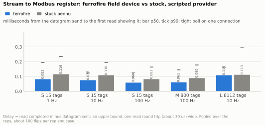
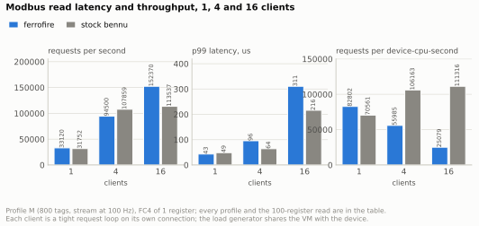
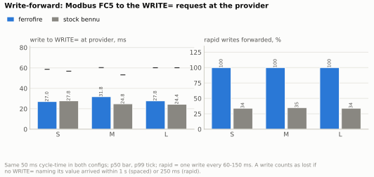
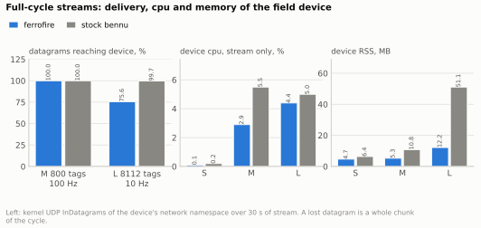
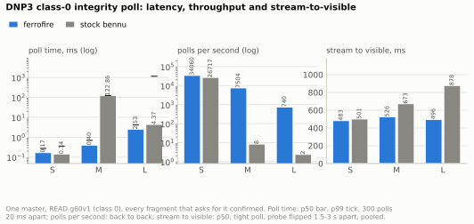

# Field-device microbench: ferrofire field-device vs stock bennu-field-deviced

*Generated by `bench/charts.py` (`make charts`) from the raw runs under [results/fdmicro/](results/fdmicro/); every table below is computed from those files and saved as a CSV next to its SVG in [docs/img/charts/](../img/charts/).
Harness, phases and how to rerun: [bench/fdmicro/README.md](../../bench/fdmicro/README.md).*

The control-latency bench ([control-latency.md](control-latency.md)) pairs ferrofire's provider with ferrofire's field devices and stock's with stock's, so it cannot say how much of a difference is the field device. This
bench removes the provider: **one scripted provider process** (the same bytes for both devices) feeds the datagram stream and answers every `WRITE=` with `ACK=`, and **the same config file** (points, Modbus map, DNP3 map) is
loaded by `ferrofire field-device` and by stock `bennu-field-deviced` (bennu 6.0.0 from the phenix-waterway-range overlay image). Everything runs on Docker Desktop's Linux VM (18 vCPU, 7.7 GB; an Apple Silicon Mac), device and
harness in separate containers on one bridge network, 3 reps per cell, the two stacks alternating who runs first.

## What was measured

Three device sizes, **S** 15 tags, **M** 800 tags, **L** 8 112 tags (the size of the full grid model); each is a stream of every tag every cycle, at 10 Hz (S, L) and 100 Hz (M), S also at 1 and 100 Hz. A quarter of the tags are binary
(Modbus discrete inputs, DNP3 binary inputs), the rest analog (input registers scaled 0..1000 onto 0..65535, DNP3 analog inputs); 4 coils and 2 holding registers go out to the provider's REP. `cycle-time` is 50 ms in both configs.

- **The stream**: RADIO-framed UDP to `239.0.0.1:40000` in 1 400-byte chunks (whole points, `_ff.seq/_ff.cyc/_ff.t` trailer, NUL: the framing both devices accept; the cross bench found stock accepts it and ferrofire needs the NUL). Analog values change every
  cycle. The probe point (a discrete input) flips every 0.3-0.6 s (1-2 s at 1 Hz; 1.5-3 s for DNP3) on a jittered schedule, so a flip never lines up with a period inside the device. **Each datagram begins with a counter point `cntK:<cycle>`**
  (K = the datagram's index in its cycle): the counters are input registers whose value is the integer sent, so a counter that skips is a chunk whose value was never visible.
- **One process, one clock**: the harness (`fdmicro`) sends the stream, answers the REP, runs the Modbus and DNP3 clients and timestamps everything with CLOCK_MONOTONIC; it shares the device's PID namespace, so device cpu, RSS and the UDP counters of the
  device's network namespace (`InDatagrams`, `RcvbufErrors`) are read from `/proc` of the device itself.
- **Stream to register**: the time from the send of the datagram that carries a probe flip to the end of the first Modbus read that shows it. The poll is a tight FC2 loop on one connection (about 33 000 reads a second), so the delay is an upper bound
  one read round trip (about 30 us) wide.
- **Read latency, throughput**: 1, 4 and 16 clients in tight FC4 loops on their own connections for 5 s, reading 1 register and 100 registers.
- **Write-forward**: Modbus FC5 on a coil, from just before the write is sent to the arrival of the `WRITE=` at the REP (stamped inside the handler). Spaced: 60 writes 1.2 s or more apart (each at a random phase of an idle device). Rapid: 100 writes 60-150 ms apart.
- **Drops**: 30 s of the profile's stream while one client reads every counter in a tight loop; then the stream stops and every register is compared with what the last cycle sent. Three independent counts: datagrams the kernel delivered to the device vs sent,
  counters that skipped a number, registers wrong at the end.
- **DNP3**: the same configs with a `dnp3-server` instead of the `modbus-server`; one master, class-0 integrity poll (READ g60v1), every fragment that asks for it confirmed. Latency (300 polls 20 ms apart), back-to-back polls, stream to visible.
- **CPU and RSS** are the device process's (`utime+stime` of every process of the device, VmRSS/VmHWM) over each phase's window; "idle" has no stream and no client, "stream" has the profile's stream and no client. Cpu is in percent of one core.

Deviations from a like-for-like setup, stated once: (1) the harness's REP is ferrofire's own `transport::serve` (the zeromq crate) for both devices: both talk to it, but stock's libzmq REQ and ferrofire's zeromq REQ are what they are. (2) The datagrams use ferrofire datagram
v1 framing (trailer, NUL), not stock's exact bytes; stock ignores the trailer and accepts the NUL. (3) The Modbus and DNP3 configs are separate files (one protocol per device), the same for both stacks. (4) The load generator shares the VM with the device (16 tight clients
use several cores of the 18). (5) Contention: no other `ff-rust`, cargo or mutator container ran at any run's start (`other_containers_start none` in all 36 `env.txt`), but other sessions' `ff-buildroot` containers did run at times and the host's 1-minute load average at run start
was 3.3 to 6.8 on 18 vCPU (`host_load_start`), so absolute numbers carry some host noise; the rep-to-rep spreads below show how much. (6) The harness source was committed after the runs (every `env.txt` says `dirty True`); the DNP3 runs use the master of this commit
(an earlier version stopped at the first fragment of a multi-fragment response and its DNP3 runs were discarded and redone). The harness has since gained a `counter skips by datagram index` diagnostic line that the `driver.log` files of these runs do not have; section 4's finding about it comes from a separate stock L run with that line (not in the raw results).

## 1. Stream to register

How long after a datagram leaves the provider is its value visible in a Modbus register. p50 bar and p99 tick, milliseconds; pooled over the 3 reps, 90-300 flips per cell.

| case | device | reps | flips | missed | p50 ms | p95 ms | p99 ms | max ms |
|---|---|---|---|---|---|---|---|---|
| S 15 tags, 1 Hz | ferrofire | 3 | 90 | 0 | 0.083 | 0.108 | 0.194 | 0.194 |
| S 15 tags, 1 Hz | stock bennu | 3 | 90 | 0 | 0.116 | 0.147 | 0.235 | 0.235 |
| S 15 tags, 10 Hz | ferrofire | 3 | 300 | 0 | 0.076 | 0.104 | 0.123 | 0.151 |
| S 15 tags, 10 Hz | stock bennu | 3 | 300 | 0 | 0.110 | 0.140 | 0.193 | 0.292 |
| S 15 tags, 100 Hz | ferrofire | 3 | 300 | 0 | 0.060 | 0.088 | 0.129 | 0.148 |
| S 15 tags, 100 Hz | stock bennu | 3 | 300 | 0 | 0.083 | 0.112 | 0.164 | 0.227 |
| M 800 tags, 100 Hz | ferrofire | 3 | 300 | 0 | 0.061 | 0.095 | 0.144 | 0.234 |
| M 800 tags, 100 Hz | stock bennu | 3 | 300 | 0 | 0.090 | 0.130 | 0.178 | 0.301 |
| L 8112 tags, 10 Hz | ferrofire | 3 | 300 | 0 | 0.110 | 0.138 | 0.163 | 0.179 |
| L 8112 tags, 10 Hz | stock bennu | 3 | 300 | 0 | 0.113 | 0.178 | 0.294 | 1.326 |

Both devices make a value visible within about a tenth of a millisecond of the datagram leaving, at every size and rate: neither waits for its 50 ms cycle to expose input. Ferrofire is 0.02-0.03 ms faster at p50 on S and M (0.076 vs 0.110 ms at 10 Hz, 0.061 vs 0.090
ms for M), about the width of one read, and equal at L (0.110 vs 0.113 ms; stock's p99 0.294 ms and a 1.3 ms worst case against ferrofire's 0.163 ms). The reps agree within a few microseconds (S 10 Hz p50 0.075-0.077 ms ferrofire, 0.107-0.114 ms stock). No flip was missed. Whatever
makes a ferrofire provider stack faster than the stock one is not the field device's input path: this is the stage the control-latency bench's stage table put at 1-2 ms including the SCADA's 2 ms poll.

## 2. Modbus read latency and throughput, 1, 4 and 16 clients

| profile | request | clients | device | reps | req/s | p50 us | p95 us | p99 us | errors | clients served | device cpu % | req per device-cpu-s |
|---|---|---|---|---|---|---|---|---|---|---|---|---|
| S | FC4 x 1 | 1 | ferrofire | 3 | 33 758 | 28.8 | 36.9 | 42.0 | 0 | 1 | 38.8 | 87 007 |
| S | FC4 x 1 | 1 | stock bennu | 3 | 31 307 | 31.0 | 39.8 | 44.5 | 0 | 1 | 42.0 | 74 541 |
| S | FC4 x 1 | 4 | ferrofire | 3 | 98 604 | 38.3 | 63.9 | 84.4 | 0 | 4 | 169.6 | 58 141 |
| S | FC4 x 1 | 4 | stock bennu | 3 | 111 414 | 35.1 | 40.5 | 50.4 | 0 | 4 | 99.8 | 111 639 |
| S | FC4 x 1 | 16 | ferrofire | 3 | 153 865 | 90.8 | 215.6 | 310.0 | 0 | 16 | 609.8 | 25 234 |
| S | FC4 x 1 | 16 | stock bennu | 3 | 118 495 | 132.2 | 155.8 | 180.4 | 0 | 16 | 100.0 | 118 502 |
| S | FC4 x 10 | 1 | ferrofire | 3 | 33 272 | 29.0 | 37.8 | 42.7 | 0 | 1 | 39.8 | 83 600 |
| S | FC4 x 10 | 1 | stock bennu | 3 | 30 644 | 31.8 | 40.5 | 45.1 | 0 | 1 | 43.4 | 70 608 |
| S | FC4 x 10 | 4 | ferrofire | 3 | 97 382 | 38.7 | 65.0 | 86.4 | 0 | 4 | 174.2 | 55 904 |
| S | FC4 x 10 | 4 | stock bennu | 3 | 104 819 | 37.4 | 43.0 | 52.0 | 0 | 4 | 100.0 | 104 821 |
| S | FC4 x 10 | 16 | ferrofire | 3 | 146 122 | 94.8 | 230.2 | 330.7 | 0 | 16 | 604.5 | 24 171 |
| S | FC4 x 10 | 16 | stock bennu | 3 | 109 764 | 142.9 | 164.2 | 193.1 | 0 | 16 | 100.0 | 109 774 |
| M | FC4 x 1 | 1 | ferrofire | 3 | 33 120 | 29.2 | 37.6 | 43.2 | 0 | 1 | 40.0 | 82 802 |
| M | FC4 x 1 | 1 | stock bennu | 3 | 31 752 | 30.0 | 40.3 | 48.6 | 0 | 1 | 45.0 | 70 561 |
| M | FC4 x 1 | 4 | ferrofire | 3 | 94 500 | 39.4 | 70.7 | 95.6 | 0 | 4 | 168.8 | 55 985 |
| M | FC4 x 1 | 4 | stock bennu | 3 | 107 859 | 35.8 | 43.9 | 64.2 | 0 | 4 | 101.6 | 106 163 |
| M | FC4 x 1 | 16 | ferrofire | 3 | 152 370 | 91.7 | 217.2 | 310.9 | 0 | 16 | 607.6 | 25 079 |
| M | FC4 x 1 | 16 | stock bennu | 3 | 113 537 | 135.7 | 172.3 | 216.2 | 0 | 16 | 102.0 | 111 316 |
| M | FC4 x 100 | 1 | ferrofire | 3 | 28 114 | 35.0 | 44.3 | 50.7 | 0 | 1 | 49.4 | 56 913 |
| M | FC4 x 100 | 1 | stock bennu | 3 | 20 363 | 48.1 | 59.8 | 72.0 | 0 | 1 | 63.6 | 32 018 |
| M | FC4 x 100 | 4 | ferrofire | 3 | 84 232 | 44.0 | 75.3 | 103.3 | 0 | 4 | 203.8 | 41 332 |
| M | FC4 x 100 | 4 | stock bennu | 3 | 45 600 | 85.3 | 98.7 | 155.8 | 0 | 4 | 103.0 | 44 273 |
| M | FC4 x 100 | 16 | ferrofire | 3 | 73 069 | 189.3 | 466.2 | 623.5 | 0 | 16 | 814.9 | 8 966 |
| M | FC4 x 100 | 16 | stock bennu | 3 | 45 126 | 347.5 | 410.0 | 491.8 | 0 | 16 | 103.0 | 43 817 |
| L | FC4 x 1 | 1 | ferrofire | 3 | 33 520 | 28.8 | 37.8 | 43.8 | 0 | 1 | 40.6 | 82 564 |
| L | FC4 x 1 | 1 | stock bennu | 3 | 31 027 | 30.9 | 40.7 | 46.2 | 0 | 1 | 44.8 | 69 257 |
| L | FC4 x 1 | 4 | ferrofire | 3 | 96 641 | 39.0 | 66.0 | 86.3 | 0 | 4 | 172.2 | 56 123 |
| L | FC4 x 1 | 4 | stock bennu | 3 | 109 532 | 35.4 | 42.3 | 52.2 | 0 | 4 | 101.8 | 107 597 |
| L | FC4 x 1 | 16 | ferrofire | 3 | 151 611 | 92.0 | 218.3 | 312.7 | 0 | 16 | 604.8 | 25 069 |
| L | FC4 x 1 | 16 | stock bennu | 3 | 112 954 | 135.2 | 169.2 | 226.1 | 0 | 16 | 102.0 | 110 747 |
| L | FC4 x 100 | 1 | ferrofire | 3 | 27 080 | 36.0 | 47.1 | 53.8 | 0 | 1 | 52.6 | 51 483 |
| L | FC4 x 100 | 1 | stock bennu | 3 | 16 076 | 58.7 | 77.7 | 91.5 | 0 | 1 | 71.2 | 22 579 |
| L | FC4 x 100 | 4 | ferrofire | 3 | 77 570 | 47.6 | 84.0 | 110.2 | 0 | 4 | 220.4 | 35 196 |
| L | FC4 x 100 | 4 | stock bennu | 3 | 33 007 | 118.8 | 134.0 | 214.0 | 0 | 4 | 102.6 | 32 172 |
| L | FC4 x 100 | 16 | ferrofire | 3 | 54 961 | 261.1 | 600.6 | 798.0 | 0 | 16 | 859.9 | 6 392 |
| L | FC4 x 100 | 16 | stock bennu | 3 | 32 270 | 489.5 | 542.8 | 794.8 | 0 | 16 | 102.6 | 31 455 |

Single client, one register: the devices are level (33 120 vs 31 752 requests a second on M, p50 29 vs 30 us, p99 43 vs 49 us). **At 4 clients stock is ahead** on small reads: 107 859 requests a second against ferrofire's 94 500 (p99 64 vs 96 us). At 16 clients ferrofire is
ahead on throughput (152 370 vs 113 537 requests a second) and behind on tail latency (p99 311 vs 216 us), because stock serves every client from one thread (its cpu stays at 100% of a core at 4 and 16 clients) and ferrofire spreads them over several cores (170% and 600%).
**Per unit of cpu stock wins every case from 4 clients up**: at 16 clients ferrofire spends 25 079 requests per device-cpu-second, stock 111 316 (4.4 times as much work done per cpu-second), at 4 clients 55 985 vs 106 163; only at 1 client is ferrofire cheaper per request (82 802 vs 70 561).
Large reads (100 registers) go the other way: ferrofire 28 114 vs 20 363 requests a second at 1 client, 84 232 vs 45 600 at 4, 73 069 vs 45 126 at 16 (p99 624 vs 492 us at 16: more throughput, a longer tail), and the per-request cost is not much different between the stacks (per device-cpu-second 41 332 vs 44 273 at 4 clients).
The profile size does not move the one-register numbers; on L the 100-register read widens ferrofire's lead (27 080 vs 16 076 requests a second at 1 client). No read failed and every client was served at 16 clients on both devices. The reps agree within about 5% (M, 16 clients, one register: ferrofire 150 779-152 870, stock 111 948-116 102), except ferrofire at 4 clients (87 494-96 072).

## 3. Write-forward: Modbus write to the WRITE= at the provider

| profile | device | reps | spaced p50 ms | p95 ms | p99 ms | spaced lost of 60 | rapid lost of 100 | rapid p50 ms | write ack p50 us |
|---|---|---|---|---|---|---|---|---|---|
| S | ferrofire | 3 | 27.0 | 51.5 | 58.7 | 0 | 0 | 23.4 | 309.5 |
| S | stock bennu | 3 | 27.8 | 51.1 | 56.9 | 0 | 66 | 28.6 | 369.7 |
| M | ferrofire | 3 | 31.8 | 56.5 | 60.4 | 0 | 0 | 25.0 | 298.2 |
| M | stock bennu | 3 | 24.8 | 49.4 | 53.2 | 0 | 65 | 27.9 | 238.3 |
| L | ferrofire | 3 | 27.8 | 53.7 | 60.2 | 0 | 0 | 28.1 | 301.5 |
| L | stock bennu | 3 | 24.4 | 58.3 | 60.2 | 0 | 66 | 25.2 | 302.8 |

With writes spaced out the devices are the same: a write reaches the provider 24-32 ms at p50 and 53-60 ms at p99 after it was sent, the scan cycle (`cycle-time` 50 ms) plus nothing measurable; none was lost. The Modbus reply itself takes 0.2-0.4 ms. **Written in quick succession
(every 60-150 ms) stock forwards about a third of them**: 64-66 of 100 writes never produced a `WRITE=` naming their value within 250 ms, in every rep and on every size; ferrofire forwarded all 100 each time. The writes that stock forwards at that rate are not late (p50 25-29 ms). This looks like
stock coalescing a coil that changes again before the previous value has gone out (its update map holds one value per tag) and is consistent with the control bench's burst losses. An ad hoc check outside the harness (a Python REP, not in the raw results) saw the same at 250 ms spacing, and at 2.5 s spacing every write went through, 5-53 ms after it was sent.
Which stock path drops them (the Modbus server's update map, or the output module's scan) was not traced.

## 4. Full-cycle streams: delivery, drops, cpu and memory

L is 130 datagrams per cycle, all sent back to back (as a provider does), 10 times a second; M is 13 datagrams, 100 times a second.

| case | device | reps | datagrams sent | reached the device | lost % | RcvbufErrors | sender drops | cycles never visible % | registers wrong at the end % |
|---|---|---|---|---|---|---|---|---|---|
| M 800 tags, 100 Hz | ferrofire | 3 | 117 039 | 117 000 | 0.0 | 0 | 0 | 0.0 | 0.0 |
| M 800 tags, 100 Hz | stock bennu | 3 | 117 039 | 117 000 | 0.0 | 0 | 0 | 0.0 | 0.0 |
| L 8112 tags, 10 Hz | ferrofire | 3 | 116 488 | 88 040 | 24.4 | 28 060 | 0 | 24.1 | 17.6 |
| L 8112 tags, 10 Hz | stock bennu | 3 | 116 484 | 116 100 | 0.3 | 0 | 0 | 0.8 | 0.0 |

**Ferrofire's field device loses a quarter of an 8 112-tag stream and stock does not.** On L at 10 Hz the kernel delivered 88 040 of 116 488 datagrams to ferrofire (24.4% lost, 24.2-24.6% in each rep; `RcvbufErrors` 28 060 of the 28 448 missing), so a quarter of the cycles' counters
were never visible (24.1%) and 17.6% of the 8 081 registers checked after the stream stopped were wrong (stale by one or more cycles). Stock received 116 100 of 116 484. M at 100 Hz lost nothing on either device, and neither lost anything at S. The loss is the receive queue overflowing during the burst: the
130 datagrams of a cycle arrive faster than ferrofire's receive thread parses them and the socket's default buffer holds about 100. Ferrofire sets no `SO_RCVBUF` on its input socket and a larger buffer would likely remove it; that was not tried here (follow-up bead). The stream-only and loaded
windows show the same loss (3 150-3 390 `RcvbufErrors` in each 10 s stream-only window; 1 460-1 740 in the DNP3 stream-only window).

Stock has its own, much smaller gap, not visible in the kernel counters: on L, the counters of the **last two datagrams of every second cycle** (indices 128 and 129 of 130) never became visible (the counters step by 2) although the kernel delivered those datagrams; 2 of the 8 081 registers were wrong at the end in every rep. That is
0.8% of the counters (the value of one point per datagram, not a chunk of tags); the other tags in those two datagrams were right at the end of all three reps but were not checked cycle by cycle. A direct read of the registers (counters 124-131 every 40 ms) confirmed it. A batch limit of 128 datagrams per scan would explain it; not traced.

**Cpu and memory**: ferrofire is smaller everywhere: idle RSS 4.0 / 4.5 / 10.5 MB (S / M / L) against stock's 6.3 / 10.5 / 50.7 MB; under the stream 4.7 / 5.3 / 12.2 MB against 6.4 / 10.8 / 51.1 MB. Cpu with the stream and no client: 0.1 / 2.9 / 4.4% against 0.2 / 5.5 / 5.0%
(M at 100 Hz: ferrofire half stock's cost; L: level, and ferrofire's number is for a device that lost a quarter of the datagrams). Over a whole run (including the 16-client reads) ferrofire's peak RSS reaches 30 MB on L, stock's stays at 51 MB. Idle cpu is a rounding error on both Modbus devices (0.0-0.6%); with the DNP3 server loaded stock idles at 3.0% cpu and 47 MB on L (its 1 Hz rewrite of 8 112 points) against ferrofire's 0.4% and 11 MB.

| profile | device | reps | idle RSS MB | stream RSS MB | peak RSS MB | idle cpu % | stream cpu % | stream + 1 tight reader cpu % | 4 readers cpu % | 16 readers cpu % |
|---|---|---|---|---|---|---|---|---|---|---|
| S | ferrofire | 3 | 4.0 | 4.7 | 6.6 | 0.1 | 0.1 | 38.4 | 169.6 | 609.8 |
| S | stock bennu | 3 | 6.3 | 6.4 | 6.7 | 0.1 | 0.2 | 42.2 | 99.8 | 100.0 |
| M | ferrofire | 3 | 4.5 | 5.3 | 8.6 | 0.1 | 2.9 | 40.2 | 168.8 | 607.6 |
| M | stock bennu | 3 | 10.5 | 10.8 | 11.1 | 0.2 | 5.5 | 44.6 | 101.6 | 102.0 |
| L | ferrofire | 3 | 10.5 | 12.2 | 30.0 | 0.0 | 4.4 | 40.6 | 172.2 | 604.8 |
| L | stock bennu | 3 | 50.7 | 51.1 | 51.4 | 0.6 | 5.0 | 44.8 | 101.8 | 102.0 |

## 5. DNP3 class-0 poll

| profile | device | reps | response bytes | poll p50 ms | p95 ms | p99 ms | back-to-back polls/s | cpu % while polling | idle RSS MB | stream RSS MB | idle cpu % | stream cpu % | stream-to-visible p50 ms | p95 ms | max ms | flips never seen |
|---|---|---|---|---|---|---|---|---|---|---|---|---|---|---|---|---|
| S | ferrofire | 3 | 167 | 0.169 | 0.243 | 0.275 | 34 060 | 40.4 | 4 | 5 | 0.2 | 0.2 | 483 | 974 | 983 | 0 |
| S | stock bennu | 3 | 167 | 0.144 | 0.288 | 0.361 | 26 717 | 73.8 | 8 | 8 | 0.2 | 0.2 | 501 | 995 | 999 | 0 |
| M | ferrofire | 3 | 6 716 | 0.399 | 0.634 | 0.697 | 7 504 | 60.2 | 5 | 6 | 0.4 | 2.8 | 526 | 937 | 974 | 0 |
| M | stock bennu | 3 | 6 716 | 122.859 | 123.804 | 124.185 | 8 | 6.1 | 12 | 12 | 0.4 | 5.6 | 673 | 1 101 | 1 201 | 0 |
| L | ferrofire | 3 | 67 646 | 2.527 | 3.657 | 4.118 | 740 | 56.0 | 11 | 14 | 0.4 | 5.0 | 496 | 982 | 997 | 0 |
| L | stock bennu | 3 | 67 646 | 4.366 | 85.804 | 1149.653 | 2 | 8.7 | 47 | 47 | 3.0 | 7.8 | 878 | 2 760 | 2 960 | 0 |

**Small device: level** (S, 167-byte response: p50 0.169 ms ferrofire, 0.144 ms stock, **stock ahead at p50**; 34 060 vs 26 717 polls a second back to back, ferrofire ahead there). **Large device: ferrofire is far ahead.** On M (6 716 bytes, several fragments) a stock poll
takes 123 ms at p50 against ferrofire's 0.40 ms (8 polls a second vs 7 504), the same in every rep: a constant 123 ms looks like three 40 ms stalls, a delayed-ACK pattern between the master's small confirm and the outstation's next write, which is how a standard master sees the stock outstation; a master that
acknowledges at once may see less (not tried). On L (67 646 bytes) stock's p50 was 3.1, 4.4 and 1 148 ms in the three reps with a p99 of about 1.1 s in each: its once-a-second refresh of every point (spec 4.2: "a 1 Hz thread rewrites every point") blocks polls for most of a second at 8 112 points, so back-to-back polls reached 7, 2 and 1 a second;
ferrofire polled the same response at 740 a second (p50 2.5 ms, p99 4.1 ms).
Stream to DNP3-visible is **about half a second at p50 and about a second at p95 on both** (p50 S 483 vs 501 ms, M 526 vs 673, L 496 vs 878 ms; p95 on stock L is 2.8 s because its polls are blocked): both refresh the outstation's database once a second (ferrofire copies stock's 1 Hz refresh), so for
values Modbus is where the field-device difference shows. Ferrofire also lost datagrams while serving L polls (1 450-1 530 `RcvbufErrors` in the back-to-back phase), stock none.

## Where stock wins, where ferrofire wins

Stock wins: delivery of an 8 112-tag stream at 10 Hz (0.3% lost against 24.4%); the cost of a Modbus request once there is more than one client (about 4 times as many requests per cpu-second at 16 clients, and higher throughput at 4 clients on small reads, with a shorter p99 at 4 and 16 clients);
a DNP3 class-0 poll on the smallest device (p50 0.144 vs 0.169 ms). Ferrofire wins: memory (a fifth of stock's RSS on L: 12 vs 51 MB under the stream); throughput at 16 clients and on large reads; forwarding every write of a quick sequence (stock lost 64-66 of 100); DNP3 class-0 polls on devices of 800 tags and up
(300 times faster at M, 370 times more polls a second at L); about 0.02-0.03 ms on stream to register on small devices. Level: stream to register at L, a spaced write-forward (bounded by the 50 ms cycle in both), the DNP3 refresh period, idle cpu.

## What the numbers do not say

- One scripted provider at fixed rates is not a power solver: real cycles carry changed points only (ferrofire provider) or the whole model once a second (stock); the 8 112-tag burst of 130 back-to-back datagrams is the worst case, and a real per-RTU slice is small. The loss is reproducible but only at that burst size.
- Latencies are for a device on an idle bridge with a client in the same VM; they measure the devices' software, not a network.
- Each device carries one protocol server here; a device serving Modbus and DNP3 together was not measured.
- Three reps per cell. S, M and L were run in order within a rep, so a host drift would hit the stacks alike but sizes unequally; the reps agree within a few percent except where stated (stock DNP3 on L, bimodal).
- The cause of stock's quick-write coalescing, of its two missing counters per second cycle and of its constant 123 ms DNP3 poll on M were observed, not traced in the stock source.
