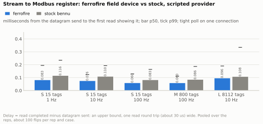
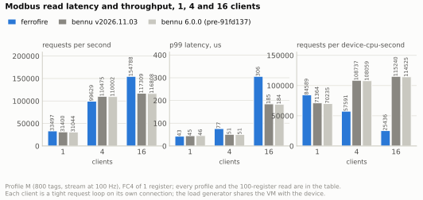
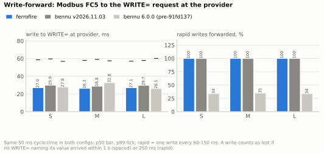
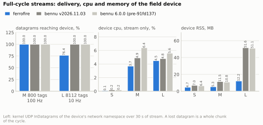
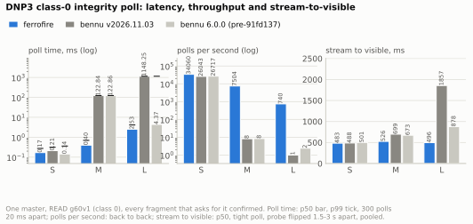

# Field-device microbench: ferrofire field-device vs stock bennu-field-deviced (v2026.11.03, and 6.0.0 for history)

*Generated by `bench/charts.py` (`make charts`) from the raw runs under [results/fdmicro/](results/fdmicro/); every table below is computed from those files and saved as a CSV next to its SVG in [docs/img/charts/](../img/charts/).
Harness, phases and how to rerun: [bench/fdmicro/README.md](../../bench/fdmicro/README.md).*

The control-latency bench ([control-latency.md](control-latency.md)) pairs ferrofire's provider with ferrofire's field devices and stock's with stock's, so it cannot say how much of a difference is the field device. This
bench removes the provider: **one scripted provider process** (the same bytes for both devices) feeds the datagram stream and answers every `WRITE=` with `ACK=`, and **the same config file** (points, Modbus map, DNP3 map) is
loaded by `ferrofire field-device` and by stock `bennu-field-deviced` in two versions: **bennu v2026.11.03** (built from the sceptre-bennu release tag, `bench/stock_image.sh`; the current stock and the main comparison) and **bennu 6.0.0 (pre-91fd137)** (the phenix-waterway-range overlay image of every earlier run; before the upstream batched-write fix 91fd137, which is in v2026.11.03). That fix matters for the write-forward results (section 3) and for nothing else here: the two versions agree within run-to-run noise in every other table. Everything runs on Docker Desktop's Linux VM (18 vCPU, 7.7 GB; an Apple Silicon Mac), device and
harness in separate containers on one bridge network, 3 reps per cell, the stacks alternating who runs first (bennu v2026.11.03 was run in a later session than ferrofire and bennu 6.0.0, ww-1df.47, on the same harness and configs).

## What was measured

Three device sizes, **S** 15 tags, **M** 800 tags, **L** 8 112 tags (the size of the full grid model); each is a stream of every tag every cycle, at 10 Hz (S, L) and 100 Hz (M), S also at 1 and 100 Hz. A quarter of the tags are binary
(Modbus discrete inputs, DNP3 binary inputs), the rest analog (input registers scaled 0..1000 onto 0..65535, DNP3 analog inputs); 4 coils and 2 holding registers go out to the provider's REP. `cycle-time` is 50 ms in both configs.

- **The stream**: RADIO-framed UDP to `239.0.0.1:40000` in 1 400-byte chunks (whole points, `_ff.seq/_ff.cyc/_ff.t` trailer, NUL: the framing both devices accept; the cross bench found stock accepts it and ferrofire needs the NUL). Analog values change every
  cycle and **every binary flips every cycle** (true on odd cycles, false on even), so the text of a cycle alternates in length: L is 130 datagrams on even cycles and 128 on odd (M 13, S 1). The probe point (a discrete input) flips every 0.3-0.6 s (1-2 s at 1 Hz; 1.5-3 s for DNP3) on a jittered schedule, so a flip never lines up with a period inside the device. **Each datagram begins with a counter point `cntK:<cycle>`**
  (K = the datagram's index in its cycle): the counters are input registers whose value is the integer sent, so a counter that skips is a chunk whose value was never visible. The drop test uses the counters that exist in every cycle (128 on L).
- **One process, one clock**: the harness (`fdmicro`) sends the stream, answers the REP, runs the Modbus and DNP3 clients and timestamps everything with CLOCK_MONOTONIC; it shares the device's PID namespace, so device cpu, RSS and the UDP counters of the
  device's network namespace (`InDatagrams`, `RcvbufErrors`) are read from `/proc` of the device itself.
- **Stream to register**: the time from the send of the datagram that carries a probe flip to the end of the first Modbus read that shows it. The poll is a tight FC2 loop on one connection (about 33 000 reads a second), so the delay is an upper bound
  one read round trip (about 30 us) wide.
- **Read latency, throughput**: 1, 4 and 16 clients in tight FC4 loops on their own connections for 5 s, reading 1 register and 100 registers.
- **Write-forward**: Modbus FC5 on a coil, from just before the write is sent to the arrival of the `WRITE=` at the REP (stamped inside the handler). Spaced: 60 writes 1.2 s or more apart (each at a random phase of an idle device). Rapid: 100 writes 60-150 ms apart.
- **Drops**: 30 s of the profile's stream while one client reads every counter in a tight loop; then the stream stops and every register is compared with what the last cycle sent. Three independent counts: datagrams the kernel delivered to the device vs sent,
  counters that skipped a number, registers wrong at the end.
- **DNP3**: the same configs with a `dnp3-server` instead of the `modbus-server`; one master, class-0 integrity poll (READ g60v1), every fragment that asks for it confirmed. Latency (300 polls 20 ms apart), back-to-back polls, stream to visible.
- **CPU and RSS** are the device process's (`utime+stime` of every process of the device, VmRSS/VmHWM) over each phase's window; "idle" has no stream and no client, "stream" has the profile's stream and no client. Cpu is in percent of one core.

Deviations from a like-for-like setup, stated once: (1) the harness's REP is ferrofire's own `transport::serve` (the zeromq crate) for both devices: both talk to it, but stock's libzmq REQ and ferrofire's zeromq REQ are what they are. (2) The datagrams use ferrofire datagram
v1 framing (trailer, NUL), not stock's exact bytes; stock ignores the trailer and accepts the NUL. (3) The Modbus and DNP3 configs are separate files (one protocol per device), the same for both stacks. (4) The load generator shares the VM with the device (16 tight clients
use several cores of the 18). (5) Contention: no other `ff-rust`, cargo or mutator container ran at any run's start (`other_containers_start none` in all 54 `env.txt`), but other sessions' `ff-buildroot` containers did run at times and the host's 1-minute load average at run start
was 2.3 to 7.3 on 18 vCPU (`host_load_start`), so absolute numbers carry some host noise; the rep-to-rep spreads below show how much. (6) The harness source was committed after the runs of ferrofire and 6.0.0 (every `env.txt` says `dirty True`; the v2026.11.03 runs say `dirty True` for an uncommitted README edit under `bench/fdmicro`, the harness itself was committed). Two sets of runs were discarded and redone: the DNP3 runs (an earlier master stopped at the first fragment of a multi-fragment response) and the M and L Modbus runs (the first drop-test analysis counted the counters of L's two datagrams that exist only on even cycles as skipped by stock, and read the sent count one cycle late; the first version of this report said stock lost 0.3% of L's datagrams and skipped two counters: both were harness artifacts).

## 1. Stream to register

How long after a datagram leaves the provider is its value visible in a Modbus register. p50 bar and p99 tick, milliseconds; pooled over the 3 reps, 90-300 flips per cell.

| case | device | reps | flips | missed | p50 ms | p95 ms | p99 ms | max ms |
|---|---|---|---|---|---|---|---|---|
| S 15 tags, 1 Hz | ferrofire | 3 | 90 | 0 | 0.083 | 0.108 | 0.194 | 0.194 |
| S 15 tags, 1 Hz | bennu v2026.11.03 | 3 | 90 | 0 | 0.121 | 0.150 | 0.207 | 0.207 |
| S 15 tags, 1 Hz | bennu 6.0.0 (pre-91fd137) | 3 | 90 | 0 | 0.116 | 0.147 | 0.235 | 0.235 |
| S 15 tags, 10 Hz | ferrofire | 3 | 300 | 0 | 0.076 | 0.104 | 0.123 | 0.151 |
| S 15 tags, 10 Hz | bennu v2026.11.03 | 3 | 300 | 0 | 0.108 | 0.141 | 0.172 | 0.266 |
| S 15 tags, 10 Hz | bennu 6.0.0 (pre-91fd137) | 3 | 300 | 0 | 0.110 | 0.140 | 0.193 | 0.292 |
| S 15 tags, 100 Hz | ferrofire | 3 | 300 | 0 | 0.060 | 0.088 | 0.129 | 0.148 |
| S 15 tags, 100 Hz | bennu v2026.11.03 | 3 | 300 | 0 | 0.081 | 0.106 | 0.122 | 0.175 |
| S 15 tags, 100 Hz | bennu 6.0.0 (pre-91fd137) | 3 | 300 | 0 | 0.083 | 0.112 | 0.164 | 0.227 |
| M 800 tags, 100 Hz | ferrofire | 3 | 300 | 0 | 0.060 | 0.084 | 0.112 | 0.148 |
| M 800 tags, 100 Hz | bennu v2026.11.03 | 3 | 300 | 0 | 0.086 | 0.119 | 0.173 | 0.188 |
| M 800 tags, 100 Hz | bennu 6.0.0 (pre-91fd137) | 3 | 300 | 0 | 0.086 | 0.122 | 0.186 | 0.221 |
| L 8112 tags, 10 Hz | ferrofire | 3 | 300 | 0 | 0.096 | 0.133 | 0.190 | 1.158 |
| L 8112 tags, 10 Hz | bennu v2026.11.03 | 3 | 300 | 0 | 0.114 | 0.167 | 0.254 | 0.328 |
| L 8112 tags, 10 Hz | bennu 6.0.0 (pre-91fd137) | 3 | 300 | 0 | 0.108 | 0.159 | 0.334 | 0.890 |

Both devices make a value visible within about a tenth of a millisecond of the datagram leaving, at every size and rate: neither waits for its 50 ms cycle to expose input. Ferrofire is 0.02-0.03 ms faster at p50 on S and M (S at 10 Hz 0.076 vs 0.110 ms, M 0.060 vs 0.086 ms), about the width of one read, and 0.01 ms
faster at L (0.096 vs 0.108 ms), where its p99 is lower (0.190 vs 0.334 ms) but its worst case higher (1.16 vs 0.89 ms). The reps agree within a few microseconds (S 10 Hz p50 0.075-0.077 ms ferrofire, 0.107-0.114 ms stock). Bennu v2026.11.03 is the same as 6.0.0 within a few microseconds at every size (S 10 Hz 0.108 ms, M 0.086 ms, L 0.114 ms; L p99 0.254 ms, worst case 0.328 ms against 6.0.0's 0.334 and 0.890). No flip was missed, and none was a cycle late, although ferrofire's device lost datagrams at L when these runs were made (fixed since, section 4).
Whatever makes a ferrofire provider stack faster than the stock one is not the field device's input path: this is the stage the control-latency bench's stage table put at 1-2 ms including the SCADA's 2 ms poll.

## 2. Modbus read latency and throughput, 1, 4 and 16 clients

| profile | request | clients | device | reps | req/s | p50 us | p95 us | p99 us | errors | clients served | device cpu % | req per device-cpu-s |
|---|---|---|---|---|---|---|---|---|---|---|---|---|
| S | FC4 x 1 | 1 | ferrofire | 3 | 33 758 | 28.8 | 36.9 | 42.0 | 0 | 1 | 38.8 | 87 007 |
| S | FC4 x 1 | 1 | bennu v2026.11.03 | 3 | 31 784 | 30.3 | 39.4 | 44.6 | 0 | 1 | 42.0 | 75 678 |
| S | FC4 x 1 | 1 | bennu 6.0.0 (pre-91fd137) | 3 | 31 307 | 31.0 | 39.8 | 44.5 | 0 | 1 | 42.0 | 74 541 |
| S | FC4 x 1 | 4 | ferrofire | 3 | 98 604 | 38.3 | 63.9 | 84.4 | 0 | 4 | 169.6 | 58 141 |
| S | FC4 x 1 | 4 | bennu v2026.11.03 | 3 | 111 614 | 35.1 | 40.3 | 48.5 | 0 | 4 | 100.0 | 111 616 |
| S | FC4 x 1 | 4 | bennu 6.0.0 (pre-91fd137) | 3 | 111 414 | 35.1 | 40.5 | 50.4 | 0 | 4 | 99.8 | 111 639 |
| S | FC4 x 1 | 16 | ferrofire | 3 | 153 865 | 90.8 | 215.6 | 310.0 | 0 | 16 | 609.8 | 25 234 |
| S | FC4 x 1 | 16 | bennu v2026.11.03 | 3 | 118 541 | 132.1 | 154.9 | 180.0 | 0 | 16 | 100.0 | 118 548 |
| S | FC4 x 1 | 16 | bennu 6.0.0 (pre-91fd137) | 3 | 118 495 | 132.2 | 155.8 | 180.4 | 0 | 16 | 100.0 | 118 502 |
| S | FC4 x 10 | 1 | ferrofire | 3 | 33 272 | 29.0 | 37.8 | 42.7 | 0 | 1 | 39.8 | 83 600 |
| S | FC4 x 10 | 1 | bennu v2026.11.03 | 3 | 31 066 | 31.2 | 40.4 | 45.7 | 0 | 1 | 43.6 | 71 255 |
| S | FC4 x 10 | 1 | bennu 6.0.0 (pre-91fd137) | 3 | 30 644 | 31.8 | 40.5 | 45.1 | 0 | 1 | 43.4 | 70 608 |
| S | FC4 x 10 | 4 | ferrofire | 3 | 97 382 | 38.7 | 65.0 | 86.4 | 0 | 4 | 174.2 | 55 904 |
| S | FC4 x 10 | 4 | bennu v2026.11.03 | 3 | 105 011 | 37.4 | 43.0 | 50.7 | 0 | 4 | 100.0 | 105 014 |
| S | FC4 x 10 | 4 | bennu 6.0.0 (pre-91fd137) | 3 | 104 819 | 37.4 | 43.0 | 52.0 | 0 | 4 | 100.0 | 104 821 |
| S | FC4 x 10 | 16 | ferrofire | 3 | 146 122 | 94.8 | 230.2 | 330.7 | 0 | 16 | 604.5 | 24 171 |
| S | FC4 x 10 | 16 | bennu v2026.11.03 | 3 | 110 362 | 142.7 | 161.4 | 188.1 | 0 | 16 | 100.0 | 110 369 |
| S | FC4 x 10 | 16 | bennu 6.0.0 (pre-91fd137) | 3 | 109 764 | 142.9 | 164.2 | 193.1 | 0 | 16 | 100.0 | 109 774 |
| M | FC4 x 1 | 1 | ferrofire | 3 | 33 497 | 28.8 | 37.6 | 42.9 | 0 | 1 | 39.6 | 84 589 |
| M | FC4 x 1 | 1 | bennu v2026.11.03 | 3 | 31 400 | 30.7 | 40.0 | 45.0 | 0 | 1 | 44.0 | 71 364 |
| M | FC4 x 1 | 1 | bennu 6.0.0 (pre-91fd137) | 3 | 31 044 | 31.1 | 40.6 | 45.8 | 0 | 1 | 44.2 | 70 235 |
| M | FC4 x 1 | 4 | ferrofire | 3 | 99 629 | 38.1 | 61.7 | 76.5 | 0 | 4 | 173.0 | 57 591 |
| M | FC4 x 1 | 4 | bennu v2026.11.03 | 3 | 110 475 | 35.3 | 41.0 | 51.3 | 0 | 4 | 101.6 | 108 737 |
| M | FC4 x 1 | 4 | bennu 6.0.0 (pre-91fd137) | 3 | 110 002 | 35.4 | 41.2 | 50.8 | 0 | 4 | 101.8 | 108 059 |
| M | FC4 x 1 | 16 | ferrofire | 3 | 154 788 | 90.2 | 213.2 | 306.1 | 0 | 16 | 608.5 | 25 436 |
| M | FC4 x 1 | 16 | bennu v2026.11.03 | 3 | 117 309 | 133.0 | 158.0 | 185.1 | 0 | 16 | 101.8 | 115 240 |
| M | FC4 x 1 | 16 | bennu 6.0.0 (pre-91fd137) | 3 | 116 808 | 133.6 | 157.7 | 183.8 | 0 | 16 | 102.0 | 114 525 |
| M | FC4 x 100 | 1 | ferrofire | 3 | 27 936 | 35.1 | 44.6 | 50.0 | 0 | 1 | 48.8 | 57 246 |
| M | FC4 x 100 | 1 | bennu v2026.11.03 | 3 | 20 303 | 47.9 | 59.0 | 74.1 | 0 | 1 | 63.4 | 32 025 |
| M | FC4 x 100 | 1 | bennu 6.0.0 (pre-91fd137) | 3 | 20 055 | 48.8 | 59.8 | 71.1 | 0 | 1 | 63.6 | 31 533 |
| M | FC4 x 100 | 4 | ferrofire | 3 | 86 895 | 43.2 | 70.1 | 88.3 | 0 | 4 | 207.8 | 41 818 |
| M | FC4 x 100 | 4 | bennu v2026.11.03 | 3 | 46 342 | 83.9 | 95.4 | 153.1 | 0 | 4 | 102.8 | 45 081 |
| M | FC4 x 100 | 4 | bennu 6.0.0 (pre-91fd137) | 3 | 46 336 | 83.7 | 96.8 | 150.8 | 0 | 4 | 103.0 | 44 988 |
| M | FC4 x 100 | 16 | ferrofire | 3 | 73 508 | 187.1 | 466.0 | 623.9 | 0 | 16 | 813.3 | 9 038 |
| M | FC4 x 100 | 16 | bennu v2026.11.03 | 3 | 45 955 | 341.4 | 396.1 | 492.7 | 0 | 16 | 102.8 | 44 708 |
| M | FC4 x 100 | 16 | bennu 6.0.0 (pre-91fd137) | 3 | 45 718 | 342.1 | 395.9 | 492.3 | 0 | 16 | 103.0 | 44 392 |
| L | FC4 x 1 | 1 | ferrofire | 3 | 33 339 | 28.8 | 37.2 | 43.1 | 0 | 1 | 40.0 | 83 348 |
| L | FC4 x 1 | 1 | bennu v2026.11.03 | 3 | 31 043 | 31.1 | 40.6 | 46.4 | 0 | 1 | 44.6 | 69 605 |
| L | FC4 x 1 | 1 | bennu 6.0.0 (pre-91fd137) | 3 | 30 594 | 31.7 | 40.8 | 46.1 | 0 | 1 | 44.6 | 68 598 |
| L | FC4 x 1 | 4 | ferrofire | 3 | 100 093 | 38.0 | 61.2 | 77.3 | 0 | 4 | 173.0 | 57 858 |
| L | FC4 x 1 | 4 | bennu v2026.11.03 | 3 | 110 279 | 35.3 | 41.0 | 51.6 | 0 | 4 | 101.8 | 108 331 |
| L | FC4 x 1 | 4 | bennu 6.0.0 (pre-91fd137) | 3 | 110 319 | 35.4 | 41.0 | 49.5 | 0 | 4 | 101.8 | 108 370 |
| L | FC4 x 1 | 16 | ferrofire | 3 | 153 117 | 91.1 | 215.8 | 310.5 | 0 | 16 | 612.3 | 25 006 |
| L | FC4 x 1 | 16 | bennu v2026.11.03 | 3 | 117 306 | 133.2 | 157.5 | 186.3 | 0 | 16 | 101.8 | 115 241 |
| L | FC4 x 1 | 16 | bennu 6.0.0 (pre-91fd137) | 3 | 116 202 | 134.5 | 155.1 | 182.3 | 0 | 16 | 101.8 | 114 154 |
| L | FC4 x 100 | 1 | ferrofire | 3 | 26 884 | 36.1 | 47.5 | 52.6 | 0 | 1 | 51.2 | 52 508 |
| L | FC4 x 100 | 1 | bennu v2026.11.03 | 3 | 15 527 | 60.5 | 80.7 | 96.1 | 0 | 1 | 71.8 | 21 626 |
| L | FC4 x 100 | 1 | bennu 6.0.0 (pre-91fd137) | 3 | 15 681 | 61.1 | 77.8 | 90.0 | 0 | 1 | 71.0 | 22 086 |
| L | FC4 x 100 | 4 | ferrofire | 3 | 78 605 | 47.3 | 80.7 | 100.6 | 0 | 4 | 224.4 | 35 030 |
| L | FC4 x 100 | 4 | bennu v2026.11.03 | 3 | 31 733 | 123.9 | 138.9 | 209.3 | 0 | 4 | 102.6 | 30 929 |
| L | FC4 x 100 | 4 | bennu 6.0.0 (pre-91fd137) | 3 | 31 700 | 124.2 | 142.9 | 191.2 | 0 | 4 | 102.6 | 30 897 |
| L | FC4 x 100 | 16 | ferrofire | 3 | 54 867 | 261.2 | 596.2 | 794.0 | 0 | 16 | 862.7 | 6 360 |
| L | FC4 x 100 | 16 | bennu v2026.11.03 | 3 | 31 781 | 496.5 | 551.5 | 811.6 | 0 | 16 | 102.6 | 30 979 |
| L | FC4 x 100 | 16 | bennu 6.0.0 (pre-91fd137) | 3 | 31 547 | 500.1 | 559.0 | 760.3 | 0 | 16 | 102.6 | 30 750 |

Single client, one register: the devices are level (33 497 vs 31 400 requests a second on M for v2026.11.03, 31 044 for 6.0.0; p50 28.8 vs 30.7 us, p99 43 vs 45 us). **At 4 clients stock is ahead** on small reads: 110 475 requests a second against ferrofire's 99 629 (p99 51 vs 77 us). At 16 clients ferrofire is
ahead on throughput (154 788 vs 117 309 requests a second) and behind on tail latency (p99 306 vs 185 us), because stock serves every client from one thread (its cpu stays at about 100% of a core at 4 and 16 clients) and ferrofire spreads them over several cores (173% and 609%).
**Per unit of cpu stock wins every case from 4 clients up**: at 16 clients ferrofire spends 25 436 requests per device-cpu-second, bennu v2026.11.03 115 240 (4.5 times as much work done per cpu-second), at 4 clients 57 591 vs 108 737; only at 1 client is ferrofire cheaper per request (84 589 vs 71 364).
Large reads (100 registers) go the other way: ferrofire 27 936 vs 20 303 requests a second at 1 client, 86 895 vs 46 342 at 4, 73 508 vs 45 955 at 16 (p99 624 vs 493 us at 16: more throughput, a longer tail), and the per-request cost is close (per device-cpu-second 41 818 vs 45 081 at 4 clients).
The profile size does not move the one-register numbers; on L the 100-register read widens ferrofire's lead (26 884 vs 15 527 requests a second at 1 client). Bennu 6.0.0 is within about 1% of v2026.11.03 in every cell of the table (91fd137 did not touch the read path). No read failed and every client was served at 16 clients on both devices. The reps agree within about 3% (M, 16 clients, one register: ferrofire 152 416-155 218, stock 116 697-117 562).

## 3. Write-forward: Modbus write to the WRITE= at the provider

| profile | device | reps | spaced p50 ms | p95 ms | p99 ms | spaced lost of 60 | rapid lost of 100 | rapid p50 ms | write ack p50 us |
|---|---|---|---|---|---|---|---|---|---|
| S | ferrofire | 3 | 27.0 | 51.5 | 58.7 | 0 | 0 | 23.4 | 309.5 |
| S | bennu v2026.11.03 | 3 | 29.9 | 55.8 | 59.6 | 0 | 0 | 25.4 | 406.9 |
| S | bennu 6.0.0 (pre-91fd137) | 3 | 27.8 | 51.1 | 56.9 | 0 | 66 | 28.6 | 369.7 |
| M | ferrofire | 3 | 26.3 | 52.6 | 58.0 | 0 | 0 | 25.9 | 311.5 |
| M | bennu v2026.11.03 | 3 | 28.8 | 55.9 | 59.1 | 0 | 0 | 27.1 | 330.9 |
| M | bennu 6.0.0 (pre-91fd137) | 3 | 32.8 | 53.6 | 57.5 | 0 | 65 | 33.1 | 343.2 |
| L | ferrofire | 3 | 27.1 | 50.2 | 57.0 | 0 | 0 | 25.0 | 326.6 |
| L | bennu v2026.11.03 | 3 | 29.7 | 52.9 | 57.9 | 0 | 0 | 28.0 | 358.2 |
| L | bennu 6.0.0 (pre-91fd137) | 3 | 26.1 | 56.6 | 60.2 | 0 | 66 | 28.8 | 369.2 |

With writes spaced out the devices are the same: a write reaches the provider 26-33 ms at p50 and 57-60 ms at p99 after it was sent, the scan cycle (`cycle-time` 50 ms) and nothing measurable on top; none was lost, with either bennu version. The Modbus reply itself takes 0.3-0.4 ms.
**Written in quick succession (every 60-150 ms), bennu 6.0.0 forwarded about a third of them and bennu v2026.11.03 forwards all of them**: of 100 writes, 65 or 66 never produced a `WRITE=` naming their value within 250 ms on 6.0.0, in every rep and on every size; ferrofire and v2026.11.03 forwarded all 100 each time (v2026.11.03 p50 25-28 ms, ferrofire 23-26 ms, 6.0.0 for the writes it did forward 29-33 ms).
**This matches upstream 91fd137 (in v2026.11.03; the rerun measures the release, not that commit alone).** In 6.0.0 `Client::send` sleeps a fixed 500 ms per request, the output module sends one blocking request per tag and the queued writes are a map keyed by tag name, so a coil that changed again before its previous value had gone out was coalesced (its update map holds one value per tag): the loss seen here, consistent with the control bench's burst losses. 91fd137 removed the sleep, sends one batched WRITE per scan and added compare-and-erase of queued tags, and the rerun with v2026.11.03 shows the result: no write lost.
An ad hoc check outside the harness (a Python REP, not in the raw results) saw the 6.0.0 loss at 250 ms spacing too, and at 2.5 s spacing every write went through, 5-53 ms after it was sent. **The quick-write advantage ferrofire had over stock is gone against current bennu.**

## 4. Full-cycle streams: delivery, drops, cpu and memory

L is 128-130 datagrams per cycle, all sent back to back (as a provider does), 10 times a second; M is 13 datagrams, 100 times a second.

| case | device | reps | datagrams sent | reached the device | lost % | RcvbufErrors | sender drops | cycles never visible % | registers wrong at the end % |
|---|---|---|---|---|---|---|---|---|---|
| M 800 tags, 100 Hz | ferrofire | 3 | 117 039 | 117 039 | 0.0 | 0 | 0 | 0.0 | 0.0 |
| M 800 tags, 100 Hz | bennu v2026.11.03 | 3 | 117 039 | 117 039 | 0.0 | 0 | 0 | 0.0 | 0.0 |
| M 800 tags, 100 Hz | bennu 6.0.0 (pre-91fd137) | 3 | 117 039 | 117 039 | 0.0 | 0 | 0 | 0.0 | 0.0 |
| L 8112 tags, 10 Hz | ferrofire | 3 | 116 486 | 88 996 | 23.6 | 27 555 | 0 | 22.4 | 20.7 |
| L 8112 tags, 10 Hz | ferrofire after the ww-c2i fix | 3 | 116 486 | 116 486 | 0.0 | 0 | 0 | 0.0 | 0.0 |
| L 8112 tags, 10 Hz | bennu v2026.11.03 | 3 | 116 616 | 116 616 | 0.0 | 0 | 0 | 0.0 | 0.0 |
| L 8112 tags, 10 Hz | bennu 6.0.0 (pre-91fd137) | 3 | 116 488 | 116 488 | 0.0 | 0 | 0 | 0.0 | 0.0 |

**Ferrofire's field device lost almost a quarter of an 8 112-tag stream and stock lost none; since ww-c2i ferrofire loses none either.** The table's ferrofire row is the run before the fix: on L at 10 Hz the kernel delivered 88 996 of 116 486 datagrams (23.6% lost, 23.0-24.4% in each rep; `RcvbufErrors` 27 555), so 22.4% of the counter values were never visible and 20.7% of the 8 079 registers checked after the stream
stopped were wrong (stale by one or more cycles). Stock received every datagram (6.0.0 116 488 of 116 488, v2026.11.03 116 616 of 116 616), skipped no counter and had no register wrong. M at 100 Hz lost nothing on either device, nor did S. The loss was the receive queue overflowing during the burst: the
128-130 datagrams of a cycle arrive faster than ferrofire's receive thread parsed them and the socket's default buffer (212 992 bytes, about 100 datagrams) was too small. **The fix** (ww-c2i, `src/fd/input.rs`): the input socket asks for `SO_RCVBUF` 8 MiB (the Docker VM's `rmem_max` is 4 MiB and the kernel doubles it, so 8 388 608 bytes are granted; an unprivileged process is held to `rmem_max`), and the receive loop drains every
queued datagram with `recv(MSG_DONTWAIT)` into a 1 MiB arena before parsing any of them (no allocation per datagram). The same L run again with that binary (`results/fdmicro-rx/`, 3 reps, commit 77494f0): **116 486 of 116 486 datagrams reached the device in all three reps (38 828, 38 830, 38 828 each), `RcvbufErrors` 0, no counter skipped, no register wrong**
(before: 29 754 / 29 887 / 29 355 of 38 828 and 9 006-9 475 `RcvbufErrors` per rep), at the same stream cpu (49.0-49.2% against 48.3-48.6%). The stream-only windows showed the same loss before (3 060-3 260 `RcvbufErrors` in each 10 s window; 1 460-1 740 in the DNP3 stream-only window); the DNP3 runs were not repeated.

**Cpu and memory**: ferrofire is smaller everywhere: idle RSS 4.0 / 4.5 / 10.5 MB (S / M / L) against bennu v2026.11.03's 6.9 / 11.1 / 51.3 MB (6.0.0: 6.3 / 10.5 / 50.7); under the stream 4.7 / 5.3 / 12.2 MB against 7.0 / 11.5 / 51.6 MB (6.0.0: 6.4 / 10.8 / 51.1). Cpu with the stream and no client: 0.1 / 3.7 / 4.5% against 0.2 / 4.9 / 4.8% (6.0.0: 0.2 / 6.4 / 5.6)
(M at 100 Hz: ferrofire a little over half stock's; L: close, and ferrofire's number is for a device that lost a quarter of the datagrams, so it parses fewer than stock does). Over a whole run (including the 16-client reads) ferrofire's peak RSS reaches 30 MB on L, stock's stays at 51-52 MB. Idle cpu is a rounding error on both Modbus devices (0.0-0.5%); with the DNP3 server loaded stock idles at 3.0-3.2% cpu and 47 MB on L (its 1 Hz rewrite of 8 112 points, both versions) against ferrofire's 0.4% and 11 MB.

| profile | device | reps | idle RSS MB | stream RSS MB | peak RSS MB | idle cpu % | stream cpu % | stream + 1 tight reader cpu % | 4 readers cpu % | 16 readers cpu % |
|---|---|---|---|---|---|---|---|---|---|---|
| S | ferrofire | 3 | 4.0 | 4.7 | 6.6 | 0.1 | 0.1 | 38.4 | 169.6 | 609.8 |
| S | bennu v2026.11.03 | 3 | 6.9 | 7.0 | 7.3 | 0.1 | 0.2 | 42.0 | 100.0 | 100.0 |
| S | bennu 6.0.0 (pre-91fd137) | 3 | 6.3 | 6.4 | 6.7 | 0.1 | 0.2 | 42.2 | 99.8 | 100.0 |
| M | ferrofire | 3 | 4.5 | 5.3 | 8.7 | 0.1 | 3.7 | 39.7 | 173.0 | 608.5 |
| M | bennu v2026.11.03 | 3 | 11.1 | 11.5 | 11.8 | 0.2 | 4.9 | 44.1 | 101.6 | 101.8 |
| M | bennu 6.0.0 (pre-91fd137) | 3 | 10.5 | 10.8 | 11.1 | 0.2 | 6.4 | 44.3 | 101.8 | 102.0 |
| L | ferrofire | 3 | 10.5 | 12.2 | 30.0 | 0.0 | 4.5 | 39.9 | 173.0 | 612.3 |
| L | bennu v2026.11.03 | 3 | 51.3 | 51.6 | 51.9 | 0.2 | 4.8 | 44.3 | 101.8 | 101.8 |
| L | bennu 6.0.0 (pre-91fd137) | 3 | 50.7 | 51.1 | 51.4 | 0.5 | 5.6 | 44.5 | 101.8 | 101.8 |

## 5. DNP3 class-0 poll

| profile | device | reps | response bytes | poll p50 ms | p95 ms | p99 ms | back-to-back polls/s | cpu % while polling | idle RSS MB | stream RSS MB | idle cpu % | stream cpu % | stream-to-visible p50 ms | p95 ms | max ms | flips never seen |
|---|---|---|---|---|---|---|---|---|---|---|---|---|---|---|---|---|
| S | ferrofire | 3 | 167 | 0.169 | 0.243 | 0.275 | 34 060 | 40.4 | 4 | 5 | 0.2 | 0.2 | 483 | 974 | 983 | 0 |
| S | bennu v2026.11.03 | 3 | 166 | 0.211 | 0.275 | 0.315 | 26 043 | 73.2 | 9 | 9 | 0.0 | 0.2 | 488 | 982 | 987 | 0 |
| S | bennu 6.0.0 (pre-91fd137) | 3 | 167 | 0.144 | 0.288 | 0.361 | 26 717 | 73.8 | 8 | 8 | 0.2 | 0.2 | 501 | 995 | 999 | 0 |
| M | ferrofire | 3 | 6 716 | 0.399 | 0.634 | 0.697 | 7 504 | 60.2 | 5 | 6 | 0.4 | 2.8 | 526 | 937 | 974 | 0 |
| M | bennu v2026.11.03 | 3 | 6 717 | 122.839 | 123.740 | 124.325 | 8 | 5.9 | 13 | 13 | 0.4 | 5.0 | 699 | 1 140 | 1 180 | 0 |
| M | bennu 6.0.0 (pre-91fd137) | 3 | 6 716 | 122.859 | 123.804 | 124.185 | 8 | 6.1 | 12 | 12 | 0.4 | 5.6 | 673 | 1 101 | 1 201 | 0 |
| L | ferrofire | 3 | 67 646 | 2.527 | 3.657 | 4.118 | 740 | 56.0 | 11 | 14 | 0.4 | 5.0 | 496 | 982 | 997 | 0 |
| L | bennu v2026.11.03 | 3 | 67 651 | 1148.253 | 1149.809 | 1150.560 | 1 | 8.9 | 47 | 48 | 3.2 | 7.0 | 1 857 | 2 820 | 3 213 | 0 |
| L | bennu 6.0.0 (pre-91fd137) | 3 | 67 646 | 4.366 | 85.804 | 1149.653 | 2 | 8.7 | 47 | 47 | 3.0 | 7.8 | 878 | 2 760 | 2 960 | 0 |

**Small device: level** (S, 167-byte response: p50 0.169 ms ferrofire, 0.144 ms bennu 6.0.0 (**ahead at p50**) and 0.211 ms bennu v2026.11.03 (behind); 34 060 vs 26 717 and 26 043 polls a second back to back, ferrofire ahead there). **Large device: ferrofire is far ahead.** On M (6 716 bytes, several fragments) a stock poll
takes 123 ms at p50 against ferrofire's 0.40 ms (8 polls a second vs 7 504), the same in every rep and in both bennu versions (122.8 ms on v2026.11.03): a constant 123 ms looks like three 40 ms stalls, a delayed-ACK pattern between the master's small confirm and the outstation's next write, which is how a standard master sees the stock outstation; a master that
acknowledges at once may see less (not tried). On L (67 646 bytes) stock's p50 was 3.1, 4.4 and 1 148 ms in the three reps of 6.0.0 and 4.4, 1 148 and 1 148 ms in the three of v2026.11.03, with a p99 of about 1.1 s in each: the likely cause is its once-a-second rewrite of every point (spec 4.2: "a 1 Hz thread rewrites every point"; its idle cpu at L is 3.0%), which would block polls for most of a second at 8 112 points (not traced), so back-to-back polls reached 7, 2 and 1 a second;
ferrofire polled the same response at 740 a second (p50 2.5 ms, p99 4.1 ms).
Stream to DNP3-visible is **about half a second at p50 and about a second at p95 on both** (p50 S 483 ms ferrofire vs 488 v2026.11.03 and 501 on 6.0.0; M 526 vs 699 and 673; L 496 vs 1 857 and 878 ms: v2026.11.03's polls were blocked in two reps of three; p95 on stock L is 2.8 s): both refresh the outstation's database once a second (ferrofire copies stock's 1 Hz refresh), so for
values Modbus is where the field-device difference shows. Ferrofire also lost datagrams while serving L polls (1 450-1 530 `RcvbufErrors` in the back-to-back phase), stock none.

## Where stock wins, where ferrofire wins

Stock (bennu v2026.11.03 and 6.0.0 alike) wins: delivery of an 8 112-tag stream at 10 Hz (none lost against 23.6%); the cost of a Modbus request once there is more than one client (about 4 times as many requests per cpu-second at 16 clients, and higher throughput at 4 clients on small reads, with a shorter p99 at 4 and 16 clients);
a DNP3 class-0 poll on the smallest device with bennu 6.0.0 (p50 0.144 vs 0.169 ms; v2026.11.03 is slower than ferrofire there, 0.211 ms). Ferrofire wins: memory (a fifth of stock's RSS on L: 12 vs 51 MB under the stream); throughput at 16 clients and on large reads; DNP3 class-0 polls on devices of 800 tags and up
(300 times faster at M; at L 740 polls a second against 1 on v2026.11.03 and 2 on 6.0.0; against a master that confirms each fragment, see section 5); 0.01-0.03 ms on stream to register. Level: stream to register at L, a spaced write-forward (bounded by the 50 ms cycle in both), **forwarding every write of a quick sequence (bennu 6.0.0 lost 64-66 of 100, so this was a ferrofire win until upstream 91fd137, released in v2026.11.03, fixed it: ferrofire and current bennu forward all 100)**, the DNP3 refresh period, idle cpu.

## What the numbers do not say

- One scripted provider at fixed rates is not a power solver: real cycles carry changed points only (ferrofire provider) or the whole model once a second (stock); the 8 112-tag burst of 130 back-to-back datagrams is the worst case, and a real per-RTU slice is small. The loss is reproducible but only at that burst size.
- Latencies are for a device on an idle bridge with a client in the same VM; they measure the devices' software, not a network.
- Each device carries one protocol server here; a device serving Modbus and DNP3 together was not measured.
- Three reps per cell. S, M and L were run in order within a rep, so a host drift would hit the stacks alike but sizes unequally; the reps agree within a few percent except where stated (stock DNP3 on L, bimodal).
- The causes of bennu's constant 123 ms DNP3 poll on M and of its stalled L polls (the same in 6.0.0 and v2026.11.03, so not changed by 91fd137) were observed, not traced in the stock source. The v2026.11.03 runs were made in a later session than the ferrofire and 6.0.0 ones; the two bennu versions agree within a few percent everywhere except the quick-write forwarding, which is what separates them.
