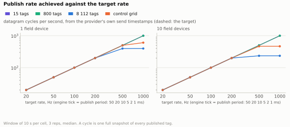
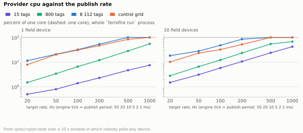
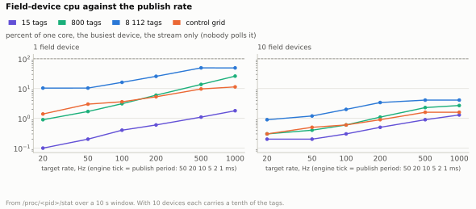
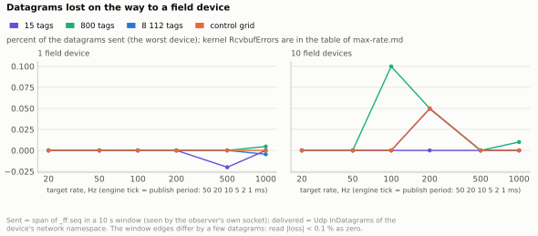
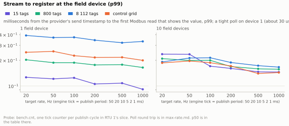
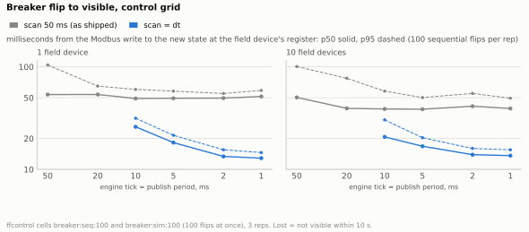

# Maximum publish rate: ferrofire provider to ferrofire field device (ww-1df.43)

How fast can `ferrofire run` publish to `ferrofire field-device`, where is the knee, what limits it, and what is a safe rate? A real provider and real devices, nothing scripted;
Docker (one VM, 18 vCPU, Apple Silicon). Raw: [results/maxrate/](results/maxrate/); harness: [bench/maxrate/](../../bench/maxrate/README.md); the numbers behind every chart are CSVs next to the SVGs in [docs/img/charts/](../img/charts/).
Findings page: [findings.md](../findings.md#10-how-fast-can-it-publish).

## Answer

- **The limit is the provider's engine thread, not the device and not the network.** `ferrofire run` ticks and publishes from one thread; when that thread reaches 100 % of a core the achieved rate flattens (or falls) and no datagram is lost.
  Across 156 runs the field devices lost nothing: `RcvbufErrors` and socket drops were exactly 0, at up to 65 000 datagrams a second to one device. Stream to register stayed 0.06 to 0.26 ms (p50 of the medians) at every rate, also past the knee.
- **Knee** (the fastest swept rate that was met, with the provider core at the shown load; the next step up misses it):

| model | devices | fastest target met, Hz | provider cpu % there | busiest device cpu % there | first target missed: achieved Hz | recommended safe rate, Hz | RcvbufErrors, all steps, all reps |
|---|---|---|---|---|---|---|---|
| 15 tags | 1 | 1000 | 7.5 | 1.8 | none below 1 ms | 1000 | 0 |
| 15 tags | 10 | 1000 | 42.1 | 1.3 | none below 1 ms | 1000 | 0 |
| 800 tags | 1 | 1000 | 55.1 | 26.2 | none below 1 ms | 1000 | 0 |
| 800 tags | 10 | 1000 | 67.7 | 2.7 | none below 1 ms | 500 | 0 |
| 8 112 tags | 1 | 200 | 53.5 | 25.8 | 1000: 398 | 200 | 0 |
| 8 112 tags | 10 | 200 | 85.1 | 3.4 | 1000: 236 | 100 | 0 |
| control grid | 1 | 500 | 83.5 | 9.7 | 1000: 607 | 200 | 0 |
| control grid | 10 | 200 | 52.3 | 0.9 | 1000: 467 | 200 | 0 |

- **Recommended safe rate: the fastest swept rate at which the provider uses at most 60 % of its core** (headroom for a write burst, a slow tick and the REP thread) and the target is met. It is the last column of the table above: 15 tags 1 000 Hz, 800 tags 500 to 1 000 Hz,
  8 112 tags 100 to 200 Hz (100 Hz with ten devices), the 1 250-breaker control grid 200 Hz. The shipped default is 10 Hz, so there is a factor of 10 to 100 of room at every size.
  These are for a model in which **every value changes every tick** (the worst case for the wire); a model whose values mostly sit still costs the same to publish but less to tick.
- **Latency floor.** Stream to register at the device is 0.06 to 0.26 ms p50 (0.09 to 0.39 ms p99). A breaker flip on the control grid is another matter: **50 ms as shipped, because the device's 50 ms scan cycle sits in the write path** (p50 49 to 54 ms at any engine dt, one device; the engine tick is not what sets it; follow-up ww-xco). With the device's `cycle-time` set to the engine dt it falls to **12.9 ms p50 (14.6 p95) at 1 ms**, and there the floor is the provider re-solving the grid: **about 9 ms** between applying the write and finishing the step.
  Publish faster than the engine ticks is not possible (the period is rounded up to a whole number of ticks), so "tick 1 ms, publish 1 ms" is the fastest setting.

## Method

Per cell (model, number of devices R, engine tick `dt`, publish period; `dt` = period unless said otherwise) a fresh provider container, R device containers and the observer `ffmaxrate` start on one bridge network.
Models: **15, 800 and 8 112 tags** (generated, [bench/maxrate/gen.py](../../bench/maxrate/gen.py); each tag is `(bench.k * 0.1 + n * 0.37) % 1000`, so every value changes every tick) and the **control grid** of
[control-latency.md](control-latency.md) (250 buses, 1 250 breakers, 10 generators, about 1 300 published tags; it ticks at the engine dt and publishes the status of breakers and generators). The tags are dealt over R publish slices, one multicast group per device, so with R = 10 each device carries a tenth.
Sweep: `dt` = publish period 50, 20, 10, 5, 2, 1 ms (20 Hz to 1 kHz) x R = 1 and 10 x 4 models x 3 reps = 144 cells, plus decoupled cells (tick 1 ms, publish 5 or 10 ms) for 8 112 tags and the grid, 12 more. Each cell: 3 s warm-up, then

- **window A, 10 s, nobody polls**: achieved publish rate (the provider's own `_ff.cyc` over its `_ff.t` send clock), achieved tick rate (the counter `bench.cnt`, +1 per tick), intervals above 1.5 periods, datagrams sent (span of `_ff.seq` at the observer's own socket)
  against `Udp InDatagrams` and `RcvbufErrors` of each device's network namespace and its socket drops (`/proc/<pid>/net/{snmp,udp}`), cpu and RSS of the provider and of every device (`/proc/<pid>/stat`, `status`; the observer runs with `--pid host`);
- **window B, 10 s, a tight Modbus poll of device 1** (about 30 us a read): stream to register = the poll that first shows counter value c minus the `_ff.t` of the datagram that carried c (one clock: the VM's). A poll that never stops costs the device 38 to 89 % of a core, which is why window A has none:
  device cpu in the tables is window A, the stream alone.

Breaker flips on the grid use the control-latency harness ([bench/run_control.py](../../bench/run_control.py) with `DT_MS`, cells `breaker:seq:100` and `breaker:sim:100`, 3 reps), engine tick and publish period both at `dt`.
The VM's `net.core.rmem_max` is 4 194 304; the device asks for an 8 MiB receive buffer and gets 4 MiB (doubled by the kernel). Nothing else was running (checked before each cell: `contended_at_start` in every `env.txt`).

## 1. Is the target rate achieved?

| model | devices | target Hz | dt ms | reps | achieved Hz |
|---|---|---|---|---|---|
| 15 tags | 1 | 20 | 50 | 3 | 20.0 |
| 15 tags | 1 | 50 | 20 | 3 | 50.0 |
| 15 tags | 1 | 100 | 10 | 3 | 100.0 |
| 15 tags | 1 | 200 | 5 | 3 | 200.0 |
| 15 tags | 1 | 500 | 2 | 3 | 500.0 |
| 15 tags | 1 | 1000 | 1 | 3 | 1000.0 |
| 800 tags | 1 | 20 | 50 | 3 | 20.0 |
| 800 tags | 1 | 50 | 20 | 3 | 50.0 |
| 800 tags | 1 | 100 | 10 | 3 | 100.0 |
| 800 tags | 1 | 200 | 5 | 3 | 200.0 |
| 800 tags | 1 | 500 | 2 | 3 | 500.0 |
| 800 tags | 1 | 1000 | 1 | 3 | 1000.0 |
| 8 112 tags | 1 | 20 | 50 | 3 | 20.0 |
| 8 112 tags | 1 | 50 | 20 | 3 | 50.0 |
| 8 112 tags | 1 | 100 | 10 | 3 | 100.0 |
| 8 112 tags | 1 | 200 | 5 | 3 | 200.0 |
| 8 112 tags | 1 | 500 | 2 | 3 | 397.7 |
| 8 112 tags | 1 | 1000 | 1 | 3 | 398.3 |
| control grid | 1 | 20 | 50 | 3 | 20.0 |
| control grid | 1 | 50 | 20 | 3 | 50.0 |
| control grid | 1 | 100 | 10 | 3 | 100.0 |
| control grid | 1 | 200 | 5 | 3 | 200.0 |
| control grid | 1 | 500 | 2 | 3 | 500.0 |
| control grid | 1 | 1000 | 1 | 3 | 607.4 |
| 15 tags | 10 | 20 | 50 | 3 | 20.0 |
| 15 tags | 10 | 50 | 20 | 3 | 50.0 |
| 15 tags | 10 | 100 | 10 | 3 | 100.0 |
| 15 tags | 10 | 200 | 5 | 3 | 200.0 |
| 15 tags | 10 | 500 | 2 | 3 | 500.0 |
| 15 tags | 10 | 1000 | 1 | 3 | 1000.0 |
| 800 tags | 10 | 20 | 50 | 3 | 20.0 |
| 800 tags | 10 | 50 | 20 | 3 | 50.0 |
| 800 tags | 10 | 100 | 10 | 3 | 100.0 |
| 800 tags | 10 | 200 | 5 | 3 | 200.0 |
| 800 tags | 10 | 500 | 2 | 3 | 500.0 |
| 800 tags | 10 | 1000 | 1 | 3 | 1000.0 |
| 8 112 tags | 10 | 20 | 50 | 3 | 20.0 |
| 8 112 tags | 10 | 50 | 20 | 3 | 50.0 |
| 8 112 tags | 10 | 100 | 10 | 3 | 100.0 |
| 8 112 tags | 10 | 200 | 5 | 3 | 200.0 |
| 8 112 tags | 10 | 500 | 2 | 3 | 235.5 |
| 8 112 tags | 10 | 1000 | 1 | 3 | 235.6 |
| control grid | 10 | 20 | 50 | 3 | 20.0 |
| control grid | 10 | 50 | 20 | 3 | 50.0 |
| control grid | 10 | 100 | 10 | 3 | 100.0 |
| control grid | 10 | 200 | 5 | 3 | 200.0 |
| control grid | 10 | 500 | 2 | 3 | 467.8 |
| control grid | 10 | 1000 | 1 | 3 | 467.3 |

Every size follows the dashed line until the provider core is full, then sits at a ceiling: 8 112 tags 398 Hz with one device and 236 Hz with ten (ten publishers' worth of datagrams, each cycle's cost is mostly the per-datagram work), the grid 607 and 467 Hz.
15 and 800 tags reach 1 kHz without missing. At 2 ms, 8 112 tags / 1 device achieved 398 Hz (79.5 %) while only 0.1 % of intervals were above 1.5 periods: the cycle takes 2.5 ms, steadily, so "late intervals" under-reports a saturated engine; the achieved rate is the test.

## 2. Provider cpu: one core, linear in the rate

| model | devices | target Hz | dt ms | reps | provider cpu % |
|---|---|---|---|---|---|
| 15 tags | 1 | 20 | 50 | 3 | 0.5 |
| 15 tags | 1 | 50 | 20 | 3 | 0.8 |
| 15 tags | 1 | 100 | 10 | 3 | 1.4 |
| 15 tags | 1 | 200 | 5 | 3 | 2.3 |
| 15 tags | 1 | 500 | 2 | 3 | 4.7 |
| 15 tags | 1 | 1000 | 1 | 3 | 7.5 |
| 800 tags | 1 | 20 | 50 | 3 | 1.5 |
| 800 tags | 1 | 50 | 20 | 3 | 3.4 |
| 800 tags | 1 | 100 | 10 | 3 | 6.6 |
| 800 tags | 1 | 200 | 5 | 3 | 12.0 |
| 800 tags | 1 | 500 | 2 | 3 | 28.4 |
| 800 tags | 1 | 1000 | 1 | 3 | 55.1 |
| 8 112 tags | 1 | 20 | 50 | 3 | 11.4 |
| 8 112 tags | 1 | 50 | 20 | 3 | 20.9 |
| 8 112 tags | 1 | 100 | 10 | 3 | 32.0 |
| 8 112 tags | 1 | 200 | 5 | 3 | 53.5 |
| 8 112 tags | 1 | 500 | 2 | 3 | 100.0 |
| 8 112 tags | 1 | 1000 | 1 | 3 | 100.0 |
| control grid | 1 | 20 | 50 | 3 | 7.9 |
| control grid | 1 | 50 | 20 | 3 | 20.3 |
| control grid | 1 | 100 | 10 | 3 | 30.7 |
| control grid | 1 | 200 | 5 | 3 | 47.1 |
| control grid | 1 | 500 | 2 | 3 | 83.5 |
| control grid | 1 | 1000 | 1 | 3 | 100.1 |
| 15 tags | 10 | 20 | 50 | 3 | 1.5 |
| 15 tags | 10 | 50 | 20 | 3 | 3.1 |
| 15 tags | 10 | 100 | 10 | 3 | 5.8 |
| 15 tags | 10 | 200 | 5 | 3 | 10.6 |
| 15 tags | 10 | 500 | 2 | 3 | 23.9 |
| 15 tags | 10 | 1000 | 1 | 3 | 42.1 |
| 800 tags | 10 | 20 | 50 | 3 | 2.8 |
| 800 tags | 10 | 50 | 20 | 3 | 6.6 |
| 800 tags | 10 | 100 | 10 | 3 | 12.2 |
| 800 tags | 10 | 200 | 5 | 3 | 23.5 |
| 800 tags | 10 | 500 | 2 | 3 | 54.4 |
| 800 tags | 10 | 1000 | 1 | 3 | 67.7 |
| 8 112 tags | 10 | 20 | 50 | 3 | 18.3 |
| 8 112 tags | 10 | 50 | 20 | 3 | 28.0 |
| 8 112 tags | 10 | 100 | 10 | 3 | 48.1 |
| 8 112 tags | 10 | 200 | 5 | 3 | 85.1 |
| 8 112 tags | 10 | 500 | 2 | 3 | 100.0 |
| 8 112 tags | 10 | 1000 | 1 | 3 | 100.0 |
| control grid | 10 | 20 | 50 | 3 | 10.2 |
| control grid | 10 | 50 | 20 | 3 | 23.2 |
| control grid | 10 | 100 | 10 | 3 | 32.2 |
| control grid | 10 | 200 | 5 | 3 | 52.3 |
| control grid | 10 | 500 | 2 | 3 | 100.0 |
| control grid | 10 | 1000 | 1 | 3 | 100.1 |

Linear in the rate until 100 %. Per cycle: 8 112 tags about 2.6 ms with one device (53 % at 200 Hz) and 4.3 ms with ten (85 % at 200 Hz); the grid 1.7 ms (one device) to 2.6 ms (ten); 800 tags 0.55 ms (one) to 0.68 ms (ten); 15 tags 0.07 ms (one) to 0.42 ms (ten).
With ten devices the cost grows because every cycle is ten groups, each its own small datagrams. RSS: 4 MB (15 tags) to 19 MB (grid), flat in the rate.

**Where the single thread goes** (decoupled cells below): 8 112 tags ticking at 1 ms and publishing every 10 ms already uses 100 % of the core and still runs 1 001 ticks a second: **evaluating 8 112 expressions that all change costs about 1 ms a tick**,
and a publish about 1.5 ms on top. The grid at tick 1 ms, publish 10 ms uses 70 %: **its idle tick costs about 0.6 ms** (nothing is being flipped; this is the per-tick power-model work, a candidate for a cheaper idle path, ww-aj8).

| model | devices | dt ms | publish ms | reps | ticks/s | publishes/s | intervals > 1.5 periods % | interval p99 ms | provider cpu % | provider RSS MB | busiest device cpu % | device RSS MB | worst device loss % | RcvbufErrors | stream to register p50 ms | p99 ms |
|---|---|---|---|---|---|---|---|---|---|---|---|---|---|---|---|---|
| 8 112 tags | 1 | 1 | 5 | 3 | 861.7 | 172.3 | 0.0 | 6.07 | 100 | 13 | 23.2 | 12 | -0.00 | 0 | 0.22 | 0.37 |
| 8 112 tags | 1 | 1 | 10 | 3 | 1001.2 | 100.1 | 0.0 | 10.36 | 100 | 13 | 13.1 | 12 | 0.00 | 0 | 0.23 | 0.39 |
| control grid | 1 | 1 | 5 | 3 | 1000.0 | 200.0 | 0.0 | 5.14 | 78 | 19 | 3.9 | 6 | 0.00 | 0 | 0.09 | 0.21 |
| control grid | 1 | 1 | 10 | 3 | 1000.0 | 100.0 | 0.0 | 10.19 | 70 | 19 | 2.1 | 6 | 0.00 | 0 | 0.10 | 0.23 |

## 3. The field device: cpu, loss, stream to register

| model | devices | target Hz | dt ms | reps | busiest device cpu % |
|---|---|---|---|---|---|
| 15 tags | 1 | 20 | 50 | 3 | 0.1 |
| 15 tags | 1 | 50 | 20 | 3 | 0.2 |
| 15 tags | 1 | 100 | 10 | 3 | 0.4 |
| 15 tags | 1 | 200 | 5 | 3 | 0.6 |
| 15 tags | 1 | 500 | 2 | 3 | 1.1 |
| 15 tags | 1 | 1000 | 1 | 3 | 1.8 |
| 800 tags | 1 | 20 | 50 | 3 | 0.9 |
| 800 tags | 1 | 50 | 20 | 3 | 1.7 |
| 800 tags | 1 | 100 | 10 | 3 | 3.1 |
| 800 tags | 1 | 200 | 5 | 3 | 6.0 |
| 800 tags | 1 | 500 | 2 | 3 | 13.8 |
| 800 tags | 1 | 1000 | 1 | 3 | 26.2 |
| 8 112 tags | 1 | 20 | 50 | 3 | 10.4 |
| 8 112 tags | 1 | 50 | 20 | 3 | 10.4 |
| 8 112 tags | 1 | 100 | 10 | 3 | 16.2 |
| 8 112 tags | 1 | 200 | 5 | 3 | 25.8 |
| 8 112 tags | 1 | 500 | 2 | 3 | 49.6 |
| 8 112 tags | 1 | 1000 | 1 | 3 | 49.4 |
| control grid | 1 | 20 | 50 | 3 | 1.4 |
| control grid | 1 | 50 | 20 | 3 | 3.0 |
| control grid | 1 | 100 | 10 | 3 | 3.6 |
| control grid | 1 | 200 | 5 | 3 | 5.3 |
| control grid | 1 | 500 | 2 | 3 | 9.7 |
| control grid | 1 | 1000 | 1 | 3 | 11.4 |
| 15 tags | 10 | 20 | 50 | 3 | 0.2 |
| 15 tags | 10 | 50 | 20 | 3 | 0.2 |
| 15 tags | 10 | 100 | 10 | 3 | 0.3 |
| 15 tags | 10 | 200 | 5 | 3 | 0.5 |
| 15 tags | 10 | 500 | 2 | 3 | 0.9 |
| 15 tags | 10 | 1000 | 1 | 3 | 1.3 |
| 800 tags | 10 | 20 | 50 | 3 | 0.3 |
| 800 tags | 10 | 50 | 20 | 3 | 0.4 |
| 800 tags | 10 | 100 | 10 | 3 | 0.6 |
| 800 tags | 10 | 200 | 5 | 3 | 1.1 |
| 800 tags | 10 | 500 | 2 | 3 | 2.3 |
| 800 tags | 10 | 1000 | 1 | 3 | 2.7 |
| 8 112 tags | 10 | 20 | 50 | 3 | 0.9 |
| 8 112 tags | 10 | 50 | 20 | 3 | 1.2 |
| 8 112 tags | 10 | 100 | 10 | 3 | 2.0 |
| 8 112 tags | 10 | 200 | 5 | 3 | 3.4 |
| 8 112 tags | 10 | 500 | 2 | 3 | 4.1 |
| 8 112 tags | 10 | 1000 | 1 | 3 | 4.1 |
| control grid | 10 | 20 | 50 | 3 | 0.3 |
| control grid | 10 | 50 | 20 | 3 | 0.5 |
| control grid | 10 | 100 | 10 | 3 | 0.6 |
| control grid | 10 | 200 | 5 | 3 | 0.9 |
| control grid | 10 | 500 | 2 | 3 | 1.6 |
| control grid | 10 | 1000 | 1 | 3 | 1.6 |

The device is cheaper than the provider in every cell: the busiest device at 8 112 tags / 1 device uses 49.6 % of a core at 398 Hz (about 65 000 datagrams a second, 7.6 us each), so **its own ceiling is about 800 Hz** (extrapolated, a straight line from 20 to 398 Hz; the provider cannot drive it that far, so this is not measured).
With ten devices each uses 3 to 4 % of a core at the provider's ceiling. RSS: 4 to 12 MB.

| model | devices | target Hz | dt ms | reps | worst device loss % |
|---|---|---|---|---|---|
| 15 tags | 1 | 20 | 50 | 3 | 0.00 |
| 15 tags | 1 | 50 | 20 | 3 | 0.00 |
| 15 tags | 1 | 100 | 10 | 3 | 0.00 |
| 15 tags | 1 | 200 | 5 | 3 | 0.00 |
| 15 tags | 1 | 500 | 2 | 3 | -0.02 |
| 15 tags | 1 | 1000 | 1 | 3 | 0.00 |
| 800 tags | 1 | 20 | 50 | 3 | 0.00 |
| 800 tags | 1 | 50 | 20 | 3 | 0.00 |
| 800 tags | 1 | 100 | 10 | 3 | 0.00 |
| 800 tags | 1 | 200 | 5 | 3 | 0.00 |
| 800 tags | 1 | 500 | 2 | 3 | 0.00 |
| 800 tags | 1 | 1000 | 1 | 3 | 0.00 |
| 8 112 tags | 1 | 20 | 50 | 3 | 0.00 |
| 8 112 tags | 1 | 50 | 20 | 3 | 0.00 |
| 8 112 tags | 1 | 100 | 10 | 3 | 0.00 |
| 8 112 tags | 1 | 200 | 5 | 3 | 0.00 |
| 8 112 tags | 1 | 500 | 2 | 3 | 0.00 |
| 8 112 tags | 1 | 1000 | 1 | 3 | -0.00 |
| control grid | 1 | 20 | 50 | 3 | 0.00 |
| control grid | 1 | 50 | 20 | 3 | 0.00 |
| control grid | 1 | 100 | 10 | 3 | 0.00 |
| control grid | 1 | 200 | 5 | 3 | 0.00 |
| control grid | 1 | 500 | 2 | 3 | 0.00 |
| control grid | 1 | 1000 | 1 | 3 | 0.00 |
| 15 tags | 10 | 20 | 50 | 3 | 0.00 |
| 15 tags | 10 | 50 | 20 | 3 | 0.00 |
| 15 tags | 10 | 100 | 10 | 3 | 0.00 |
| 15 tags | 10 | 200 | 5 | 3 | 0.00 |
| 15 tags | 10 | 500 | 2 | 3 | 0.00 |
| 15 tags | 10 | 1000 | 1 | 3 | 0.00 |
| 800 tags | 10 | 20 | 50 | 3 | 0.00 |
| 800 tags | 10 | 50 | 20 | 3 | 0.00 |
| 800 tags | 10 | 100 | 10 | 3 | 0.10 |
| 800 tags | 10 | 200 | 5 | 3 | 0.05 |
| 800 tags | 10 | 500 | 2 | 3 | 0.00 |
| 800 tags | 10 | 1000 | 1 | 3 | 0.01 |
| 8 112 tags | 10 | 20 | 50 | 3 | 0.00 |
| 8 112 tags | 10 | 50 | 20 | 3 | 0.00 |
| 8 112 tags | 10 | 100 | 10 | 3 | 0.00 |
| 8 112 tags | 10 | 200 | 5 | 3 | 0.05 |
| 8 112 tags | 10 | 500 | 2 | 3 | 0.00 |
| 8 112 tags | 10 | 1000 | 1 | 3 | 0.00 |
| control grid | 10 | 20 | 50 | 3 | 0.00 |
| control grid | 10 | 50 | 20 | 3 | 0.00 |
| control grid | 10 | 100 | 10 | 3 | 0.00 |
| control grid | 10 | 200 | 5 | 3 | 0.05 |
| control grid | 10 | 500 | 2 | 3 | 0.00 |
| control grid | 10 | 1000 | 1 | 3 | 0.00 |

No loss at any rate: `RcvbufErrors` 0, socket drops 0, provider `SndbufErrors` 0, in all 156 runs. The loss column is sent minus delivered over a 10 s window whose edges differ by a few datagrams (up to 0.5 % at 20 Hz, a handful of datagrams; sometimes negative).
The receive-path fix of ww-c2i holds: the largest burst here is 163 back-to-back datagrams per cycle at up to 400 cycles a second. **Not tested:** a lower `rmem_max` than the VM's 4 MiB, and injected network loss (see [datagram-v1-bench.md](datagram-v1-bench.md)).

| model | devices | target Hz | dt ms | reps | p99 ms |
|---|---|---|---|---|---|
| 15 tags | 1 | 20 | 50 | 3 | 0.13 |
| 15 tags | 1 | 50 | 20 | 3 | 0.12 |
| 15 tags | 1 | 100 | 10 | 3 | 0.12 |
| 15 tags | 1 | 200 | 5 | 3 | 0.11 |
| 15 tags | 1 | 500 | 2 | 3 | 0.11 |
| 15 tags | 1 | 1000 | 1 | 3 | 0.09 |
| 800 tags | 1 | 20 | 50 | 3 | 0.20 |
| 800 tags | 1 | 50 | 20 | 3 | 0.19 |
| 800 tags | 1 | 100 | 10 | 3 | 0.19 |
| 800 tags | 1 | 200 | 5 | 3 | 0.18 |
| 800 tags | 1 | 500 | 2 | 3 | 0.18 |
| 800 tags | 1 | 1000 | 1 | 3 | 0.16 |
| 8 112 tags | 1 | 20 | 50 | 3 | 0.39 |
| 8 112 tags | 1 | 50 | 20 | 3 | 0.37 |
| 8 112 tags | 1 | 100 | 10 | 3 | 0.37 |
| 8 112 tags | 1 | 200 | 5 | 3 | 0.34 |
| 8 112 tags | 1 | 500 | 2 | 3 | 0.32 |
| 8 112 tags | 1 | 1000 | 1 | 3 | 0.33 |
| control grid | 1 | 20 | 50 | 3 | 0.25 |
| control grid | 1 | 50 | 20 | 3 | 0.25 |
| control grid | 1 | 100 | 10 | 3 | 0.23 |
| control grid | 1 | 200 | 5 | 3 | 0.22 |
| control grid | 1 | 500 | 2 | 3 | 0.22 |
| control grid | 1 | 1000 | 1 | 3 | 0.20 |
| 15 tags | 10 | 20 | 50 | 3 | 0.24 |
| 15 tags | 10 | 50 | 20 | 3 | 0.24 |
| 15 tags | 10 | 100 | 10 | 3 | 0.17 |
| 15 tags | 10 | 200 | 5 | 3 | 0.16 |
| 15 tags | 10 | 500 | 2 | 3 | 0.15 |
| 15 tags | 10 | 1000 | 1 | 3 | 0.15 |
| 800 tags | 10 | 20 | 50 | 3 | 0.21 |
| 800 tags | 10 | 50 | 20 | 3 | 0.20 |
| 800 tags | 10 | 100 | 10 | 3 | 0.20 |
| 800 tags | 10 | 200 | 5 | 3 | 0.17 |
| 800 tags | 10 | 500 | 2 | 3 | 0.16 |
| 800 tags | 10 | 1000 | 1 | 3 | 0.16 |
| 8 112 tags | 10 | 20 | 50 | 3 | 0.19 |
| 8 112 tags | 10 | 50 | 20 | 3 | 0.21 |
| 8 112 tags | 10 | 100 | 10 | 3 | 0.21 |
| 8 112 tags | 10 | 200 | 5 | 3 | 0.19 |
| 8 112 tags | 10 | 500 | 2 | 3 | 0.17 |
| 8 112 tags | 10 | 1000 | 1 | 3 | 0.17 |
| control grid | 10 | 20 | 50 | 3 | 0.19 |
| control grid | 10 | 50 | 20 | 3 | 0.20 |
| control grid | 10 | 100 | 10 | 3 | 0.19 |
| control grid | 10 | 200 | 5 | 3 | 0.17 |
| control grid | 10 | 500 | 2 | 3 | 0.14 |
| control grid | 10 | 1000 | 1 | 3 | 0.14 |

The register shows a value 0.06 ms (15 tags) to 0.26 ms (8 112 tags) after the datagram left the provider (p50; p99 up to 0.39 ms), at every rate, also while the provider is saturated: the device applies a datagram as it arrives and does not wait for its scan cycle.
Resolution: one poll takes about 29 us. Counter steps skipped by the register: 1 in 156 runs.

## 4. Breaker flip on the control grid

| devices | device scan | dt ms | reps | flips (seq) | p50 ms | p95 ms | seq flips not seen | sim flips lost |
|---|---|---|---|---|---|---|---|---|
| 1 | scan 50 ms (as shipped) | 50 | 3 | 300 | 53.7 | 104.3 | 0 | 0 of 300 |
| 1 | scan 50 ms (as shipped) | 20 | 3 | 300 | 53.7 | 64.9 | 0 | 0 of 300 |
| 1 | scan 50 ms (as shipped) | 10 | 3 | 300 | 49.1 | 60.2 | 0 | 0 of 300 |
| 1 | scan 50 ms (as shipped) | 5 | 3 | 300 | 49.4 | 57.9 | 0 | 0 of 300 |
| 1 | scan 50 ms (as shipped) | 2 | 3 | 300 | 49.5 | 54.9 | 0 | 0 of 300 |
| 1 | scan 50 ms (as shipped) | 1 | 3 | 300 | 51.5 | 58.9 | 0 | 0 of 300 |
| 1 | scan = dt | 10 | 3 | 300 | 26.0 | 31.5 | 0 | 0 of 300 |
| 1 | scan = dt | 5 | 3 | 300 | 18.2 | 21.5 | 0 | 0 of 300 |
| 1 | scan = dt | 2 | 3 | 300 | 13.4 | 15.5 | 0 | 0 of 300 |
| 1 | scan = dt | 1 | 3 | 300 | 12.9 | 14.6 | 0 | 0 of 300 |
| 10 | scan 50 ms (as shipped) | 50 | 3 | 300 | 50.3 | 100.8 | 0 | 0 of 300 |
| 10 | scan 50 ms (as shipped) | 20 | 3 | 300 | 39.4 | 77.3 | 0 | 0 of 300 |
| 10 | scan 50 ms (as shipped) | 10 | 3 | 300 | 38.8 | 57.9 | 0 | 0 of 300 |
| 10 | scan 50 ms (as shipped) | 5 | 3 | 300 | 38.6 | 50.2 | 0 | 0 of 300 |
| 10 | scan 50 ms (as shipped) | 2 | 3 | 300 | 41.3 | 55.1 | 0 | 0 of 300 |
| 10 | scan 50 ms (as shipped) | 1 | 3 | 300 | 39.2 | 49.4 | 0 | 0 of 300 |
| 10 | scan = dt | 10 | 3 | 300 | 20.7 | 30.4 | 0 | 0 of 300 |
| 10 | scan = dt | 5 | 3 | 300 | 16.8 | 20.4 | 0 | 0 of 300 |
| 10 | scan = dt | 2 | 3 | 300 | 13.9 | 16.0 | 0 | 0 of 300 |
| 10 | scan = dt | 1 | 3 | 300 | 13.6 | 15.5 | 0 | 0 of 300 |

Flip to visible is the time from the SCADA's Modbus write on a breaker coil until the field device's register shows the new state. As shipped (scan 50 ms), it stays at **49 to 54 ms p50 whatever the engine tick** (one device; 39 to 50 ms with ten): the write waits for the device's next scan to be forwarded to the provider.
Setting the device's `cycle-time` to the engine dt brings it to **26.0 ms (10 ms), 18.2 (5), 13.4 (2) and 12.9 ms (1)**; nothing was lost or flipped back: 0 of 300 sequential flips and 0 of 300 simultaneous (`breaker:sim:100`) in every cell, at every dt.
At 1 ms the stages (provider stamps, `--stamp-writes`) are: write applied at the provider 1.5 ms after the command, step finished 10.5 ms, first datagram carrying the new state 11.6 ms, visible at the register 12.9 ms. The 9 ms between "applied" and "finished" is **one AC re-solve of the 250-bus grid**,
the same at dt 10 ms (9.6 ms). That, not the tick, the publish or the network, is the floor for a flip on this grid; a model without a solver has none (stream to register above: 0.1 ms).

## 5. Everything per step

| model | devices | dt ms | reps | ticks/s | publishes/s | intervals > 1.5 periods % | interval p99 ms | provider cpu % | provider RSS MB | busiest device cpu % | device RSS MB | worst device loss % | RcvbufErrors | stream to register p50 ms | p99 ms |
|---|---|---|---|---|---|---|---|---|---|---|---|---|---|---|---|
| 15 tags | 1 | 50 | 3 | 20.0 | 20.0 | 0.0 | 59.80 | 0 | 4 | 0.1 | 4 | 0.00 | 0 | 0.08 | 0.13 |
| 15 tags | 1 | 20 | 3 | 50.0 | 50.0 | 0.0 | 28.33 | 1 | 4 | 0.2 | 4 | 0.00 | 0 | 0.07 | 0.12 |
| 15 tags | 1 | 10 | 3 | 100.0 | 100.0 | 0.0 | 14.43 | 1 | 4 | 0.4 | 4 | 0.00 | 0 | 0.07 | 0.12 |
| 15 tags | 1 | 5 | 3 | 200.0 | 200.0 | 0.0 | 6.75 | 2 | 4 | 0.6 | 4 | 0.00 | 0 | 0.06 | 0.11 |
| 15 tags | 1 | 2 | 3 | 500.0 | 500.0 | 0.0 | 2.27 | 5 | 4 | 1.1 | 4 | -0.02 | 0 | 0.06 | 0.11 |
| 15 tags | 1 | 1 | 3 | 1000.0 | 1000.0 | 0.0 | 1.40 | 7 | 4 | 1.8 | 4 | 0.00 | 0 | 0.06 | 0.09 |
| 15 tags | 10 | 50 | 3 | 20.0 | 20.0 | 0.0 | 59.61 | 1 | 4 | 0.2 | 4 | 0.00 | 0 | 0.10 | 0.24 |
| 15 tags | 10 | 20 | 3 | 50.0 | 50.0 | 0.0 | 28.82 | 3 | 4 | 0.2 | 4 | 0.00 | 0 | 0.08 | 0.24 |
| 15 tags | 10 | 10 | 3 | 100.0 | 100.0 | 0.0 | 14.32 | 6 | 4 | 0.3 | 4 | 0.00 | 0 | 0.08 | 0.17 |
| 15 tags | 10 | 5 | 3 | 200.0 | 200.0 | 0.0 | 6.77 | 11 | 4 | 0.5 | 4 | 0.00 | 0 | 0.07 | 0.16 |
| 15 tags | 10 | 2 | 3 | 500.0 | 500.0 | 0.0 | 2.26 | 24 | 4 | 0.9 | 4 | 0.00 | 0 | 0.07 | 0.15 |
| 15 tags | 10 | 1 | 3 | 1000.0 | 1000.0 | 0.0 | 1.10 | 42 | 4 | 1.3 | 4 | 0.00 | 0 | 0.07 | 0.15 |
| 800 tags | 1 | 50 | 3 | 20.0 | 20.0 | 0.0 | 59.31 | 1 | 5 | 0.9 | 5 | 0.00 | 0 | 0.11 | 0.20 |
| 800 tags | 1 | 20 | 3 | 50.0 | 50.0 | 0.0 | 28.57 | 3 | 5 | 1.7 | 5 | 0.00 | 0 | 0.09 | 0.19 |
| 800 tags | 1 | 10 | 3 | 100.0 | 100.0 | 0.0 | 14.07 | 7 | 5 | 3.1 | 5 | 0.00 | 0 | 0.09 | 0.19 |
| 800 tags | 1 | 5 | 3 | 200.0 | 200.0 | 0.0 | 7.03 | 12 | 5 | 6.0 | 5 | 0.00 | 0 | 0.08 | 0.18 |
| 800 tags | 1 | 2 | 3 | 500.0 | 500.0 | 0.0 | 2.25 | 28 | 5 | 13.8 | 5 | 0.00 | 0 | 0.08 | 0.18 |
| 800 tags | 1 | 1 | 3 | 1000.0 | 1000.0 | 0.0 | 1.17 | 55 | 5 | 26.2 | 5 | 0.00 | 0 | 0.08 | 0.16 |
| 800 tags | 10 | 50 | 3 | 20.0 | 20.0 | 0.0 | 59.25 | 3 | 5 | 0.3 | 5 | 0.00 | 0 | 0.10 | 0.21 |
| 800 tags | 10 | 20 | 3 | 50.0 | 50.0 | 0.0 | 28.48 | 7 | 5 | 0.4 | 5 | 0.00 | 0 | 0.09 | 0.20 |
| 800 tags | 10 | 10 | 3 | 100.0 | 100.0 | 0.0 | 13.86 | 12 | 5 | 0.6 | 5 | 0.10 | 0 | 0.09 | 0.20 |
| 800 tags | 10 | 5 | 3 | 200.0 | 200.0 | 0.0 | 6.56 | 23 | 5 | 1.1 | 5 | 0.05 | 0 | 0.09 | 0.17 |
| 800 tags | 10 | 2 | 3 | 500.0 | 500.0 | 0.0 | 2.23 | 54 | 5 | 2.3 | 5 | 0.00 | 0 | 0.08 | 0.16 |
| 800 tags | 10 | 1 | 3 | 1000.0 | 1000.0 | 0.0 | 1.19 | 68 | 5 | 2.7 | 5 | 0.01 | 0 | 0.08 | 0.16 |
| 8 112 tags | 1 | 50 | 3 | 20.0 | 20.0 | 0.0 | 59.93 | 11 | 12 | 10.4 | 12 | 0.00 | 0 | 0.25 | 0.39 |
| 8 112 tags | 1 | 20 | 3 | 50.0 | 50.0 | 0.0 | 28.38 | 21 | 12 | 10.4 | 12 | 0.00 | 0 | 0.23 | 0.37 |
| 8 112 tags | 1 | 10 | 3 | 100.0 | 100.0 | 0.0 | 12.66 | 32 | 12 | 16.2 | 12 | 0.00 | 0 | 0.22 | 0.37 |
| 8 112 tags | 1 | 5 | 3 | 200.0 | 200.0 | 0.0 | 5.68 | 53 | 12 | 25.8 | 12 | 0.00 | 0 | 0.22 | 0.34 |
| 8 112 tags | 1 | 2 | 3 | 397.7 | 397.7 | 0.1 | 2.66 | 100 | 12 | 49.6 | 12 | 0.00 | 0 | 0.21 | 0.32 |
| 8 112 tags | 1 | 1 | 3 | 398.3 | 398.3 | 100.0 | 2.63 | 100 | 12 | 49.4 | 12 | -0.00 | 0 | 0.21 | 0.33 |
| 8 112 tags | 10 | 50 | 3 | 20.0 | 20.0 | 0.0 | 59.72 | 18 | 12 | 0.9 | 5 | 0.00 | 0 | 0.12 | 0.19 |
| 8 112 tags | 10 | 20 | 3 | 50.0 | 50.0 | 0.0 | 26.80 | 28 | 12 | 1.2 | 5 | 0.00 | 0 | 0.11 | 0.21 |
| 8 112 tags | 10 | 10 | 3 | 100.0 | 100.0 | 0.0 | 12.40 | 48 | 12 | 2.0 | 5 | 0.00 | 0 | 0.10 | 0.21 |
| 8 112 tags | 10 | 5 | 3 | 200.0 | 200.0 | 0.0 | 5.19 | 85 | 12 | 3.4 | 5 | 0.05 | 0 | 0.09 | 0.19 |
| 8 112 tags | 10 | 2 | 3 | 235.5 | 235.5 | 100.0 | 4.42 | 100 | 12 | 4.1 | 5 | 0.00 | 0 | 0.09 | 0.17 |
| 8 112 tags | 10 | 1 | 3 | 235.6 | 235.6 | 100.0 | 4.47 | 100 | 12 | 4.1 | 5 | 0.00 | 0 | 0.09 | 0.17 |
| control grid | 1 | 50 | 3 | 20.0 | 20.0 | 0.0 | 59.35 | 8 | 19 | 1.4 | 6 | 0.00 | 0 | 0.11 | 0.25 |
| control grid | 1 | 20 | 3 | 50.0 | 50.0 | 0.0 | 27.70 | 20 | 19 | 3.0 | 6 | 0.00 | 0 | 0.10 | 0.25 |
| control grid | 1 | 10 | 3 | 100.0 | 100.0 | 0.1 | 13.87 | 31 | 19 | 3.6 | 6 | 0.00 | 0 | 0.10 | 0.23 |
| control grid | 1 | 5 | 3 | 200.0 | 200.0 | 0.0 | 6.40 | 47 | 19 | 5.3 | 6 | 0.00 | 0 | 0.09 | 0.22 |
| control grid | 1 | 2 | 3 | 500.0 | 500.0 | 0.0 | 2.11 | 83 | 19 | 9.7 | 6 | 0.00 | 0 | 0.09 | 0.22 |
| control grid | 1 | 1 | 3 | 607.4 | 607.4 | 100.0 | 1.76 | 100 | 19 | 11.4 | 6 | 0.00 | 0 | 0.08 | 0.20 |
| control grid | 10 | 50 | 3 | 20.0 | 20.0 | 0.0 | 59.48 | 10 | 18 | 0.3 | 5 | 0.00 | 0 | 0.10 | 0.19 |
| control grid | 10 | 20 | 3 | 50.0 | 50.0 | 0.0 | 27.90 | 23 | 19 | 0.5 | 5 | 0.00 | 0 | 0.09 | 0.20 |
| control grid | 10 | 10 | 3 | 100.0 | 100.0 | 0.0 | 13.43 | 32 | 19 | 0.6 | 5 | 0.00 | 0 | 0.09 | 0.19 |
| control grid | 10 | 5 | 3 | 200.0 | 200.0 | 0.0 | 6.06 | 52 | 19 | 0.9 | 5 | 0.05 | 0 | 0.08 | 0.17 |
| control grid | 10 | 2 | 3 | 467.8 | 467.8 | 0.0 | 2.28 | 100 | 18 | 1.6 | 5 | 0.00 | 0 | 0.08 | 0.14 |
| control grid | 10 | 1 | 3 | 467.3 | 467.3 | 100.0 | 2.29 | 100 | 18 | 1.6 | 5 | 0.00 | 0 | 0.08 | 0.14 |

## What this does not cover

- One host (Docker Desktop, an 18 vCPU Apple Silicon VM, no other load); real range hardware is slower per core. No phenix range point was run (out of scope for this bead's workflow).
- The synthetic models change every value every tick; Modbus only (no protocol load on the devices besides the one probe); no writes during the rate sweep (flips are measured separately, section 4); no injected loss.
- The sweep stops at 1 ms; the 15- and 800-tag ceilings are extrapolations (15 tags: 7 % at 1 kHz, 800 tags: 55 % with one device, 68 % with ten).
- The provider's own tick overruns are not logged; here they are inferred from the achieved rate and the intervals between the provider's send timestamps. A bead exists to expose them (ww-aj8).
- The 4 MiB `rmem_max` of this VM is what the devices got; a host with the Linux default (212 992 bytes) would give them a smaller buffer than the 8 MiB asked for; not tested.
