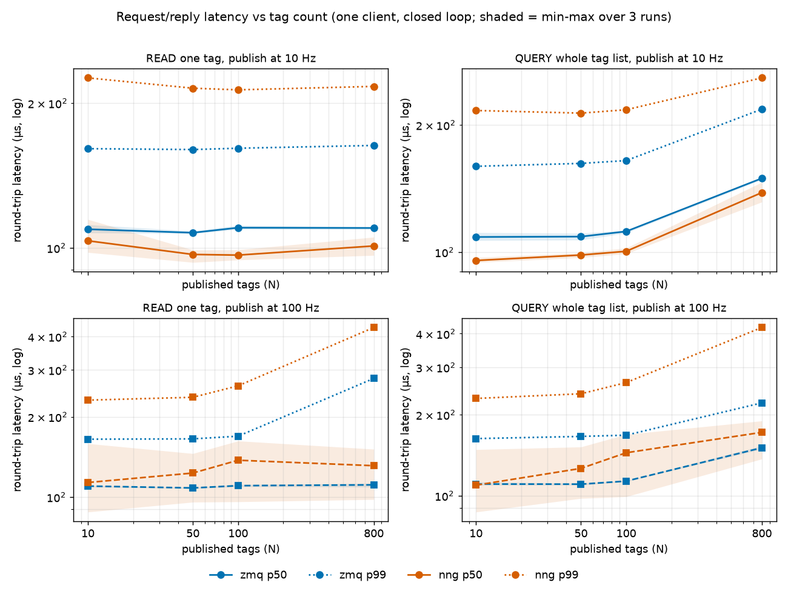
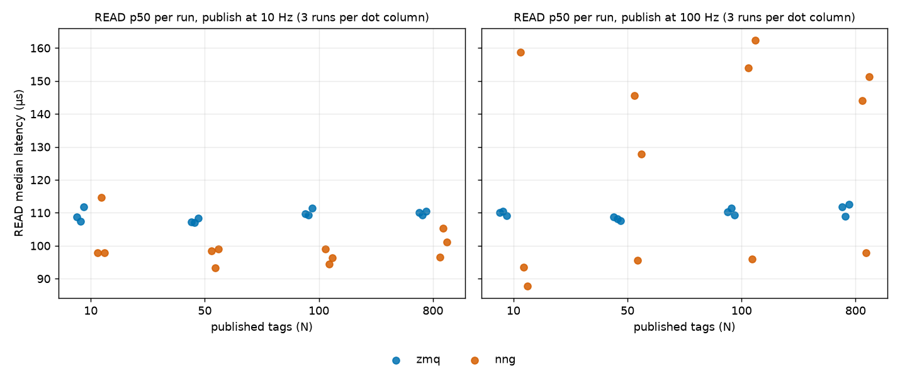
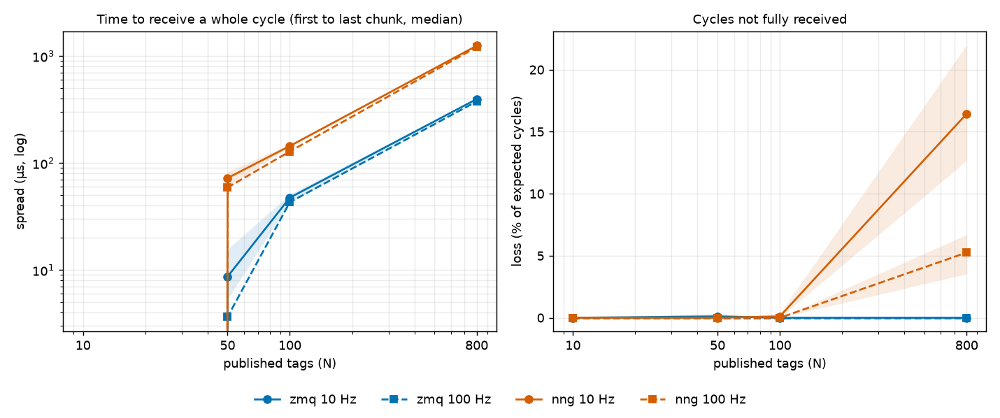
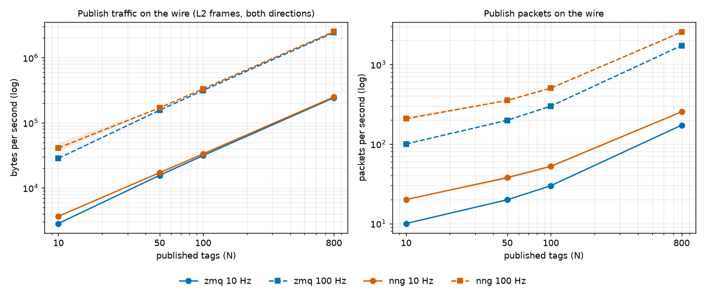
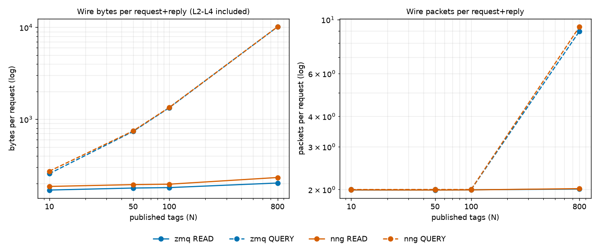
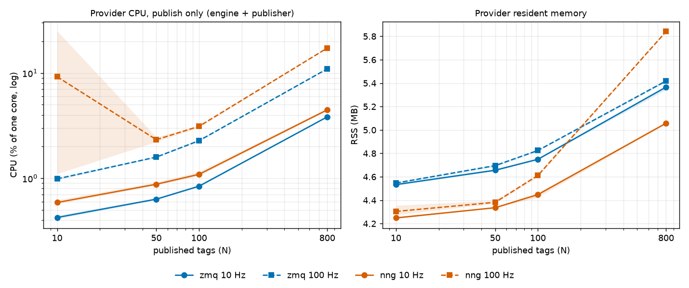

# ferrofire transports: ZeroMQ vs NNG at 10, 50, 100 and 800 tags

*Generated by `bench/report.py` from the 48 raw runs in `docs/bench/results/raw/`; every number below is computed from those files.
Method and exact commands: [bench/README.md](../../bench/README.md).*

## Bottom line

- **Use zmq (RADIO/DISH) today if** you need to talk to stock bennu field devices and bennu-probe (only zmq does), want the lowest provider CPU,
  or publish large models: zmq lost no publish cycles at 800 tags and its request latency is steady (READ median 108-111 µs in every run).
- **Use nng if** you want TCP delivery semantics (connection-oriented, ordered, retransmitting) and do not need multicast or stock-bennu compatibility.
  Fix the 800-tag publish loss first: nng dropped 3.5-22% of publish cycles at 800 tags in all 6 runs (suspected PUB0 send buffer, bead ww-a8n).
  Below 800 tags nng delivered every cycle.
- **Speed is not a reason to pick either.** Request latency is the same order for both (about 90-160 µs median on a Docker bridge); nng's request
  latency is bimodal (below), so no single "nng is faster/slower" figure is honest. What is solid is that nng costs about 1.8x the provider CPU
  when serving requests and sends 1.5-2x the packets when publishing.

## Summary

- **Request/reply latency: nng is bimodal, zmq is steady.** zmq: READ p50 108-111 µs, about 8,779-9,182 READ/s, in every run. nng runs fall into
  two modes: a fast mode (READ p50 about 88-105 µs, about 9,000-10,000 req/s) where nng's median is *lower* than zmq's, and a slow mode (READ p50 about 145-162 µs, about 6,300-6,700 req/s)
  where it is roughly 45% higher; a few runs sit in between (see the per-run table in section 1). In this data set the slow mode appeared only in 100 Hz runs
  (reps 1 and 3), which made the 100 Hz means look worse (nng/zmq READ p50 ratio 1.03-1.25, QUERY 0.99-1.27, depending on N), but a later re-run at 10 Hz also hit the slow mode, so this is a
  mode artifact, not an effect of publish rate. The cause is **unknown** (candidates: nng's aio/thread scheduling, Docker Desktop VM scheduling); it is filed as a note on bead ww-a8n.
  The tail is worse on nng in either mode: READ p99 at 10 Hz is about 1.3-1.4x zmq's (216-226 µs vs 160-163 µs), and at 100 Hz, 800 tags, 433 µs vs 279 µs.
  A QUERY of 800 tags: about 150 µs zmq; 138 µs nng at 10 Hz and 172 µs at 100 Hz.
- **The provider burns about 1.8x the CPU answering requests on nng**: about 28-32% of a core on zmq vs about 48-58% on nng for a closed-loop
  ~7-10k requests/s (the ratio is 1.7-1.8x for READ).
- **At 800 tags the nng publisher dropped whole chunks: 3.5-22% of publish cycles arrived incomplete, in every one of the 6 runs.** zmq lost
  nothing at any size (bar one window-edge cycle). This is not network loss (TCP, no retransmit stalls): an 800-tag cycle is 17 chunks sent back to back, and NNG's PUB0
  send queue defaults to 16 messages (hypothesis, not tested here: ferrofire does not raise `SendBuf`). Follow-up bead filed.
- **Publish traffic on the wire is nearly equal in bytes and very different in packets.** Payload is identical (the same bytes), so bytes/cycle differ by
  2-10% at 50-800 tags (zmq lower) and by about 29% at 10 tags (the 44% in the 10-tag mean comes from one outlier rep with extra packets; the two clean reps give 29%). Packets differ more: nng sends 1.5-2x as many, because each TCP message is acknowledged
  (800 tags: about 25-26 vs 17.3 packets per cycle; 10 tags: 2 vs 1). The nng count depends on ACK coalescing and varies by run and over time
  (50-100 tags: 3.5-5.4 per cycle across these runs; a later re-run measured 4.47 vs 5.02-5.04 for the same cell), so read it as "about 1.5-2x", not a constant.
- **Publishing costs little CPU on either**: 800 tags at 100 Hz is 11% (zmq) vs 17% of a core (nng); at 10 Hz and 800 tags, 3.8% vs 4.5%.
  The engine is not the bottleneck (it evaluates 800 expressions per 10 ms step well inside that).
- Both are far below what a range needs: 100 Hz x 800 tags is 2.4-2.5 MB/s on the wire. The choice should be made on compatibility, delivery
  semantics and the 800-tag loss, not on these numbers (see Conclusion).

## Method (short)

| | |
|---|---|
| Provider | `ferrofire run` (release build, `--transport zmq\|nng`), PID 1 of container `ffb-prov` on a dedicated docker bridge network (`ffbench`) |
| Client | `ffbench client` (Rust, `bench/client/`), container `ffbench-client` on the same bridge: one REQ socket (closed loop, one request in flight) and one subscriber (zmq: UDP socket joined to 239.0.0.1:40000 parsing RADIO framing; nng: SUB0 on tcp 5556) |
| Monitor | `ffbench mon` shares the provider's network and PID namespaces; AF_PACKET capture on `eth0` plus `/proc/1` CPU ticks and RSS, every ~250 ms |
| Models | `bench/gen_model.py N`: exactly N published tags (`sim.t`, 4 writable inputs echoed, N-5 cheap analog expressions); `dt` 10 ms |
| Publish rate | 10 Hz (`--rate 0.1`, the default) and 100 Hz (`--rate 0.01`) |
| Matrix | 2 transports x N in {10, 50, 100, 800} x 2 rates x 3 repetitions = 48 runs. Reps are the outer loop. Tables show mean ± sample standard deviation over the 3 reps |
| One run | 3 s warm-up, 30 s publish only, then 10 s each of READ (random tag), QUERY (whole list), WRITE+READ-back; ~65 s |

Separate network namespaces (provider, monitor, client are on a bridge, not loopback) make the traffic accounting clean: everything the provider sends or
receives crosses `eth0` and is counted there, classified by port: tcp 5555 = request/reply, tcp 5556 (nng) or udp 40000 (zmq) = publish.

## Environment

- Mac: Apple M5 Max, macOS 27.0; Docker Desktop 29.9.2, Linux VM kernel 7.0.14-linuxkit, aarch64, 18 CPUs, 8.3 GB RAM. No other benchmark ran and the Lima VM was not used; other desktop activity on the Mac was not controlled.
- Image `ffbench:22.04` = `ff-rust:22.04` (Ubuntu 22.04) + ethtool; rustc 1.99.1; ferrofire built `--release` with both transports; zmq crate 0.10.0 with libzmq 4.3.4 (zeromq-src 0.2.6), nng crate 1.0.1 with nng-sys 1.4.0-rc.0 (bundled NNG).
- TSO/GSO/GRO were switched off with `ethtool` in the provider and client namespaces, so every captured frame is a real wire-size frame (largest frame seen in any run: 1,514 bytes; the packet monitor reported 0 kernel drops in all runs).
- The container network is a Linux bridge inside Docker Desktop's VM: **this is not a real network** (no NIC, no switch, no loss, no queueing, about 100 µs RTT).

## How each metric is measured

- **Request latency**: client-side `Instant` around send and receive, per request, percentiles over all requests in the 10 s phase (roughly 63,000-101,000 samples per READ phase and 48,000-72,000 per QUERY phase at 800 tags).
  It includes the client's socket call overhead, the bridge, the provider's REP loop and handler, and the provider's `Mutex` on the snapshot.
- **WRITE then READ-back**: WRITE is acknowledged as soon as it is queued; the value shows in READ only after the next engine tick (`dt` = 10 ms). The loop therefore reports the write round trip, the read round trip, and
  *write-to-visible* (write sent until a READ returns the new value), which is bounded below by the engine tick.
- **Publish cycle**: a chunk starting with `sim.t:` begins a cycle; it is complete when all N tags have arrived. *Loss* = 1 - complete cycles / expected cycles (window / period), good to about one cycle (0.1% of 30 s at 10 Hz).
  *Spread* = time from the first to the last chunk of a cycle (a cycle is 1-17 chunks of up to 1,400 bytes). *Inter-arrival* = gap between cycle starts (jitter).
- **Update-to-receipt**: the provider does not stamp sends, and the publisher thread sleeps in 5 ms slices, so an absolute one-way delay is not observable without instrumenting `src/`. *Age above floor*
  is the client receipt time of a cycle's last chunk minus (`sim.t` + E0), with E0 chosen so the smallest age in the run is 0. All containers share one kernel clock, so no skew. It measures how stale a value is at receipt
  beyond the freshest cycle in the run (engine tick up to 10 ms, publisher slice up to 5 ms, plus transport) and is dominated by the provider's own scheduling; it is nearly the same for both transports.
- **Wire traffic**: AF_PACKET frame lengths on the provider's `eth0`, both directions: **Ethernet header (14 B) + IP + TCP/UDP headers + payload, no preamble, inter-frame gap or FCS**. TCP ACKs and handshakes are included.
  zmq's multicast datagrams are counted once, on transmit (the kernel's own loopback copy of a multicast send also appears on the interface and is excluded; a first pass that did not exclude it showed exactly twice the zmq packets, which is how this was caught).
- **CPU**: delta of the provider process's `utime+stime` over the phase, percent of one core. **RSS**: `VmRSS` of the provider, sampled during the publish-only phase.

## 1. Request/reply latency



All times in microseconds; mean ± sd of the per-run percentile over 3 runs. Top row of each table is publishing at 10 Hz, bottom 100 Hz.
**Caution: nng READ/QUERY latency is bimodal, so a mean ± sd over 3 runs describes neither mode** (an nng "mean" of 137 µs is one slow-mode run
averaged with fast ones; no run is near it). The per-run view comes first.

### READ p50 per run (reps 1 / 2 / 3)



| Hz | N | zmq p50 r1 / r2 / r3 | nng p50 r1 / r2 / r3 | zmq READ/s r1 / r2 / r3 | nng READ/s r1 / r2 / r3 |
|---|---|---|---|---|---|
| 10 | 10 | 109 / 107 / 112 | 97.8 / 115 / 97.9 | 9,117 / 9,245 / 9,012 | 9,633 / 7,918 / 9,054 |
| 10 | 50 | 107 / 107 / 108 | 98.4 / 93.2 / 99.0 | 9,213 / 9,226 / 9,107 | 9,580 / 9,644 / 9,096 |
| 10 | 100 | 110 / 109 / 111 | 99.1 / 94.4 / 96.3 | 9,065 / 9,076 / 9,023 | 9,649 / 9,466 / 9,325 |
| 10 | 800 | 110 / 109 / 110 | 96.5 / 105 / 101 | 9,021 / 9,032 / 8,997 | 10,086 / 8,290 / 8,449 |
| 100 | 10 | 110 / 110 / 109 | 159 / 93.5 / 87.8 | 9,043 / 9,007 / 9,095 | 6,413 / 9,638 / 9,518 |
| 100 | 50 | 109 / 108 / 108 | 146 / 95.7 / 128 | 9,066 / 9,212 / 9,139 | 6,715 / 9,373 / 7,685 |
| 100 | 100 | 110 / 111 / 109 | 154 / 96.0 / 162 | 9,015 / 8,956 / 9,089 | 6,368 / 9,040 / 6,269 |
| 100 | 800 | 112 / 109 / 113 | 144 / 97.9 / 151 | 8,742 / 8,858 / 8,737 | 6,323 / 8,696 / 6,537 |


nng fast mode: p50 about 88-105 µs, about 9,000-10,000 READ/s (below zmq's 108-111 µs). nng slow mode: p50 about 145-162 µs, about 6,300-6,700 READ/s (about 45% above zmq).
Some runs are in between (e.g. 128 µs, 114 µs). In the committed data the slow mode appears only at 100 Hz (reps 1 and 3 at N = 10, 100, 800, rep 1 and partly rep 3 at N = 50), but a re-run
at 10 Hz also hit it, so the publish rate is not the cause. The cause is unknown (candidates: nng's aio/thread scheduling, Docker Desktop VM scheduling); not investigated.
Reps are the outer loop of the matrix, so a slow period of the host would hit the same rep for several cells, which fits the pattern but is not proven.

### READ (one tag, random tag per request)

| Hz | N | p50 zmq | p50 nng | p95 zmq | p95 nng | p99 zmq | p99 nng | max zmq | max nng |
|---|---|---|---|---|---|---|---|---|---|
| 10 | 10 | 109 ± 2.20 | 103 ± 9.65 | 142 ± 3.17 | 175 ± 27.6 | 161 ± 3.21 | 226 ± 21.0 | 1,004 ± 275 | 1,502 ± 738 |
| 10 | 50 | 108 ± 0.747 | 96.9 ± 3.16 | 140 ± 0.878 | 161 ± 13.8 | 160 ± 1.79 | 215 ± 11.8 | 1,319 ± 743 | 796 ± 122 |
| 10 | 100 | 110 ± 1.14 | 96.6 ± 2.37 | 141 ± 0.980 | 160 ± 20.7 | 161 ± 1.67 | 213 ± 20.3 | 713 ± 114 | 1,065 ± 330 |
| 10 | 800 | 110 ± 0.624 | 101 ± 4.40 | 142 ± 0.677 | 170 ± 42.4 | 163 ± 0.741 | 217 ± 54.6 | 808 ± 362 | 1,038 ± 32.2 |
| 100 | 10 | 110 ± 0.724 | 113 ± 39.4 | 144 ± 1.32 | 187 ± 37.0 | 165 ± 1.94 | 231 ± 39.0 | 1,547 ± 1,225 | 868 ± 420 |
| 100 | 50 | 108 ± 0.543 | 123 ± 25.3 | 144 ± 1.01 | 190 ± 19.4 | 165 ± 1.94 | 237 ± 16.5 | 1,434 ± 849 | 549 ± 159 |
| 100 | 100 | 110 ± 1.04 | 137 ± 36.1 | 145 ± 0.210 | 207 ± 20.0 | 169 ± 0.468 | 261 ± 18.9 | 842 ± 199 | 1,006 ± 521 |
| 100 | 800 | 111 ± 1.89 | 131 ± 29.0 | 148 ± 0.983 | 236 ± 38.1 | 279 ± 4.96 | 433 ± 56.6 | 1,350 ± 546 | 1,254 ± 178 |


### QUERY (whole tag list)

| Hz | N | p50 zmq | p50 nng | p95 zmq | p95 nng | p99 zmq | p99 nng | max zmq | max nng |
|---|---|---|---|---|---|---|---|---|---|
| 10 | 10 | 109 ± 2.41 | 95.5 ± 1.38 | 142 ± 2.58 | 163 ± 24.5 | 160 ± 3.23 | 216 ± 18.4 | 1,471 ± 1,141 | 2,426 ± 2,811 |
| 10 | 50 | 109 ± 2.00 | 98.4 ± 1.28 | 143 ± 1.01 | 162 ± 19.8 | 162 ± 1.58 | 213 ± 20.9 | 1,600 ± 1,792 | 1,056 ± 291 |
| 10 | 100 | 112 ± 0.873 | 100 ± 1.62 | 145 ± 0.401 | 164 ± 19.5 | 165 ± 0.741 | 217 ± 18.4 | 755 ± 323 | 778 ± 152 |
| 10 | 800 | 150 ± 1.04 | 138 ± 7.54 | 200 ± 0.494 | 203 ± 42.6 | 218 ± 0.411 | 258 ± 60.4 | 1,030 ± 922 | 904 ± 159 |
| 100 | 10 | 110 ± 1.78 | 109 ± 33.9 | 144 ± 0.268 | 185 ± 36.0 | 163 ± 0.671 | 230 ± 37.9 | 875 ± 667 | 3,035 ± 2,215 |
| 100 | 50 | 110 ± 0.917 | 126 ± 27.2 | 146 ± 1.26 | 193 ± 19.2 | 166 ± 2.00 | 239 ± 15.9 | 679 ± 317 | 816 ± 191 |
| 100 | 100 | 113 ± 0.479 | 144 ± 39.2 | 148 ± 0.509 | 211 ± 31.6 | 168 ± 0.701 | 263 ± 25.2 | 989 ± 268 | 1,361 ± 1,415 |
| 100 | 800 | 151 ± 2.28 | 172 ± 30.4 | 203 ± 1.55 | 289 ± 42.0 | 221 ± 1.03 | 422 ± 47.3 | 943 ± 336 | 906 ± 158 |


### WRITE (round trip to ACK)

| Hz | N | p50 zmq | p50 nng | p95 zmq | p95 nng | p99 zmq | p99 nng | max zmq | max nng |
|---|---|---|---|---|---|---|---|---|---|
| 10 | 10 | 111 ± 0.150 | 104 ± 19.3 | 143 ± 6.46 | 151 ± 28.6 | 163 ± 13.0 | 206 ± 5.50 | 275 ± 108 | 317 ± 24.9 |
| 10 | 50 | 109 ± 0.651 | 95.7 ± 1.42 | 138 ± 1.73 | 160 ± 31.1 | 157 ± 3.73 | 218 ± 22.4 | 267 ± 94.6 | 302 ± 48.0 |
| 10 | 100 | 112 ± 1.48 | 97.1 ± 1.46 | 142 ± 0.630 | 148 ± 22.7 | 167 ± 3.18 | 209 ± 7.42 | 238 ± 33.1 | 332 ± 48.0 |
| 10 | 800 | 119 ± 1.09 | 98.0 ± 2.58 | 152 ± 0.865 | 160 ± 29.7 | 171 ± 7.45 | 227 ± 61.2 | 393 ± 101 | 620 ± 87.3 |
| 100 | 10 | 112 ± 1.73 | 112 ± 24.5 | 142 ± 1.35 | 180 ± 12.5 | 166 ± 5.03 | 213 ± 12.7 | 312 ± 151 | 289 ± 20.5 |
| 100 | 50 | 111 ± 0.897 | 128 ± 22.7 | 143 ± 4.36 | 196 ± 17.4 | 170 ± 1.88 | 244 ± 30.5 | 250 ± 51.7 | 325 ± 33.4 |
| 100 | 100 | 112 ± 0.839 | 137 ± 36.3 | 144 ± 1.17 | 204 ± 35.5 | 173 ± 13.0 | 274 ± 44.5 | 330 ± 143 | 400 ± 64.2 |
| 100 | 800 | 120 ± 1.95 | 129 ± 30.0 | 154 ± 3.56 | 254 ± 39.8 | 267 ± 83.9 | 535 ± 71.6 | 461 ± 38.9 | 905 ± 222 |


### READ-back round trip (during the write loop)

| Hz | N | p50 zmq | p50 nng | p95 zmq | p95 nng | p99 zmq | p99 nng | max zmq | max nng |
|---|---|---|---|---|---|---|---|---|---|
| 10 | 10 | 107 ± 2.10 | 101 ± 14.7 | 142 ± 4.38 | 164 ± 28.0 | 162 ± 6.39 | 216 ± 19.1 | 926 ± 280 | 1,397 ± 553 |
| 10 | 50 | 106 ± 0.974 | 93.9 ± 0.962 | 139 ± 1.61 | 157 ± 17.7 | 159 ± 2.48 | 209 ± 17.5 | 639 ± 318 | 880 ± 460 |
| 10 | 100 | 108 ± 1.06 | 95.2 ± 2.34 | 140 ± 0.251 | 161 ± 22.8 | 160 ± 0.699 | 213 ± 24.0 | 694 ± 364 | 1,166 ± 745 |
| 10 | 800 | 108 ± 0.898 | 96.7 ± 4.46 | 140 ± 0.295 | 154 ± 31.2 | 160 ± 0.980 | 208 ± 40.8 | 688 ± 339 | 928 ± 183 |
| 100 | 10 | 109 ± 1.72 | 106 ± 28.8 | 142 ± 0.042 | 178 ± 26.0 | 162 ± 0.417 | 223 ± 25.0 | 1,306 ± 313 | 1,152 ± 995 |
| 100 | 50 | 108 ± 0.690 | 122 ± 24.0 | 143 ± 0.147 | 191 ± 11.2 | 166 ± 0.798 | 237 ± 7.98 | 1,086 ± 1,031 | 568 ± 107 |
| 100 | 100 | 109 ± 1.02 | 133 ± 34.3 | 145 ± 0.515 | 199 ± 30.7 | 169 ± 1.79 | 258 ± 25.7 | 711 ± 309 | 804 ± 265 |
| 100 | 800 | 109 ± 3.23 | 118 ± 22.0 | 146 ± 2.19 | 220 ± 37.5 | 279 ± 1.43 | 425 ± 63.6 | 732 ± 62.5 | 1,178 ± 87.6 |


### WRITE to value visible (includes the 10 ms engine tick)

| Hz | N | p50 zmq | p50 nng | p95 zmq | p95 nng | p99 zmq | p99 nng | max zmq | max nng |
|---|---|---|---|---|---|---|---|---|---|
| 10 | 10 | 9,986 ± 6.94 | 10,002 ± 2.77 | 13,679 ± 507 | 10,178 ± 94.0 | 14,162 ± 197 | 11,184 ± 1,352 | 14,596 ± 175 | 13,170 ± 1,888 |
| 10 | 50 | 9,984 ± 3.21 | 10,000 ± 0.685 | 13,679 ± 382 | 10,139 ± 20.9 | 14,160 ± 385 | 10,311 ± 81.8 | 14,448 ± 145 | 10,885 ± 109 |
| 10 | 100 | 9,988 ± 23.7 | 9,999 ± 0.551 | 13,381 ± 352 | 10,130 ± 4.61 | 14,301 ± 121 | 10,268 ± 41.3 | 14,648 ± 182 | 11,527 ± 1,319 |
| 10 | 800 | 9,995 ± 11.6 | 10,000 ± 4.40 | 12,585 ± 1,980 | 10,154 ± 31.0 | 12,912 ± 1,699 | 10,365 ± 173 | 13,906 ± 1,553 | 12,071 ± 2,120 |
| 100 | 10 | 9,994 ± 5.46 | 9,999 ± 1.41 | 13,619 ± 200 | 10,139 ± 26.3 | 14,033 ± 16.9 | 10,272 ± 85.9 | 14,613 ± 52.2 | 10,750 ± 543 |
| 100 | 50 | 9,993 ± 10.5 | 10,000 ± 2.29 | 12,278 ± 1,713 | 10,167 ± 17.8 | 13,010 ± 1,711 | 10,331 ± 146 | 13,636 ± 1,505 | 12,081 ± 1,282 |
| 100 | 100 | 9,994 ± 3.99 | 10,001 ± 1.15 | 13,699 ± 262 | 10,173 ± 47.0 | 14,255 ± 212 | 10,344 ± 137 | 14,740 ± 98.4 | 11,977 ± 695 |
| 100 | 800 | 9,982 ± 15.7 | 10,001 ± 3.63 | 13,290 ± 173 | 10,271 ± 19.9 | 14,277 ± 81.3 | 10,782 ± 71.8 | 14,685 ± 226 | 11,498 ± 303 |


### Throughput, one client, closed loop

| Hz | N | READ/s zmq | READ/s nng | QUERY/s zmq | QUERY/s nng | write+readback loops/s zmq | write+readback loops/s nng |
|---|---|---|---|---|---|---|---|
| 10 | 10 | 9,124 ± 117 | 8,869 ± 873 | 9,149 ± 115 | 9,432 ± 594 | 100 ± 0.002 | 100 ± 0.023 |
| 10 | 50 | 9,182 ± 65.1 | 9,440 ± 300 | 9,057 ± 140 | 9,280 ± 233 | 100 ± 0.026 | 100 ± 0.031 |
| 10 | 100 | 9,055 ± 28.1 | 9,480 ± 162 | 8,866 ± 21.0 | 9,141 ± 140 | 100 ± 0.031 | 100 ± 0.040 |
| 10 | 800 | 9,017 ± 17.8 | 8,941 ± 995 | 6,405 ± 27.3 | 6,623 ± 572 | 100 ± 0.047 | 100 ± 0.015 |
| 100 | 10 | 9,049 ± 44.1 | 8,523 ± 1,828 | 9,040 ± 48.6 | 8,698 ± 1,747 | 100 ± 0.052 | 100 ± 0.021 |
| 100 | 50 | 9,139 ± 73.0 | 7,925 ± 1,345 | 8,946 ± 32.6 | 7,735 ± 1,337 | 100 ± 0.017 | 100 ± 0.032 |
| 100 | 100 | 9,020 ± 66.6 | 7,226 ± 1,572 | 8,753 ± 3.82 | 7,023 ± 1,781 | 100 ± 0.012 | 100 ± 0.021 |
| 100 | 800 | 8,779 ± 68.7 | 7,186 ± 1,313 | 6,322 ± 71.8 | 5,454 ± 794 | 100 ± 0.032 | 100 ± 0.034 |


(WRITE+READ-back loops/s is pinned at 100 by the 10 ms engine tick, not by the transport.)

Reading the tables:

- Medians sit at about 90-160 µs for both and barely move with N (except QUERY at 800 tags: about 140-190 µs) (READ looks up one tag; only QUERY grows, because its reply is 10 KB at 800 tags, 9 packets).
  With a bridge between client and provider, most of the 95 µs is the network stack, not the messaging library.
- In the fast mode nng's median is lower than zmq's; in the slow mode it is about 45% higher. Means over the 3 runs give nng/zmq READ p50 of 0.88-0.95 at 10 Hz and 1.03-1.25 at 100 Hz
  (QUERY 0.88-0.93 and 0.99-1.27), but that split follows which runs hit the slow mode, not the publish rate.
- The tail is worse on nng even in the fast mode: READ p99 at 10 Hz is 1.3-1.4x zmq's (214-226 µs vs 160-163 µs; 800 tags 217 vs 163 µs). At 100 Hz, 800 tags: 433 µs vs 279 µs (zmq's 800-tag p99 also rises with 100 Hz publishing).
- All maxima are ms-scale outliers (scheduler hiccups in a shared VM) and have large run-to-run spread; do not read anything into them.
- Write-to-visible is 10 ms for both (the engine tick). zmq's p95/p99 are a couple of ms higher than nng's here (about 12.3-13.7 vs 10.1-10.3 ms p95, at both publish rates, so nng is better here); the cause was not investigated.

## 2. Publishing



| Hz | N | cycles/s zmq | cycles/s nng | chunks/cycle zmq | chunks/cycle nng | loss % zmq | loss % nng | spread p50 µs zmq | spread p50 µs nng | spread p99 µs zmq | spread p99 µs nng |
|---|---|---|---|---|---|---|---|---|---|---|---|
| 10 | 10 | 10.00 ± 0.000 | 10.00 ± 0.000 | 1.00 ± 0.000 | 1.00 ± 0.000 | 0.000 ± 0.000 | 0.000 ± 0.000 | 0.000 ± 0.000 | 0.000 ± 0.000 | 0.000 ± 0.000 | 0.000 ± 0.000 |
| 10 | 50 | 9.99 ± 0.019 | 10.00 ± 0.001 | 1.98 ± 0.002 | 1.98 ± 0.002 | 0.111 ± 0.192 | 0.000 ± 0.000 | 8.68 ± 5.83 | 72.4 ± 11.3 | 45.5 ± 5.12 | 170 ± 33.3 |
| 10 | 100 | 10.00 ± 0.000 | 9.99 ± 0.019 | 2.99 ± 0.000 | 2.99 ± 0.002 | 0.000 ± 0.000 | 0.111 ± 0.192 | 47.5 ± 4.38 | 144 ± 4.02 | 76.6 ± 3.70 | 245 ± 10.5 |
| 10 | 800 | 10.00 ± 0.000 | 10.00 ± 0.000 | 17.2 ± 0.007 | 17.1 ± 0.050 | 0.000 ± 0.000 | 16.4 ± 4.91 | 396 ± 2.30 | 1,247 ± 21.6 | 510 ± 10.3 | 1,548 ± 13.4 |
| 100 | 10 | 100.0 ± 0.002 | 100.0 ± 0.006 | 1.00 ± 0.000 | 1.00 ± 0.000 | 0.000 ± 0.000 | 0.000 ± 0.000 | 0.000 ± 0.000 | 0.000 ± 0.000 | 0.000 ± 0.000 | 0.000 ± 0.000 |
| 100 | 50 | 100 ± 0.001 | 100 ± 0.020 | 1.98 ± 0.001 | 1.98 ± 0.001 | 0.000 ± 0.000 | 0.000 ± 0.000 | 3.65 ± 0.064 | 59.0 ± 0.250 | 45.0 ± 0.629 | 120 ± 3.39 |
| 100 | 100 | 100 ± 0.023 | 100 ± 0.000 | 2.99 ± 0.000 | 2.99 ± 0.000 | 0.000 ± 0.000 | 0.000 ± 0.000 | 43.1 ± 0.387 | 128 ± 0.980 | 78.0 ± 7.54 | 212 ± 2.70 |
| 100 | 800 | 100 ± 0.020 | 100.0 ± 0.003 | 17.3 ± 0.006 | 17.2 ± 0.023 | 0.000 ± 0.000 | 5.26 ± 1.60 | 376 ± 8.41 | 1,212 ± 4.55 | 473 ± 7.54 | 1,531 ± 12.9 |


- Both deliver 10.00 and 100.0 cycles per second at every size, with the same payload per cycle.
- **zmq (UDP RADIO) lost no cycles in any run.** On a bridge inside one VM that says nothing about a congested real network: UDP has no retransmit and no back-pressure.
- **nng (TCP PUB0) at 800 tags: 3.5-22% of cycles arrived incomplete in all 6 runs (12.7-22.0% at 10 Hz, 3.5-6.7% at 100 Hz); zmq at most one window-edge cycle per run.** TCP did not lose these; the publisher's own PUB0 send queue is the suspect (17 chunks per cycle vs a default queue of 16). At 10, 50 and 100 tags (1-3 chunks per cycle) nng delivered every cycle
  (the 0.1% cells are a single boundary cycle at a window edge).
- Receiving a whole cycle takes about 3x longer on nng at 100-800 tags and more at 50 (spread p50 at 800 tags: 396 µs zmq vs 1,247 µs nng): TCP segments and ACKs per message instead of back-to-back datagrams.

| Hz | N | interarrival sd µs zmq | interarrival sd µs nng | interarrival p99 µs zmq | interarrival p99 µs nng | age p50 µs zmq | age p50 µs nng | age p99 µs zmq | age p99 µs nng |
|---|---|---|---|---|---|---|---|---|---|
| 10 | 10 | 2,700 ± 75.6 | 2,673 ± 90.4 | 106,128 ± 396 | 105,918 ± 148 | 7,953 ± 1,363 | 6,686 ± 417 | 14,049 ± 429 | 14,109 ± 166 |
| 10 | 50 | 2,850 ± 224 | 2,756 ± 75.8 | 106,291 ± 220 | 106,086 ± 198 | 7,023 ± 137 | 7,020 ± 525 | 13,855 ± 208 | 14,767 ± 359 |
| 10 | 100 | 2,543 ± 108 | 2,883 ± 36.6 | 105,771 ± 394 | 106,295 ± 304 | 10,178 ± 388 | 8,277 ± 1,643 | 14,257 ± 121 | 14,674 ± 229 |
| 10 | 800 | 2,890 ± 107 | 2,738 ± 108 | 105,870 ± 351 | 106,008 ± 190 | 9,451 ± 2,301 | 7,436 ± 262 | 14,512 ± 652 | 15,175 ± 167 |
| 100 | 10 | 3,401 ± 30.0 | 3,052 ± 425 | 14,869 ± 0.850 | 14,865 ± 58.0 | 5,784 ± 227 | 5,481 ± 915 | 13,814 ± 158 | 14,154 ± 152 |
| 100 | 50 | 3,417 ± 9.58 | 3,361 ± 44.4 | 14,913 ± 45.4 | 14,951 ± 2.33 | 5,919 ± 104 | 6,466 ± 432 | 14,130 ± 155 | 14,435 ± 389 |
| 100 | 100 | 3,385 ± 11.8 | 3,393 ± 41.4 | 14,938 ± 6.82 | 14,960 ± 21.5 | 5,845 ± 122 | 6,334 ± 230 | 14,048 ± 101 | 14,468 ± 233 |
| 100 | 800 | 3,231 ± 11.5 | 3,205 ± 39.4 | 15,525 ± 60.7 | 15,925 ± 16.0 | 6,460 ± 175 | 6,029 ± 348 | 14,403 ± 183 | 14,344 ± 482 |


- Inter-arrival jitter is the provider's publish scheduler (the 5 ms sleep slices), about 2.8 ms sd at 10 Hz and 3.3 ms at 100 Hz, identical for both transports. Age above floor is also the same within noise: it is ±1-2 ms, so it cannot resolve sub-millisecond transport differences and says nothing about them.

## 3. Network traffic



### Publish only (30 s window, no requests)

| Hz | N | B/s zmq | B/s nng | pkts/s zmq | pkts/s nng | B/cycle zmq | B/cycle nng | pkts/cycle zmq | pkts/cycle nng |
|---|---|---|---|---|---|---|---|---|---|
| 10 | 10 | 2,839 | 3,660 | 10.00 | 20.0 | 284 | 366 | 1.000 | 2.00 |
| 10 | 50 | 15,571 | 17,076 | 19.8 | 37.7 | 1,559 | 1,708 | 1.99 | 3.77 |
| 10 | 100 | 31,361 | 33,331 | 29.9 | 52.4 | 3,136 | 3,337 | 2.99 | 5.24 |
| 10 | 800 | 242,295 | 248,225 | 172 | 254 | 24,230 | 24,824 | 17.2 | 25.4 |
| 100 | 10 | 28,398 | 41,038 | 100.0 | 208 | 284 | 410 | 1.000 | 2.08 |
| 100 | 50 | 155,735 | 169,065 | 198 | 352 | 1,557 | 1,691 | 1.98 | 3.52 |
| 100 | 100 | 313,730 | 331,962 | 299 | 503 | 3,137 | 3,320 | 2.99 | 5.03 |
| 100 | 800 | 2,429,497 | 2,504,791 | 1,727 | 2,555 | 24,293 | 25,048 | 17.3 | 25.5 |


- Bytes/cycle at 800 tags: 24.2 KB zmq vs 24.8 KB nng for the same ~21 KB of payload (zmq: 58 B of Ethernet, IP, UDP and RADIO-group headers per datagram; nng: headers plus TCP options plus the return ACKs).
- At 10 tags a whole cycle is one 284-byte frame on zmq; nng sends the data frame plus an ACK (366-410 B, 2 frames). That ratio shrinks as chunks fill the MTU.
- Packets per cycle equal chunks per cycle on zmq (1.00 at N=10 up to 17.3); on nng it is chunks + ACKs (25.5 at N=800: TCP delays ACKs, so about one ACK per two data segments).
- Exception: nng at 100 Hz, 10 tags shows 208 pkts/s because rep 2 of that cell had a burst of extra packets and 25% CPU (see runs.csv); the other two reps are at 200 pkts/s and 1.1-1.4% CPU. It is left in the means.
- Bytes on the wire, 800 tags: 242 KB/s zmq vs 248 KB/s nng at 10 Hz; 2.43 vs 2.50 MB/s at 100 Hz.



### Request/reply, bytes and packets per request+reply pair (both directions, L2-L4 included)

| Hz | N | READ B/req zmq | READ B/req nng | READ pkts/req zmq | READ pkts/req nng | QUERY B/req zmq | QUERY B/req nng | QUERY pkts/req zmq | QUERY pkts/req nng | WRITE+READ B/req zmq | WRITE+READ B/req nng | WRITE+READ pkts/req zmq | WRITE+READ pkts/req nng |
|---|---|---|---|---|---|---|---|---|---|---|---|---|---|
| 10 | 10 | 170 | 186 | 1.99 | 1.99 | 256 | 272 | 2.00 | 2.00 | 162 | 178 | 1.99 | 1.99 |
| 10 | 50 | 179 | 195 | 1.99 | 1.99 | 738 | 747 | 2.00 | 2.00 | 164 | 180 | 1.99 | 1.99 |
| 10 | 100 | 181 | 197 | 1.99 | 1.99 | 1,336 | 1,345 | 2.00 | 2.00 | 165 | 181 | 1.99 | 1.99 |
| 10 | 800 | 203 | 233 | 2.01 | 2.02 | 10,134 | 10,138 | 8.96 | 9.34 | 186 | 211 | 2.01 | 2.01 |
| 100 | 10 | 170 | 186 | 1.99 | 1.99 | 256 | 272 | 2.00 | 2.00 | 162 | 178 | 1.99 | 1.99 |
| 100 | 50 | 179 | 195 | 1.99 | 1.99 | 738 | 746 | 2.00 | 2.00 | 164 | 180 | 1.99 | 1.99 |
| 100 | 100 | 183 | 199 | 1.99 | 1.99 | 1,330 | 1,339 | 2.00 | 2.00 | 168 | 184 | 1.99 | 1.99 |
| 100 | 800 | 208 | 213 | 2.01 | 2.01 | 10,121 | 10,178 | 8.98 | 9.17 | 192 | 195 | 2.01 | 2.01 |


- A READ costs 170-230 B and 2 packets on either (nng about 16 B more per request); a QUERY of 800 tags is a 10 KB reply in 9 packets on either.
  Request/reply wire cost is equal for practical purposes.

### Total bytes on the wire per second (request/reply + publish + other), by phase

| Hz | N | publish-only B/s zmq | publish-only B/s nng | during READ B/s zmq | during READ B/s nng | during QUERY B/s zmq | during QUERY B/s nng |
|---|---|---|---|---|---|---|---|
| 10 | 10 | 2,841 | 3,663 | 1,552,674 | 1,652,323 | 2,346,281 | 2,572,439 |
| 10 | 50 | 15,573 | 17,077 | 1,655,646 | 1,853,856 | 6,702,841 | 6,953,136 |
| 10 | 100 | 31,364 | 33,331 | 1,666,646 | 1,898,235 | 11,880,732 | 12,327,757 |
| 10 | 800 | 242,298 | 248,227 | 2,070,189 | 2,327,607 | 65,165,193 | 67,404,579 |
| 100 | 10 | 28,401 | 41,039 | 1,564,877 | 1,620,745 | 2,344,466 | 2,403,505 |
| 100 | 50 | 155,738 | 169,066 | 1,790,529 | 1,711,477 | 6,753,770 | 5,940,333 |
| 100 | 100 | 313,733 | 331,964 | 1,965,210 | 1,766,346 | 11,956,928 | 9,735,516 |
| 100 | 800 | 2,429,500 | 2,504,791 | 4,259,977 | 3,981,202 | 66,519,411 | 58,067,304 |


- The request phases are closed loops (the client sends as fast as replies return), so these show what a saturating client costs: about 1.6-4.3 MB/s of READ requests, 2.3-67 MB/s of QUERY requests, versus 2.8 KB/s - 2.5 MB/s of publishing.
  A single field device polling at a sane rate is orders of magnitude below the loop numbers.

## 4. Provider CPU and memory



CPU is percent of one core, per phase (publish-only: engine plus publisher; the others add serving one closed-loop client).

| Hz | N | publish-only % zmq | publish-only % nng | READ % zmq | READ % nng | QUERY % zmq | QUERY % nng | WRITE % zmq | WRITE % nng |
|---|---|---|---|---|---|---|---|---|---|
| 10 | 10 | 0.424 ± 0.017 | 0.588 ± 0.030 | 28.4 ± 0.793 | 49.9 ± 1.08 | 28.8 ± 0.816 | 50.5 ± 1.01 | 29.0 ± 1.54 | 50.3 ± 0.695 |
| 10 | 50 | 0.633 ± 0.014 | 0.877 ± 0.034 | 28.3 ± 0.164 | 50.6 ± 0.871 | 29.6 ± 0.133 | 51.3 ± 0.613 | 28.3 ± 0.306 | 50.6 ± 0.468 |
| 10 | 100 | 0.841 ± 0.018 | 1.09 ± 0.056 | 28.3 ± 0.064 | 51.2 ± 0.991 | 30.3 ± 0.271 | 52.0 ± 1.04 | 28.2 ± 0.193 | 51.1 ± 1.24 |
| 10 | 800 | 3.83 ± 0.048 | 4.46 ± 0.128 | 29.7 ± 0.144 | 51.6 ± 1.45 | 42.5 ± 0.237 | 57.8 ± 2.51 | 29.2 ± 0.121 | 51.7 ± 1.17 |
| 100 | 10 | 0.987 ± 0.023 | 9.22 ± 13.8 | 28.5 ± 0.211 | 50.0 ± 4.21 | 28.8 ± 0.109 | 50.6 ± 4.25 | 28.2 ± 0.171 | 50.2 ± 4.21 |
| 100 | 50 | 1.59 ± 0.024 | 2.32 ± 0.127 | 28.9 ± 0.245 | 49.8 ± 3.16 | 29.9 ± 0.317 | 50.8 ± 3.48 | 28.8 ± 0.155 | 50.0 ± 2.39 |
| 100 | 100 | 2.28 ± 0.050 | 3.12 ± 0.075 | 29.1 ± 0.244 | 48.4 ± 2.55 | 30.9 ± 0.110 | 49.4 ± 2.57 | 29.0 ± 0.236 | 48.9 ± 2.28 |
| 100 | 800 | 11.0 ± 0.111 | 17.3 ± 0.102 | 31.9 ± 0.335 | 57.1 ± 0.881 | 45.1 ± 0.326 | 65.1 ± 0.360 | 31.2 ± 0.090 | 58.5 ± 1.98 |


| Hz | N | RSS MB mean zmq | RSS MB mean nng | RSS MB max zmq | RSS MB max nng |
|---|---|---|---|---|---|
| 10 | 10 | 4.53 ± 0.008 | 4.25 ± 0.010 | 4.54 ± 0.008 | 4.26 ± 0.010 |
| 10 | 50 | 4.66 ± 0.010 | 4.34 ± 0.004 | 4.67 ± 0.013 | 4.37 ± 0.014 |
| 10 | 100 | 4.75 ± 0.008 | 4.45 ± 0.021 | 4.77 ± 0.007 | 4.49 ± 0.020 |
| 10 | 800 | 5.37 ± 0.020 | 5.06 ± 0.008 | 5.38 ± 0.018 | 5.20 ± 0.024 |
| 100 | 10 | 4.55 ± 0.007 | 4.30 ± 0.044 | 4.55 ± 0.008 | 4.31 ± 0.047 |
| 100 | 50 | 4.70 ± 0.009 | 4.38 ± 0.015 | 4.70 ± 0.008 | 4.39 ± 0.012 |
| 100 | 100 | 4.82 ± 0.006 | 4.61 ± 0.012 | 4.83 ± 0.008 | 4.64 ± 0.011 |
| 100 | 800 | 5.42 ± 0.012 | 5.84 ± 0.005 | 5.43 ± 0.014 | 6.64 ± 0.000 |


- Publish-only CPU is small on both and scales with N x rate; nng costs 15-60% more (800 tags at 100 Hz: 11.0% vs 17.3%), apart from the single outlier run above.
- Serving requests costs 28-32% (zmq) vs 48-58% (nng) of a core (the client is closed loop, so nng in its slow mode also completes fewer requests: see throughput).
- Memory is 4-6 MB on both and grows only with N.

## Conclusion

On this setup the two transports are close on speed and differ in behaviour. zmq has the steadier, safer profile today; nng has real advantages in
some cells but one defect that must be fixed first:

- Request latency: zmq is steady (READ p50 108-111 µs). nng is bimodal: lower median than zmq in its fast mode, about 45% higher in its slow mode, with a cause not yet known (ww-a8n note).
  nng's p99 is about 1.3-1.4x zmq's even at 10 Hz. zmq needs about 55-60% of nng's CPU to serve the same request stream.
- nng's write-to-visible p95/p99 are lower than zmq's (about 10.2 vs 12-14 ms); the cause was not investigated.
- Publish: nearly the same bytes on the wire (nng +2-10% at N >= 50), but nng sends 1.5-2x the packets (TCP ACKs) and takes about 3x longer to deliver a cycle's chunks.
- **nng dropped 3.5-22% of publish cycles at 800 tags**, zmq none. A client-side SUB0 buffer was ruled out in a separate test; the suspect is the provider's PUB0 send buffer.
  If NNG is to be used with models that large, the nng publisher needs a deeper send buffer (or pacing between chunks); that is a ferrofire change, bead ww-a8n, not measured here.

What the numbers do not say, and why the choice is not just about speed:

- **Delivery semantics differ.** nng PUB over TCP is connection-oriented: a slow or restarted subscriber reconnects, the stack retransmits lost segments, and bytes arrive in order, but a PUB0 socket still drops messages for a subscriber whose queue is full (as seen at 800 tags). zmq RADIO/DISH is UDP multicast: no
  delivery guarantee, no back-pressure, no ordering across datagrams, no per-subscriber state in the provider; it just works for one-to-many on a LAN and loses silently on a congested or lossy network. The zero loss here is a property of an idle in-VM bridge.
- **Interoperability.** Only the zmq transport talks to stock bennu field devices and bennu-probe; nng is for NNG clients only. That, not the 2x CPU, decides most real deployments.
- **Multicast vs unicast fan-out.** zmq's publish cost on the wire is independent of the number of subscribers (one multicast stream); nng PUB over TCP sends a copy per subscriber. This benchmark used a single subscriber, so it understates nng's cost with many.
- Single client, closed loop, one provider thread answering requests: these are latency and CPU-per-request numbers, not a multi-client capacity test.

## Caveats

- Docker bridge inside a VM on one host: not a real network. No loss, jitter, MTU or multicast-snooping effects; absolute latencies include the VM's network stack and virtualised scheduling. Relative differences are the useful part.
- Client is a Rust process in its own container; it shares the 18 cores with the provider and the monitor.
- The packet monitor runs during every measured phase; its CPU is in its own process, not in the provider's accounting, but it shares the VM's cores.
- Request-phase wire counts have about 1% boundary error (monitor samples every ~250 ms and phase edges are interpolated); the publish-only counts are exact to the packet at the 30 s scale.
- 3 repetitions: standard deviations are from n=3, so they are crude, and for nng latency they hide two modes (use the per-run table). Maxima are dominated by outliers.
- Age above floor is relative, not an absolute one-way latency (the provider sends no timestamps and sleeps in 5 ms slices).
- The `ferrofire` source was not changed; the nng loss and the REP CPU difference are properties of the current provider code, not necessarily of NNG itself.
- The first full pass counted multicast frames twice (found by comparing packets per cycle with chunks per cycle); the zmq runs were repeated with the fix, and the nng runs from before the fix are kept (TCP is not affected).
  Two earlier smoke runs were discarded.

## Reproduce

```
make bench          # ~1.2 h, docker only; raw results land in docs/bench/results/raw/
make bench-report   # regenerates CSVs, charts and this file from the raw results
```

Files: `docs/bench/results/runs.csv` (one row per run), `docs/bench/results/aggregate.csv` (mean/sd/min/max per cell and metric), `docs/bench/results/raw/` (per run: client JSON, monitor CSV, provider log), `docs/bench/img/`.
