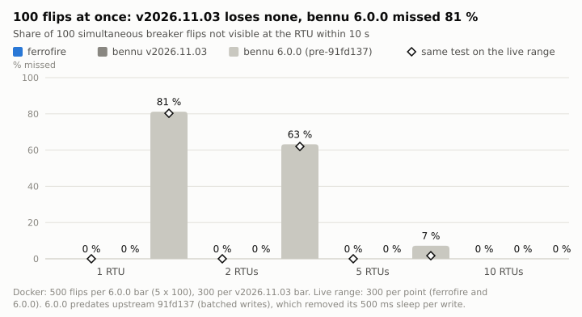
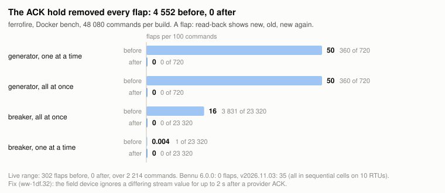

# ferrofire: findings on one page

ferrofire against stock bennu as shipped: Docker bench on one VM plus a live phenix range, 2026-11-14.
"Stock" is stock bennu 6.0.0 (before the upstream batched-write fix 91fd137, release v2026.11.03).
That fix removed a fixed 500 ms sleep per write in the field device, which explains the burst losses, the reordering and the 0.5 s floor on 1-2 RTUs below.
Those results are not claimed for current bennu; a rerun against it is pending (ww-1df.47). The 1 s publish latency is unaffected by the fix.
Every number is recomputed from raw data by [`bench/findings/`](../bench/findings/README.md).

## In 30 seconds

- A breaker flip is visible in **98 ms** on ferrofire, **1 025 ms** on stock as shipped.
- Stock tuned to publish at 0.1 s reaches **116 ms**, but only on 5+ RTUs.
- Of 100 simultaneous flips on 1 RTU, stock bennu 6.0.0 misses **81 %**; ferrofire misses **0**.
- The ACK hold cut ferrofire's flaps from **4 552** to **0**, latency unchanged.
- One hour on the live range: **35 993** datagrams sent, **0** missing.
- Stock bennu fails **5 of 5** fault checks; three proposed fixes pass all 5.
- ferrofire's provider costs **11 %** of a core at dt 0.05 s (VM, noisy).

## 1. How fast does a command take effect?

98-99 ms on ferrofire against 1 022-1 025 ms on stock bennu, flat from 1 to 10 RTUs.

- The live range agrees: 99 ms against 1 017-1 020 ms.
- 100 flips at once: stock bennu 6.0.0 misses 81 / 63 / 7 / 0 % on 1 / 2 / 5 / 10 RTUs; ferrofire none.
- 1 000 flips at once: 7 128-8 318 flips/s against 1.7-18.2.

*Stock is as shipped (1 s publish); tuned stock is in section 2. "Missed" = not visible within 10 s. Stock's 1 000-flip cells are one rep. Burst rows: bennu 6.0.0 only, rerun pending.*

## 2. Where does the second go?

Stock applies a flip in 26 ms, then waits about 995 ms for its once-a-second publish.

- Tuned to 0.1 s, stock reaches 116 ms on 5 RTUs but 512 ms on 1 (never under 468 ms).
- Bursts are not fixed on bennu 6.0.0: 80 % still missed on 1 RTU, 60 % on 2.
- Stock cannot hold 0.05 s: real period 72 ms under bench load, 79 ms idle; idle CPU 2.9 % -> 29.8 % of a core.

*Docker only. The 995 ms is a difference of medians. The 468 ms floor and the burst loss are the 500 ms sleep of bennu 6.0.0's field device.*

## 3. Provider or field device: which one matters?

Swapping only the provider gives 49 % of the latency gain on 1 RTU, 79 % on 2, all of it on 5-10.

- Burst loss follows the field device: a stock bennu 6.0.0 FD misses 80-81 % on 1 RTU behind either provider.
- The mixed pairing flaps on generators: 118 of 240 commands.

*Docker, 3 reps (stock's 1 000-flip cells: 1). Stock FD = bennu 6.0.0, before upstream fix 91fd137; rerun pending. Stock provider + ferrofire FD cannot run: the FD rejects stock's datagrams.*

## 4. Is a command ever lost, reordered or flickering?

The ACK hold took ferrofire from 4 552 flaps to 0 over 48 080 commands.

- Reordered commands: ferrofire 0; stock bennu 6.0.0 1 105 in Docker, 221 on the range, 1 to 10 s apart.
- Sequential p50: 98.7 ms before the fix, 98.5 ms after.

*Before and after are separate runs of different builds, not an A/B. Stock's reorders: bennu 6.0.0, before upstream fix 91fd137; rerun pending.*

## 5. Does the data stream arrive whole?

Live range, one hour at 10 Hz: 35 993 datagrams sent, 0 missing at either RTU.

- 5 % injected loss, 800 tags: 40 % of cycles whole on multicast, 84 % on the pull-bridge.
- 32 RTUs: 0.25 MB/s shared stream, 1.03 per-RTU groups, 1.43 pull-bridges.
- After a provider kill -9: multicast fresh in 3.4-3.7 ms, pull-bridge in 139-144 ms.

*Live hour is one run. Loss and fan-out are Docker, 3 reps; the shared stream had 1 listener, not 32.*

## 6. What breaks a stock field device?

Stock bennu fails all 5 fault checks on the live range; with proposed fixes #79, #81, #82 all 5 pass.

- Stock leaks 1 socket per Modbus connection and stops answering at connection 1 006.
- A truncated Modbus frame kills the stock device.
- Stock's idle watcher logs 57 780 B/min, 28x the limit; fixed: 0.

*Patched bennu, not ferrofire. "Fixed" is three builds, one per PR. Stock's leak numbers have no raw file (its stderr volume is 240 MB in one report, 6.2 GB in another).*

## 7. What does it cost in CPU?

ferrofire's provider costs 11 % of a core at dt 0.05 s, 49 % at dt 0.005 s.

- Three of six prototypes pay: 43 %, 32 % and 19 % less provider CPU.
- Hotspot per workload: publish bookkeeping 48 %, power sync plus solve 62 %, expression eval 53 %.

*One 25 s window per point on a Docker Desktop VM: absolute CPU is noisy, about 2x. Prototypes are throwaway, 3 pairs each.*

## Open

- Rerun of the stock side against current bennu (v2026.11.03 or later, with 91fd137): pending (ww-1df.47).
- 2x2 cross bench: stock provider + ferrofire FD cannot run (the FD rejects stock's datagrams, [control latency](bench/control-latency.md) section 9).
- Field-device microbench and C++ provider comparison: done, not charted here ([field device](bench/field-device.md), [C++ provider](bench/cpp-provider.md)).
- Maximum publish rate (ww-1df.43): not done.

## Sources

- Detail: [results](results.md), [control latency](bench/control-latency.md), [datagram bench](bench/datagram-v1-bench.md), [transports](bench/transport-comparison.md), [profiling](profiling.md), [testing](testing.md).
- Raw data: [`docs/bench/results/`](bench/results/), [`bench/findings/cpu-profiling-raw/`](../bench/findings/cpu-profiling-raw/).
- Scripts and what the raw data cannot settle: [`bench/findings/README.md`](../bench/findings/README.md).
