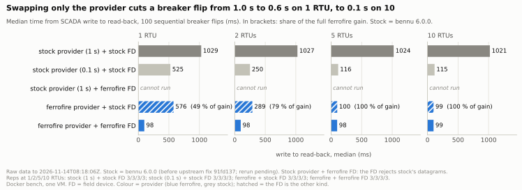
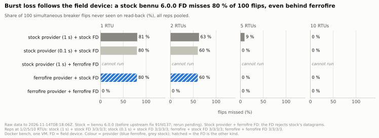
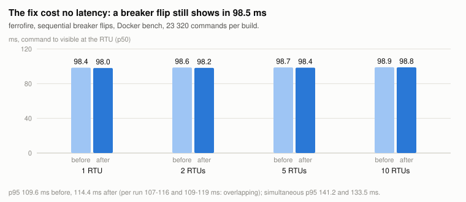
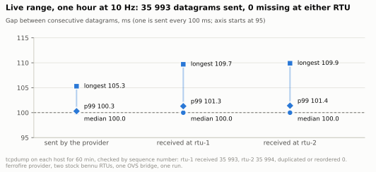
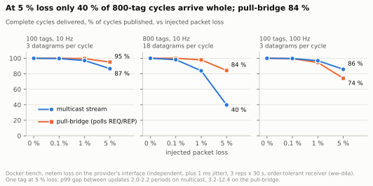
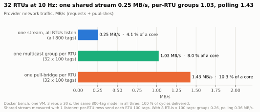
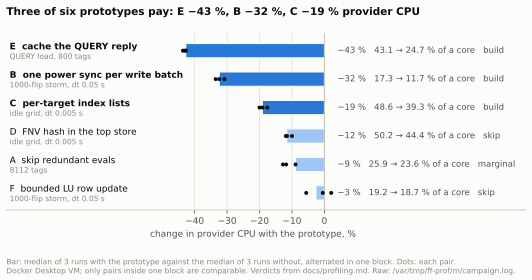
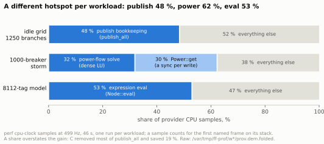
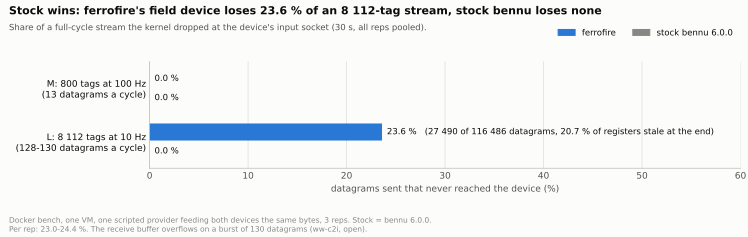
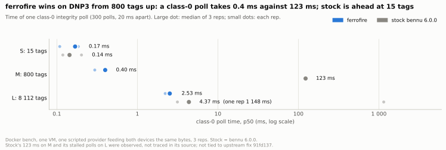

# ferrofire: findings on one page

ferrofire against stock bennu as shipped: Docker bench on one VM plus a live phenix range, 2026-11-14.
"Stock" is bennu 6.0.0, before the upstream batched-write fix 91fd137 (release v2026.11.03), which removed a fixed 500 ms sleep per write in the field device.
That sleep explains the burst losses, the reordering and the 0.5 s floor below; none is claimed for current bennu, and a rerun is pending (ww-1df.47). The 1 s publish latency is unaffected.
Every number is recomputed from raw data by [`bench/findings/`](../bench/findings/README.md).

## In 30 seconds

- A breaker flip is visible in **98 ms** on ferrofire, **1 025 ms** on stock as shipped, **116 ms** on stock tuned to 0.1 s (5+ RTUs).
- Of 100 simultaneous flips on 1 RTU, stock bennu 6.0.0 misses **81 %**; ferrofire **0**.
- The provider alone gives **49 %** of the latency gain on 1 RTU, all of it on 5-10.
- **Stock wins** on a full 8 112-tag stream: ferrofire's field device drops **23.6 %**, stock none. Stock also serves **4.5x** the Modbus requests per CPU-second at 16 clients.
- Against the C++ provider (stub model): **49 ms** against 118-148 ms at a 0.05 s publish, indicative only.
- One hour on the live range: **35 993** datagrams sent, **0** missing.
- Stock bennu fails **5 of 5** fault checks; three proposed fixes pass all 5.

## 1. How fast does a command take effect?

98-99 ms on ferrofire against 1 022-1 025 ms on stock bennu, flat from 1 to 10 RTUs.

- The live range agrees: 99 ms against 1 017-1 020 ms.
- 100 flips at once: stock bennu 6.0.0 misses 81 / 63 / 7 / 0 % on 1 / 2 / 5 / 10 RTUs; ferrofire none.
- 1 000 flips at once: 7 128-8 318 flips/s against 1.7-18.2.

*"Missed" = not visible within 10 s. Stock's 1 000-flip cells are one rep. Burst rows: bennu 6.0.0 only.*

## 2. Where does the second go?

Stock applies a flip in 26 ms, then waits about 995 ms for its once-a-second publish.

- Tuned to 0.1 s, stock reaches 116 ms on 5 RTUs but 512 ms on 1.
- Bursts stay lost on bennu 6.0.0: 80 % on 1 RTU, 60 % on 2.
- Stock cannot hold 0.05 s: real period 72 ms, idle CPU 2.9 % -> 29.8 % of a core.

*Docker only. The 1-RTU floor and the burst loss are bennu 6.0.0's 500 ms sleep.*

## 3. Provider or field device: which one matters?

Swapping only the provider gives 49 % of the latency gain on 1 RTU, 79 % on 2, all of it on 5-10.

- Burst loss follows the field device: a stock bennu 6.0.0 FD misses 80-81 % on 1 RTU behind either provider.
- The mixed pairing flaps on generators: 118 of 240 commands.

*Final, 3 reps. Stock provider + ferrofire FD cannot run: pybennu's datagrams lack the trailing NUL ferrofire's receiver requires (ww-y87).*

## 4. Is a command ever lost, reordered or flickering?

The ACK hold took ferrofire from 4 552 flaps to 0 over 48 080 commands.

- Reordered commands: ferrofire 0; stock bennu 6.0.0 1 105 in Docker, 221 on the range.
- Latency is unchanged: 98.7 ms before, 98.5 ms after.

*Before and after are separate runs of different builds, not an A/B.*

## 5. Does the data stream arrive whole?

Live range, one hour at 10 Hz: 35 993 datagrams sent, 0 missing at either RTU.

- 5 % injected loss, 800 tags: 40 % of cycles whole on multicast, 84 % on the pull-bridge.

*Live hour is one run. Loss and fan-out are Docker, 3 reps; the shared stream had 1 listener.*

## 6. What breaks a stock field device?

Stock bennu fails all 5 fault checks on the live range; with proposed fixes #79, #81, #82 all 5 pass.

- Stock leaks 1 socket per Modbus connection and stops answering at connection 1 006.

*Patched bennu, not ferrofire; three builds, one per PR. Stock's leak numbers have no raw file.*

## 7. What does it cost in CPU?

ferrofire's provider costs 11 % of a core at dt 0.05 s, 49 % at dt 0.005 s.

- Three of six prototypes pay: 43 %, 32 % and 19 % less provider CPU.

*One 25 s window per point on a Docker Desktop VM: absolute CPU is noisy, about 2x.*

## 8. Field device against field device

Same scripted provider, same config: stock wins stream delivery and CPU per request; ferrofire wins DNP3 from 800 tags and quick writes.

- Stock wins: ferrofire drops 23.6 % of an 8 112-tag 10 Hz stream, stock none; 800 tags at 100 Hz is clean on both.
- Stock wins: 4.5x the Modbus requests per CPU-second at 16 clients, where ferrofire serves 33 % more on 6.1 cores.
- ferrofire wins: a DNP3 poll of 800 tags takes 0.4 ms against 123 ms; it forwards all 100 quick writes, stock bennu 6.0.0 34-35.

*Docker, 3 reps. The 130-datagram burst is a worst case. Quick-write loss: bennu 6.0.0 only. The 123 ms is untraced.*

## 9. Against the C++ provider

Plumbing only: at a 0.05 s publish ferrofire shows a flip in 49 ms, the C++ `bennu-simulink-provider` chain in 118-148 ms.

- The 2.4-3.0x is indicative only: each C++ rep lands near 100 or 150-200 ms; at 0.1 s and 1 250 points it is 103 against 99 ms.
- 1 000 flips at once: ferrofire loses none, the C++ chain 49-53 % behind a ferrofire FD; behind a stock bennu 6.0.0 FD both lose 80 %.

*Stub model with a 0.05 s step, no solver, 3 reps. The C++ loss depends on that step.*

## Open

- Stock rerun against current bennu (v2026.11.03 or later): pending (ww-1df.47).
- Maximum publish rate (ww-1df.43): blocked on ww-c2i.
- ferrofire FD drops 23.6 % of an 8 112-tag stream (ww-c2i): open.
- ferrofire FD rejects pybennu's NUL-less datagrams (ww-y87): open.
- Upstream bennu issue: draft.

## Sources

- Detail: [results](results.md), [control latency](bench/control-latency.md), [field device](bench/field-device.md), [C++ provider](bench/cpp-provider.md), [datagram bench](bench/datagram-v1-bench.md), [transports](bench/transport-comparison.md), [profiling](profiling.md), [testing](testing.md).
- Raw data: [`docs/bench/results/`](bench/results/), [`bench/findings/cpu-profiling-raw/`](../bench/findings/cpu-profiling-raw/).
- Scripts and what the raw data cannot settle: [`bench/findings/README.md`](../bench/findings/README.md).
