# ferrofire: findings on one page

ferrofire against stock bennu as shipped: Docker bench on one VM plus a live phenix range, 2026-11-14.
Every number is recomputed from raw data by [`bench/findings/`](../bench/findings/README.md).

## In 30 seconds

- A breaker flip is visible in **98 ms** on ferrofire, **1 025 ms** on stock.
- Of 100 simultaneous flips on 1 RTU, stock misses **81 %**; ferrofire misses **0**.
- The ACK hold cut ferrofire's flaps from **4 552** to **0**, latency unchanged.
- One hour on the live range: **35 993** datagrams sent, **0** missing.
- Stock bennu fails **5 of 5** fault checks; three upstream fixes pass all 5.
- ferrofire's provider costs **11 %** of a core at dt 0.05 s.

## 1. How fast does a command take effect?

98-99 ms on ferrofire against 1 022-1 025 ms on stock bennu, flat from 1 to 10 RTUs.

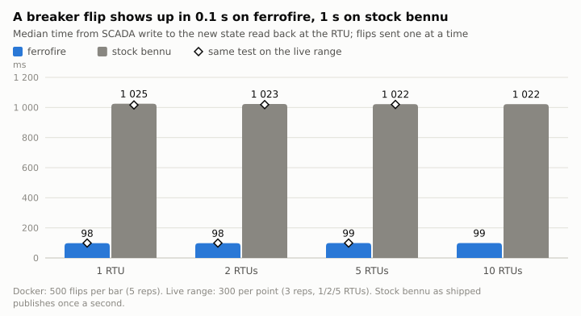

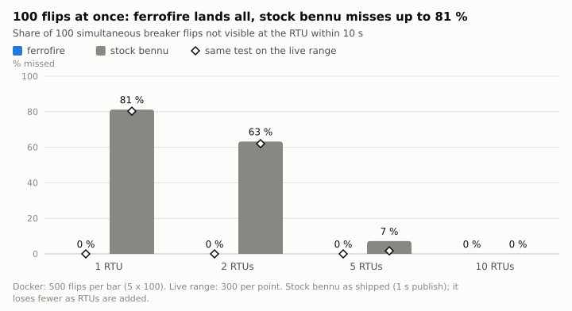

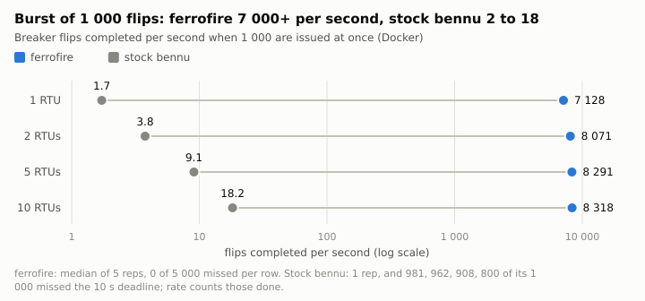

- The live range agrees: 99 ms against 1 017-1 020 ms.
- 100 flips at once: stock misses 81 / 63 / 7 / 0 % on 1 / 2 / 5 / 10 RTUs; ferrofire none.
- 1 000 flips at once: 7 128-8 318 flips/s against 1.7-18.2.

*"Missed" = not visible within 10 s. Stock's 1 000-flip cells are one rep.*

## 2. Where does the second go?

Stock applies a flip in 26 ms, then waits about 995 ms for its once-a-second publish.

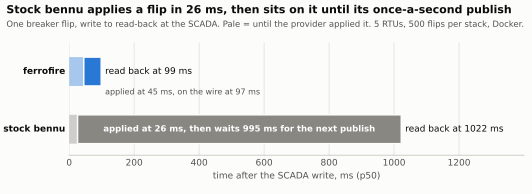

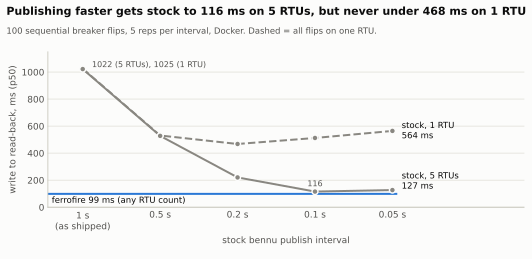

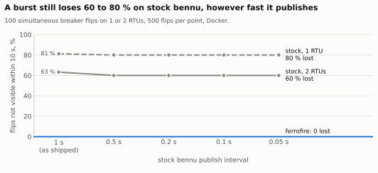

- Tuned to 0.1 s, stock reaches 116 ms on 5 RTUs but stays at 468-564 ms on 1.
- Bursts are not fixed: 80 % still missed on 1 RTU, 60 % on 2.
- Stock cannot hold 0.05 s: real period 72-79 ms, idle CPU 2.9 % -> 29.8 % of a core.

*Docker only. The 995 ms is a difference of medians.*

## 3. Provider or field device: which one matters? (interim)

Swapping only the provider gives 49 % of the latency gain on 1 RTU, 79 % on 2, all of it on 5-10.

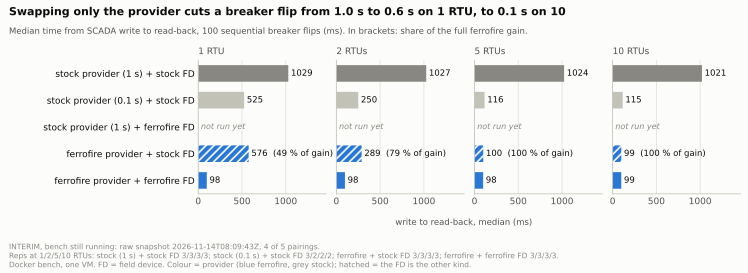

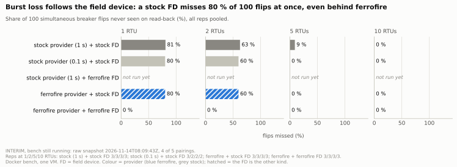

- Burst loss follows the field device: a stock FD misses 80-81 % on 1 RTU behind either provider.
- The mixed pairing flaps on generators: 118 of 240 commands.

*Interim: snapshot 2026-11-14T08:03:27Z, 3 of 4 pairings, 3 reps (tuned stock 1-2). The FD-only swap is unmeasured.*

## 4. Is a command ever lost, reordered or flickering?

The ACK hold took ferrofire from 4 552 flaps to 0 over 48 080 commands.

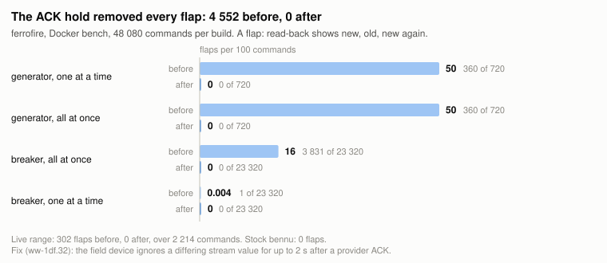

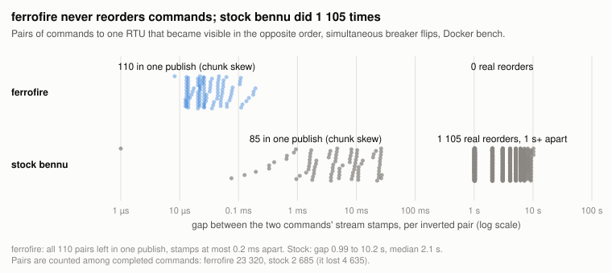

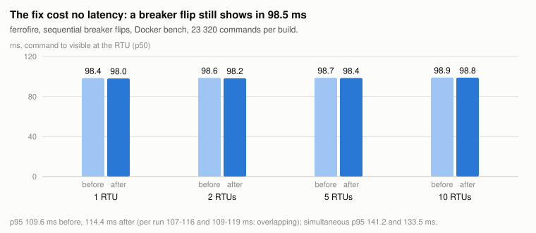

- Reordered commands: ferrofire 0; stock 1 105 in Docker, 221 on the range.
- Sequential p50: 98.7 ms before the fix, 98.5 ms after.

*Before and after are separate runs of different builds, not an A/B.*

## 5. Does the data stream arrive whole?

Live range, one hour at 10 Hz: 35 993 datagrams sent, 0 missing at either RTU.

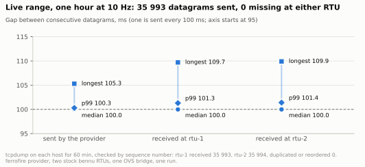

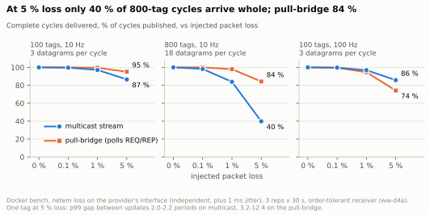

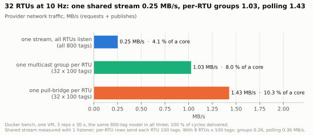

- 5 % injected loss, 800 tags: 40 % of cycles whole on multicast, 84 % on the pull-bridge.
- 32 RTUs: 0.25 MB/s shared stream, 1.03 per-RTU groups, 1.43 pull-bridges.
- After a provider kill -9: multicast fresh in 3.4-3.7 ms, pull-bridge in 139-144 ms.

*Live hour is one run. Loss and fan-out are Docker, 3 reps; the shared stream had 1 listener, not 32.*

## 6. What breaks a stock field device?

Stock bennu fails all 5 fault checks on the live range; with fixes #79, #81, #82 all 5 pass.




- Stock leaks 1 socket per Modbus connection and stops answering at connection 1 006.
- A truncated Modbus frame kills the stock device.
- Stock's idle watcher logs 57 780 B/min, 28x the limit; fixed: 0.

*Patched bennu, not ferrofire. "Fixed" is three builds, one per PR. Stock's leak numbers have no raw file.*

## 7. What does it cost in CPU?

ferrofire's provider costs 11 % of a core at dt 0.05 s, 49 % at dt 0.005 s.

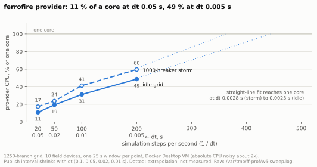

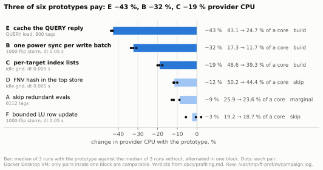

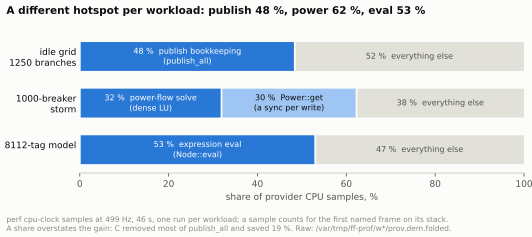

- Three of six prototypes pay: 43 %, 32 % and 19 % less provider CPU.
- Hotspot per workload: publish bookkeeping 48 %, power sync plus solve 62 %, expression eval 53 %.

*One 25 s window per point on a Docker Desktop VM. Prototypes are throwaway, 3 pairs each.*

## Still running / open

- 2x2 cross bench: stock provider + ferrofire FD not run yet.
- Field-device microbench: not done.
- C++ provider comparison: not done.
- Maximum publish rate (ww-1df.43): not done.

## Sources

- Detail: [results](results.md), [control latency](bench/control-latency.md), [datagram bench](bench/datagram-v1-bench.md), [transports](bench/transport-comparison.md), [profiling](profiling.md), [testing](testing.md).
- Raw data: [`docs/bench/results/`](bench/results/), [`bench/findings/cpu-profiling-raw/`](../bench/findings/cpu-profiling-raw/).
- Scripts and mismatches with the reports: [`bench/findings/README.md`](../bench/findings/README.md).
