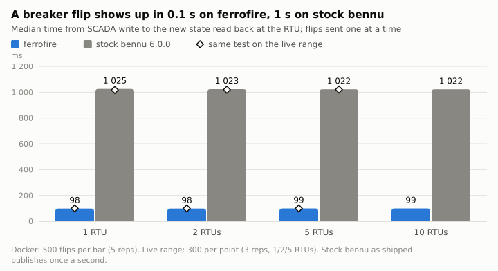
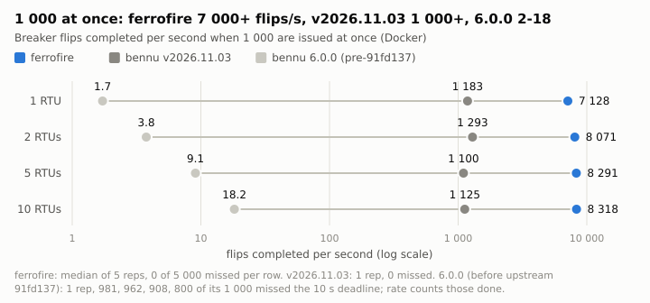
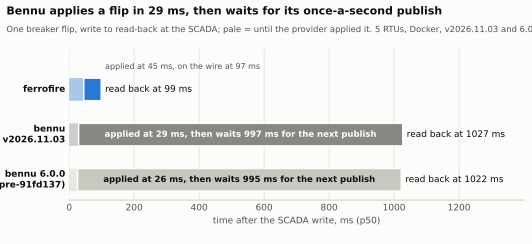
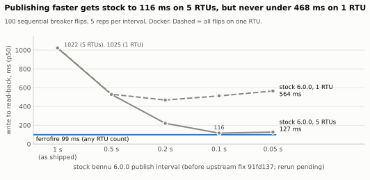
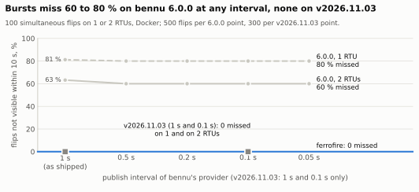
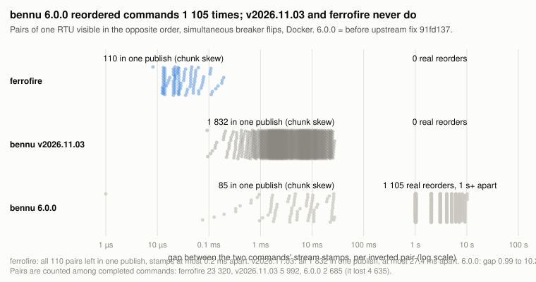
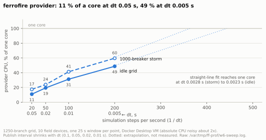
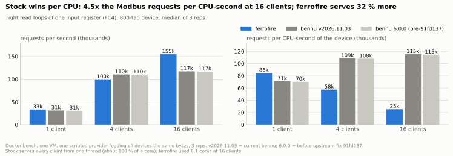
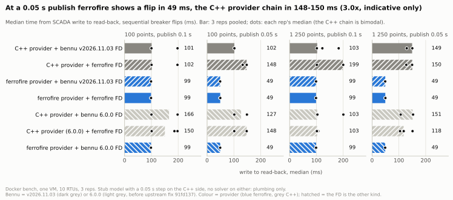
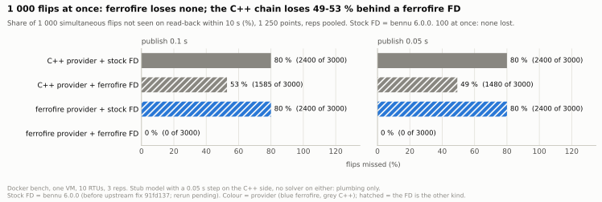

# ferrofire: findings on one page

ferrofire against stock bennu as shipped: Docker bench on one VM plus a live phenix range, 2026-11-14 (control, field-device and C++-provider benches rerun with the current bennu on 2026-11-14).

- "Stock" is two versions of bennu, always labelled: **bennu v2026.11.03** (the current release, the main comparison) and **bennu 6.0.0 (pre-91fd137)** (the older one every earlier run used, kept as history).
- Upstream fix 91fd137 (in v2026.11.03) removed a fixed 500 ms sleep per write in the field device and batched its writes. Against v2026.11.03 the burst losses, the reordering, the 0.5 s floor on 1-2 RTUs and the quick-write loss that 6.0.0 showed are **gone**; they are not ferrofire advantages over current bennu. What did not change is the 1 s publish latency. What is new: flaps under bursts.
- Every number is recomputed from raw data by [`bench/findings/`](../bench/findings/README.md).

## In 30 seconds

- A breaker flip is visible in **98 ms** on ferrofire, **1 025-1 029 ms** on bennu as shipped (either version), **114-120 ms** on bennu v2026.11.03 tuned to 0.1 s (any number of RTUs; 6.0.0: 512 ms on 1 RTU).
- Of 100 simultaneous flips on 1 RTU, bennu v2026.11.03 misses **0 %** and ferrofire **0**; bennu 6.0.0 missed **81 %**.
- With the v2026.11.03 field device the provider alone gives **all** of the latency gain on any RTU count (6.0.0: **49 %** on 1 RTU).
- Ferrofire's field device used to drop **23.6 %** of a full 8 112-tag stream (bennu none); after the receive-path fix (ww-c2i) it drops **0** (116 486 of 116 486 datagrams, 3 reps). **Stock wins** on cpu: bennu serves **4.5x** the Modbus requests per CPU-second at 16 clients.
- **New with v2026.11.03: flaps.** Behind a ferrofire provider its field device flapped on **27 %** of 100 simultaneous flips on 5 RTUs and **33 %** of 1 000 (ferrofire's own field device: 0); cause not traced.
- Against the C++ provider (stub model): **49 ms** against 148-150 ms at a 0.05 s publish (bennu v2026.11.03), indicative only; its 1 000-flip loss of 49-53 % on 6.0.0 is gone.
- One hour on the live range: **35 993** datagrams sent, **0** missing.
- Stock bennu fails **5 of 5** fault checks; three proposed fixes pass all 5.

## 1. How fast does a command take effect?

98-99 ms on ferrofire against 1 025-1 029 ms on bennu v2026.11.03 and 1 022-1 025 ms on 6.0.0 as shipped (1 s publish), flat from 1 to 10 RTUs.

- The live range agrees: 99 ms against 1 017-1 020 ms (bennu 6.0.0; v2026.11.03 was not run on the range).
- 100 flips at once: bennu v2026.11.03 misses 0 % on 1 / 2 / 5 / 10 RTUs, like ferrofire; bennu 6.0.0 missed 81 / 63 / 7 / 0 %.
- 1 000 flips at once: 7 128-8 318 flips/s on ferrofire, 1 100-1 293 on v2026.11.03 (served by the next 1 s publish), 1.7-18.2 on 6.0.0.

*"Missed" = not visible within 10 s. Stock's 1 000-flip cells are one rep; v2026.11.03 is 3 reps elsewhere (ferrofire and 6.0.0: 5).*

## 2. Where does the second go?

Bennu applies a flip in 29 ms (v2026.11.03; 6.0.0: 26 ms), then waits about 997 ms for its once-a-second publish.

- Tuned to 0.1 s, bennu v2026.11.03 reaches 115 ms on 5 RTUs and 119 ms on 1; bennu 6.0.0 reached 116 ms on 5 RTUs but 512 ms on 1.
- Bursts stayed lost on bennu 6.0.0 at any interval (80 % on 1 RTU, 60 % on 2); v2026.11.03 loses none at 1 s or 0.1 s.
- Bennu 6.0.0's provider cannot hold 0.05 s: real period 72 ms, idle CPU 2.9 % -> 29.8 % of a core (not re-measured for v2026.11.03).

*Docker only. The 6.0.0 1-RTU floor and burst loss were its 500 ms sleep per write, removed by upstream 91fd137.*

## 3. Provider or field device: which one matters?

Against bennu v2026.11.03 as shipped (1 s publish), swapping only the provider gives all of the latency gain on any RTU count (with the 6.0.0 field device it was 49 % on 1 RTU, 79 % on 2, all on 5-10).

- Burst loss followed the 6.0.0 field device (80-81 % on 1 RTU behind either provider); with the v2026.11.03 field device nothing is lost behind either provider.
- The mixed pairing ferrofire provider + v2026.11.03 field device flaps: 120 of 240 generator commands (118 with 6.0.0) and, new, 1 167 of 13 920 simultaneous breaker flips (on 5 RTUs 1 099 of 3 480, pooled over the 10-1 000-flip phases). Cause not traced; ferrofire's field device has none.

*Final, 3 reps. Bennu provider + ferrofire FD runs since ww-y87 (the receiver accepts pybennu's NUL-less datagrams): 1 026-1 028 ms, no loss, no flap, the provider's 1 s.*

## 4. Is a command ever lost, reordered or flickering?

The ACK hold took ferrofire from 4 552 flaps to 0 over 48 080 commands.

- Reordered commands: ferrofire 0; bennu v2026.11.03 0; bennu 6.0.0 1 105 in Docker, 221 on the range.
- Flaps: bennu v2026.11.03 35 of 12 848 commands at 1 s and 198 at 0.1 s (mostly 10 RTUs), 6.0.0 none; ferrofire none since the ACK hold.
- Latency is unchanged: 98.7 ms before, 98.5 ms after.

*Before and after are separate runs of different builds, not an A/B.*

## 5. Does the data stream arrive whole?

Live range, one hour at 10 Hz: 35 993 datagrams sent, 0 missing at either RTU.

- 5 % injected loss, 800 tags: 40 % of cycles whole on multicast, 84 % on the pull-bridge.

*Live hour is one run. Loss and fan-out are Docker, 3 reps; the shared stream had 1 listener.*

## 6. What breaks a stock field device?

Stock bennu fails all 5 fault checks on the live range; with proposed fixes #79, #81, #82 all 5 pass.

- Stock leaks 1 socket per Modbus connection and stops answering at connection 1 006.

*Patched bennu, not ferrofire; three builds, one per PR. Stock's leak numbers have no raw file.*

## 7. What does it cost in CPU?

ferrofire's provider costs 11 % of a core at dt 0.05 s, 49 % at dt 0.005 s.

- Three of six prototypes pay: 43 %, 32 % and 19 % less provider CPU.

*One 25 s window per point on a Docker Desktop VM: absolute CPU is noisy, about 2x.*

## 8. Field device against field device

Same scripted provider, same config: stock wins stream delivery and CPU per request; ferrofire wins DNP3 from 800 tags (and, against bennu 6.0.0 only, quick writes).

- Fixed (ww-c2i): ferrofire dropped 23.6 % of an 8 112-tag 10 Hz stream, bennu (either version) none; with an 8 MiB SO_RCVBUF and a drain-then-parse loop ferrofire drops 0 of 116 486; 800 tags at 100 Hz was clean on all.
- Stock wins: 4.5x the Modbus requests per CPU-second at 16 clients, where ferrofire serves 32 % more on 6.1 cores.
- ferrofire wins: a DNP3 poll of 800 tags takes 0.4 ms against 123 ms on bennu (both versions; 6.0.0 was ahead at 15 tags, v2026.11.03 is not).
- Quick writes: ferrofire and bennu v2026.11.03 forward all 100; bennu 6.0.0 forwarded 34-35. No longer an advantage against current bennu.

*Docker, 3 reps. The 130-datagram burst is a worst case. The 123 ms is untraced and the same in both versions.*

## 9. Against the C++ provider

Plumbing only: at a 0.05 s publish ferrofire shows a flip in 49 ms, the C++ `bennu-simulink-provider` chain (bennu v2026.11.03) in 148-150 ms.

- The 3.0x is indicative only: each C++ rep lands near 100 or 150-200 ms; at 0.1 s the factor is 1.0 to 2.0 depending on the reps drawn.
- 1 000 flips at once: nothing is lost by any pairing with bennu v2026.11.03. With bennu 6.0.0 the C++ chain lost 49-53 % behind a ferrofire FD (its updates FIFO, enlarged upstream in `e59691f`) and both providers 80 % behind the 6.0.0 FD.
- New with v2026.11.03: its field device flaps behind the C++ provider on 6 411 of 8 040 commands (99 % of them at 0.05 s); ferrofire's field device behind it: none.

*Stub model with a 0.05 s step, no solver, 3 reps. The C++ latency depends on that step.*

## Open

- Flaps of the v2026.11.03 field device under bursts (behind a ferrofire provider and a fast bennu provider): cause not traced.
- Maximum publish rate (ww-1df.43): was blocked on ww-c2i, which is fixed.
- Upstream bennu issue about the burst loss: not needed, 91fd137 fixed it.

## Sources

- Detail: [results](results.md), [control latency](bench/control-latency.md), [field device](bench/field-device.md), [C++ provider](bench/cpp-provider.md), [datagram bench](bench/datagram-v1-bench.md), [transports](bench/transport-comparison.md), [profiling](profiling.md), [testing](testing.md).
- Raw data: [`docs/bench/results/`](bench/results/), [`bench/findings/cpu-profiling-raw/`](../bench/findings/cpu-profiling-raw/).
- Scripts and what the raw data cannot settle: [`bench/findings/README.md`](../bench/findings/README.md).
