# Results

What ferrofire has been measured to do. Every section names the two things compared, the conditions and the unit, then shows a chart, the
numbers behind it, and one line on what they mean.

- **Docker bench**: provider, monitor and client are containers on one Linux bridge inside the Docker Desktop VM of an Apple Silicon Mac. The only loss is
  what `tc netem` injects. Method, caveats and every table: [datagram-v1-bench.md](bench/datagram-v1-bench.md) (sections A-F) and
  [transport-comparison.md](bench/transport-comparison.md) (historical).
- **Live range**: the `waterway-arm64` phēnix range (aarch64 KVM guests on the same Mac): `ferrofire` as the provider, two stock `bennu-field-device` RTUs, one
  OVS bridge. Section G of [datagram-v1-bench.md](bench/datagram-v1-bench.md#g-live-range-waterway-arm64-across-ovs-ww-otj19-ww-2s0).
- Charts are SVG, drawn by [bench/charts.py](../bench/charts.py) (`make charts`) from the raw files under [docs/bench/results/](bench/results/); the numbers
  under each chart are the plotted values, also saved as a CSV next to each SVG in [docs/img/charts/](img/charts/). Three repetitions per bench point unless
  stated; values are means over the repetitions.
- Colour follows the thing measured: grey is "before" or stock; blue is the fixed or new code and the multicast stream; orange is the pull-bridge; green is
  per-RTU multicast groups; purple is ZeroMQ and red is NNG (historical).

## 1. Value age: publish on a timer vs right after the engine tick

Age of the values at the receiver for an 800-tag model, before the change (a publisher thread sampling the model on its own timer) and after it (the
provider publishes the snapshot it has just taken). Docker bench, 10 Hz and 100 Hz publish, 30 s x 3 reps. Unit: milliseconds, p50 and p99 of age above the
smallest age in the run. Raw: [raw/](bench/results/raw/) (before), [raw-datagram-v1/A_age_*](bench/results/raw-datagram-v1/) (after).

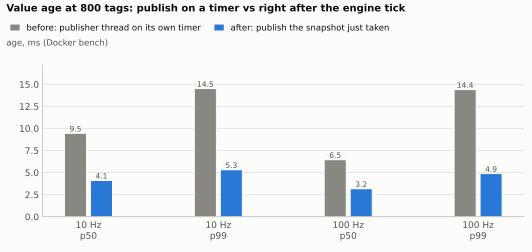

| rate | percentile | before ms | after ms | reps before | reps after |
|---|---|---|---|---|---|
| 10 Hz | p50 | 9.5 | 4.1 | 3 | 3 |
| 10 Hz | p99 | 14.5 | 5.3 | 3 | 3 |
| 100 Hz | p50 | 6.5 | 3.2 | 3 | 3 |
| 100 Hz | p99 | 14.4 | 4.9 | 3 | 3 |

Publishing right after the tick roughly halves the age and removes the 14-15 ms ceiling, which was the publisher thread sampling a snapshot up to one engine step (10 ms) old. "Before" and "after" are different
builds and clients on the same machine, not a controlled A/B of one commit ([caveats](bench/datagram-v1-bench.md#caveats-read-before-quoting-a-number)).

## 2. Complete cycles under injected loss: multicast vs pull-bridge

Share of published cycles that arrive complete, with `tc netem delay 2ms 1ms` and 0, 0.1, 1 and 5 % loss on the provider's egress. Datagram v1 multicast (order-tolerant
receiver) against a `ferrofire pull-bridge` (ZeroMQ REQ/REP over TCP), run in the same cell at the same time. Docker bench, 30 s x 3 reps per point; 100 tags at
10 and 100 Hz, 800 tags at 10 Hz. Unit: percent of cycles the provider published. Raw: [raw-datagram-v1-d4a/](bench/results/raw-datagram-v1-d4a/). (The pull
numbers in section B and C of the bench report come from the earlier, first run of the same cells and differ by up to 0.5 points.)

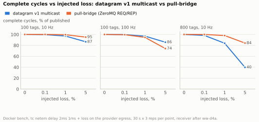

| cell | loss | multicast complete % | pull-bridge complete % | reps |
|---|---|---|---|---|
| 100 tags, 10 Hz | 0 % | 100.0 | 100.0 | 3 |
| 100 tags, 10 Hz | 0.1 % | 99.7 | 100.0 | 3 |
| 100 tags, 10 Hz | 1 % | 97.1 | 99.5 | 3 |
| 100 tags, 10 Hz | 5 % | 86.6 | 95.1 | 3 |
| 100 tags, 100 Hz | 0 % | 100.0 | 100.0 | 3 |
| 100 tags, 100 Hz | 0.1 % | 99.7 | 99.5 | 3 |
| 100 tags, 100 Hz | 1 % | 96.9 | 94.6 | 3 |
| 100 tags, 100 Hz | 5 % | 85.8 | 74.2 | 3 |
| 800 tags, 10 Hz | 0 % | 100.0 | 100.0 | 3 |
| 800 tags, 10 Hz | 0.1 % | 98.2 | 100.0 | 3 |
| 800 tags, 10 Hz | 1 % | 83.9 | 98.0 | 3 |
| 800 tags, 10 Hz | 5 % | 39.8 | 84.2 | 3 |

A multicast cycle of D datagrams is complete with probability (1-p)^D, so a big cycle suffers: at 5 % loss 800 tags (18 datagrams) complete 39.8 % of the time, 100 tags (3) 86.6 %.
TCP retransmits inside the pull, so it wins at 800 tags (84.2 % at 5 %) and loses at 100 Hz (74.2 %: a lost segment costs an RTO of 200 ms or more against a bridge timeout of 20 ms).

### 2b. The reordering fix

Complete cycles at zero injected loss with the same jitter (`delay 2ms 1ms` reorders datagrams that leave back to back): the receiver as first shipped against the
order-tolerant receiver of ww-d4a. Docker bench, 30 s x 3 reps. Unit: percent of cycles published. Raw: [raw-datagram-v1/](bench/results/raw-datagram-v1/) (before),
[raw-datagram-v1-d4a/](bench/results/raw-datagram-v1-d4a/) (after).

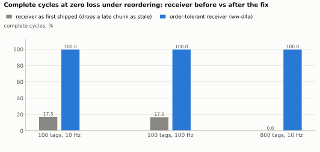

| cell (0 % loss, delay 2ms 1ms) | complete % before ww-d4a | complete % after ww-d4a |
|---|---|---|
| 100 tags, 10 Hz | 17.3 | 100.0 |
| 100 tags, 100 Hz | 17.0 | 100.0 |
| 800 tags, 10 Hz | 0.0 | 100.0 |

The first receiver dropped a late chunk as `stale` although it carried different tags; with no loss at all it completed 17 % of 100-tag cycles and none of the 800-tag cycles. After the fix, all of them.

## 3. Per-tag staleness under injected loss: multicast vs pull-bridge

How long a reader of a single tag waits between updates: p99 of the gap between arrivals of 8 probe tags spread over the cycle's datagrams, in the same runs as section 2
(Docker bench, `delay 2ms 1ms` plus loss, 30 s x 3 reps). Unit: publish periods (1 period = 100 ms at 10 Hz, 10 ms at 100 Hz); milliseconds in the table. Raw:
[raw-datagram-v1-d4a/](bench/results/raw-datagram-v1-d4a/), field `probe_gap`.

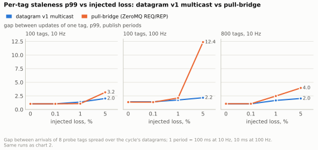

| cell | loss | multicast p99 ms | multicast p99 periods | pull p99 ms | pull p99 periods |
|---|---|---|---|---|---|
| 100 tags, 10 Hz | 0 % | 105 | 1.0 | 103 | 1.0 |
| 100 tags, 10 Hz | 0.1 % | 104 | 1.0 | 104 | 1.0 |
| 100 tags, 10 Hz | 1 % | 137 | 1.4 | 107 | 1.1 |
| 100 tags, 10 Hz | 5 % | 202 | 2.0 | 316 | 3.2 |
| 100 tags, 100 Hz | 0 % | 14 | 1.4 | 14 | 1.4 |
| 100 tags, 100 Hz | 0.1 % | 14 | 1.4 | 13 | 1.3 |
| 100 tags, 100 Hz | 1 % | 17 | 1.7 | 21 | 2.1 |
| 100 tags, 100 Hz | 5 % | 22 | 2.2 | 124 | 12.4 |
| 800 tags, 10 Hz | 0 % | 104 | 1.0 | 105 | 1.1 |
| 800 tags, 10 Hz | 0.1 % | 104 | 1.0 | 105 | 1.1 |
| 800 tags, 10 Hz | 1 % | 167 | 1.7 | 247 | 2.5 |
| 800 tags, 10 Hz | 5 % | 202 | 2.0 | 396 | 4.0 |

A single tag stays within about 2 periods at 5 % loss with multicast (each later cycle refreshes it); the pull-bridge reaches 3.2-12.4 periods at 5 % because after a lost segment the bridge waits out a TCP retransmission timeout (200 ms or more) before it asks again. A reader that needs a whole consistent cycle waits longer than a reader of one tag (complete-cycle staleness, section B and C of the bench report).

## 4. Fan-out: one stream vs per-RTU groups vs pull-bridges

32 RTUs x 100 tags each, 800-tag model: one multicast stream of all 800 tags (every RTU would receive all of it), 32 multicast groups of 100 tags, and 32 pull-bridges of
100 tags. Docker bench, 30 s x 3 reps at 10 Hz and 100 Hz. Two charts, one unit each. Raw: [raw-datagram-v1/D_*](bench/results/raw-datagram-v1/).

Provider wire traffic, MB/s (request + publish frames on the provider's `eth0`, both directions):

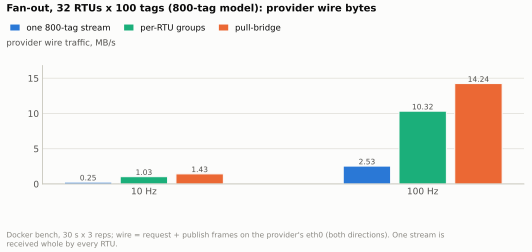

Provider CPU, percent of one core:

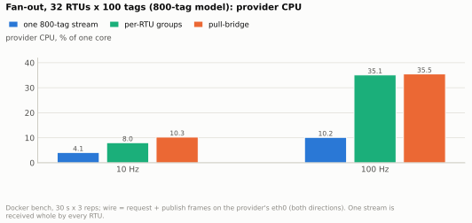

| rate | mode | provider wire MB/s | provider CPU % of a core | reps |
|---|---|---|---|---|
| 10 Hz | one 800-tag stream | 0.25 | 4.1 | 3 |
| 10 Hz | per-RTU groups | 1.03 | 8.0 | 3 |
| 10 Hz | pull-bridge | 1.43 | 10.3 | 3 |
| 100 Hz | one 800-tag stream | 2.53 | 10.2 | 3 |
| 100 Hz | per-RTU groups | 10.32 | 35.1 | 3 |
| 100 Hz | pull-bridge | 14.24 | 35.5 | 3 |

The single stream is cheapest for the provider (0.25 MB/s, 4.1 % at 10 Hz) and costliest for every RTU, which receives all of it (252 kB/s at 10 Hz, 2.5 MB/s at 100 Hz) instead of
its own 32 kB/s or 323 kB/s slice. Per-RTU groups cost the provider 4x the bytes; pull costs 1.4x the groups' bytes and, at 10 Hz, 1.3x the CPU.

## 5. Historical: ZeroMQ vs NNG

NNG was evaluated and dropped on 2026-11-09 (no multicast, so N RTUs are N copies; bimodal request latency; an 800-tag publish loss). ZeroMQ against NNG as ferrofire's transport,
Docker bench, tag counts 10, 50, 100 and 800, 10 and 100 Hz, 3 reps each (48 runs). Raw: [raw/](bench/results/raw/); report: [transport-comparison.md](bench/transport-comparison.md).

**5a. Publish cycles lost at 800 tags**, percent of cycles not delivered complete (bars: mean of the 3 reps; dots: each rep):

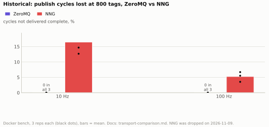

| metric | transport | rate | each rep, % | mean, % |
|---|---|---|---|---|
| publish cycles lost, 800 tags | zmq | 10 Hz | 0.0, 0.0, 0.0 | 0.0 |
| publish cycles lost, 800 tags | zmq | 100 Hz | 0.0, 0.0, 0.0 | 0.0 |
| publish cycles lost, 800 tags | nng | 10 Hz | 12.7, 22.0, 14.7 | 16.4 |
| publish cycles lost, 800 tags | nng | 100 Hz | 6.7, 5.5, 3.5 | 5.3 |

ZeroMQ lost no cycle at any size; NNG lost 3.5-22 % of the 800-tag cycles in every run (suspected: NNG's 16-message PUB queue against 17 chunks sent back to back).

**5b. Request latency**, READ round trip p50 in microseconds, one dot per run (24 runs per transport):

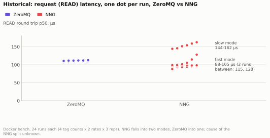

NNG ran in two modes, a fast one below ZeroMQ (88-105 µs, 16 runs of 24) and a slow one about 45 % above it (144-162 µs, 6 runs), with two runs in between (115 and 128 µs); ZeroMQ was in one (107-113 µs). Run-by-run values are in
[05b-nng-latency.csv](img/charts/05b-nng-latency.csv); the cause of the split is not known, so no single "NNG is faster/slower" figure is honest.

**5c. Packets per publish cycle**, mean of 6 runs per tag count (2 rates x 3 reps):

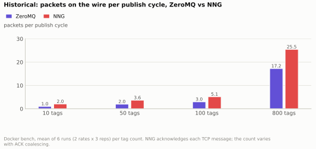

| tags | ZeroMQ packets/cycle | NNG packets/cycle |
|---|---|---|
| 10 | 1.00 | 2.04 |
| 50 | 1.99 | 3.65 |
| 100 | 2.99 | 5.14 |
| 800 | 17.24 | 25.45 |

NNG sends 1.5-2x the packets (each TCP message is acknowledged); the payload bytes are about equal.

## 6. Live range, one hour: datagrams sent vs received

Datagram v1 whole-model stream, 10 Hz, 3 600 s, from the provider to two stock bennu RTUs across one OVS bridge (snooping off, the default). Datagrams counted from `tcpdump` at each
NIC by `_ff.seq` ([bench/live/seqgap.py](../bench/live/seqgap.py)). Raw: [live/*/cap-dg1h-*.txt](bench/results/live/).

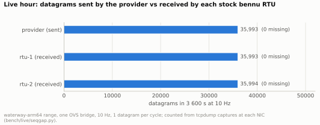

Inter-arrival time between consecutive datagrams at each capture point, milliseconds (the period is 100 ms):

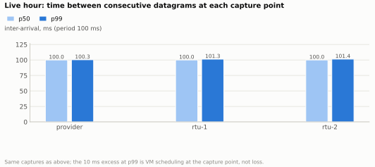

| capture point | datagrams | _ff.seq range | missing | inter-arrival p50 ms | p99 ms | max ms |
|---|---|---|---|---|---|---|
| provider | 35993 | 2454..38446 | 0 | 100.0 | 100.3 | 105.3 |
| rtu-1 | 35993 | 2454..38446 | 0 | 100.0 | 101.3 | 109.7 |
| rtu-2 | 35994 | 2453..38446 | 0 | 100.0 | 101.4 | 109.9 |

No datagram was lost, duplicated or reordered between the provider's NIC and either RTU in an hour (rtu-2 started its capture 1 s earlier, hence one more datagram). The p99 excess of up to 1.4 ms and the 105-110 ms maxima are VM scheduling.
During the hour the RTUs' Modbus registers matched the provider's values in 100 % of 325 samples (max error 0.5 m on a 300 m transit) and the stock device was not affected by the extra `_ff.*` tags.

## 7. Live range: OVS multicast snooping off vs on

Bytes per second the OVS bridge sent to each NIC, with snooping off (the default: every multicast datagram is flooded to every port) and on (only to ports that joined the group). Two stream layouts: one whole-model
stream, and per-RTU groups. Bystanders are the five machines that do not listen: opc, historian, hmi, scada-server, engineer-workstation. Unit: bytes/s on the segment NIC of each VM, from the OVS per-port
counters before and after each run over its nominal length (off: 1 h and 10 min; on: 5 min and 10 min). Raw: [live/ovs-*.txt](bench/results/live/).

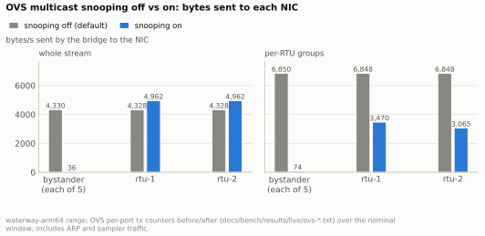

| stream | NIC | snooping off B/s | snooping on B/s | window off / on |
|---|---|---|---|---|
| whole stream | bystander NIC (mean of 5) | 4,330 | 36 | 3600 s / 300 s |
| whole stream | rtu-1 | 4,328 | 4,962 | 3600 s / 300 s |
| whole stream | rtu-2 | 4,328 | 4,962 | 3600 s / 300 s |
| per-RTU groups | bystander NIC (mean of 5) | 6,850 | 74 | 600 s / 600 s |
| per-RTU groups | rtu-1 | 6,848 | 3,470 | 600 s / 600 s |
| per-RTU groups | rtu-2 | 6,848 | 3,065 | 600 s / 600 s |

With snooping off each bystander received the whole stream (4.3 kB/s, 15.6 MB per hour) although it listens to nothing; with it on, bystanders fell to the 36-74 B/s of background traffic and each RTU received only the group it joined.
The RTU figures are higher than the datagram rate because they include the RTU's own management traffic (Modbus polling by the sampler, ARP); the counters include everything on the port.

## 8. Stock bennu vs bennu with the fixes

Stock bennu field device and watcher (the `bennu-arm64` range image) against the same code with the fixes proposed in [sandialabs/sceptre-bennu #79](https://github.com/sandialabs/sceptre-bennu/pull/79) (fd leak),
[#81](https://github.com/sandialabs/sceptre-bennu/pull/81) (robustness) and [#82](https://github.com/sandialabs/sceptre-bennu/pull/82) (watcher log), on the `waterway-arm64` range, checked by
`everything-burger-with-extra-sauce` boards on rtu-1 and rtu-2. Raw: [bench/results/burger/](bench/results/burger/) (copies of the board reports; the stock fd-leak run is quoted from the #79 PR comment, no raw file was kept).

**8a. Modbus/TCP server fd leak**: sockets of the field device before and after opening and closing Modbus connections, one per read. Stock stopped answering at connection 1 006 with 1 011 sockets (soft limit 1 024) and wrote 240 MB to stderr;
the fixed build did all 1 500 and stayed at 5.

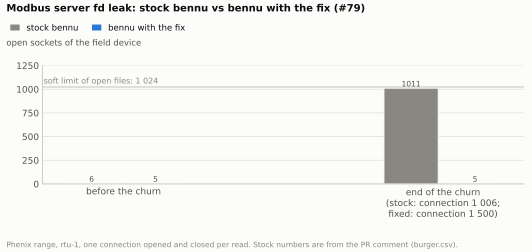

| build | label | connections done | sockets before | sockets at the end | state at the end |
|---|---|---|---|---|---|
| stock | stock bennu | 1006 | 6.0 | 1011.0 | stopped answering |
| fixed | bennu with the fix | 1500 | 5.0 | 5.0 | still answering |

**8b. Watcher stderr log growth**: `watcher-stderr.log` growth over the burger `watcher-quiet` check, KB per minute, stock against fixed (the stock line is `pid = N`, repeated 22 958 and 23 761 times on the two RTUs):

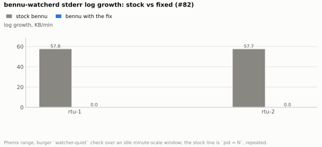

| RTU | stock watcher-stderr.log B/min | fixed B/min |
|---|---|---|
| rtu-1 | 57,780 | 0 |
| rtu-2 | 57,723 | 0 |

**8c. Robustness checks**, pass or fail, stock against fixed:

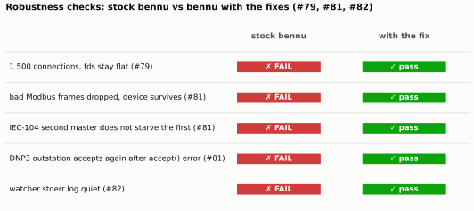

| check | what it requires | stock | fixed |
|---|---|---|---|
| modbus-churn | 1 500 connections, fds stay flat (#79) | FAIL | pass |
| modbus-badframes | bad Modbus frames dropped, device survives (#81) | FAIL | pass |
| iec104-masters | IEC-104 second master does not starve the first (#81) | FAIL | pass |
| dnp3-accept | DNP3 outstation accepts again after accept() error (#81) | FAIL | pass |
| watcher-quiet | watcher stderr log quiet (#82) | FAIL | pass |

Stock bennu fails all five checks (the field device dies on a truncated Modbus frame; an IEC-104 master starves when a second connects; a DNP3 outstation never accepts again after an accept error; fds leak; the watcher floods its log); with the fixes all five pass.
Not covered: GOOSE, Windows nodes, the real rig.

## 9. Control latency: breaker flips and generator spin-up and spin-down

ferrofire vs stock bennu (pybennu + stock field devices), same grid (1 250 branches, 10 generators) and SCADA driver, 1 to 10 RTUs, sequential and simultaneous commands, Docker (5 reps, full matrix) and the live range (3 reps, 1, 2, 5 RTUs). Unit: milliseconds from the SCADA write to the read-back showing the new state, p50 (100 sequential flips on 1, 2, 5, 10 RTUs, Docker).
Full method, every figure, lost and wrong counts, and what stock cannot run (no generator ramp): [control-latency.md](bench/control-latency.md); raw: [results/control/](bench/results/control/).

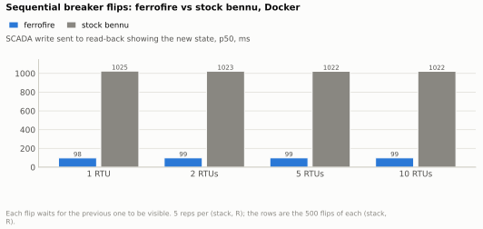

| stack | RTUs | flips done | p50 ms | p95 ms | p99 ms | max ms |
|---|---|---|---|---|---|---|
| ferrofire | 1 | 500 | 98 | 118 | 125 | 128 |
| ferrofire | 2 | 500 | 98 | 117 | 125 | 126 |
| ferrofire | 5 | 500 | 99 | 112 | 119 | 126 |
| ferrofire | 10 | 500 | 99 | 110 | 114 | 115 |
| stock bennu | 1 | 500 | 1025 | 1033 | 1035 | 1036 |
| stock bennu | 2 | 500 | 1023 | 1032 | 1035 | 1037 |
| stock bennu | 5 | 500 | 1022 | 1035 | 1041 | 1046 |
| stock bennu | 10 | 500 | 1022 | 1044 | 1051 | 1060 |

Ferrofire shows a flip in about 100 ms, stock bennu in about 1 020 ms; with 100 flips at once on 1 RTU stock loses 81% within 10 s and ferrofire loses none. With stock's publish interval cut to 0.1 s or 0.05 s (Docker, [control-latency.md](bench/control-latency.md) section 8) its sequential flips over 5 or 10 RTUs take 86 to 127 ms, close to ferrofire's 99 ms, but on 1 RTU still about 500 ms, and it still loses 80% of 100 simultaneous flips on 1 RTU: stock's write rate, not its publish interval, limits those.

## Other results on the bench and the live range

These have no chart: each is a single measured event rather than a comparison across settings.

| What is compared | Conditions | Result |
|---|---|---|
| Datagram v1 stream vs the `_ff.seq` count: injected 0.1 / 1 / 5 % loss vs missing sequence numbers | Docker bench, netem, 3 reps per cell | read as 0.10-0.17 / 1.07-1.34 / 5.07-5.14 % |
| Multicast subscriber vs pull-bridge after `kill -9` of the provider and a restart 3 s later | Docker bench, 100 tags, 10 Hz, 3 reps | multicast fresh 3-4 ms after the restart command; pull-bridge 139-144 ms; nothing wedged |
| Multicast vs pull-bridge while every REP reply is dropped for 4 s | same | multicast untouched; pull-bridge fresh 260 ms after replies return, socket recreated |
| Clean vs 7 800 bad datagrams injected at 100/s | same | all counted by reason, 100 % of cycles still delivered, no crash |
| Provider `kill -9` (restart after 5 s or 20 s) and `SIGSTOP` 10 s | live range, stock RTUs | RTUs tracking again at the first sample (0.2 s); no RTU wedged; writes go through after recovery |
| 11 041 garbage datagrams into the group, vs the same range without | live range, 60 s injection | stock bennu kept running (values flickered while it lasted) |
| Misspelled tag in a `WRITE`/`READ` vs a correct one | live range and bench | `ERR` with a "did you mean" suggestion, nothing else changes |
| Per-RTU groups, 10 min, snooping off vs on | live range | 0 lost, 100 % tracking in both |
| Pull-bridge at 100 ms vs 1 s vs push, two RTUs | live range, 3 reps, 30 s windows | provider NIC 11.4 kB/s (pull 100 ms), 1.3 kB/s (pull 1 s), 4.2 kB/s (push); section G5 of the bench report |

### Tools on the live range

`waterway-arm64`, ferrofire provider, stock bennu RTUs ([captures](live-tools/README.md)).

| Tool | Result |
|---|---|
| `probe write lowervalve.open=1,lowergate.open=0` | reached rtu-1's Modbus registers within 577 ms |
| `probe play` (3 timed writes at 0, 2, 4 s) | writes landed at 0, 2 012 and 4 023 ms |
| `probe record`, 60 s | 601 rows, cycles 2249..2849, no gaps, no stale flags |
| `probe diff` against both RTUs (22 registers) | 20 clean cycles; a holding register written straight onto rtu-1 gave 9 mismatches and exit 1, then clean |
| `ferrofire top`, provider stopped | all 15 tags `STALE` at 4.4 s (stale-after 2 s), back to `good` on resume |
| `ferrofire doctor`, OVS snooping off/on | caught a wrong multicast route on a multihomed host, a member starved after snooping was enabled late, and a 1.0 s clock skew between VMs |
| `ferrofire log` | `on` x3 printed "already logging to" twice with one file; `off` x2 printed "already off"; `level debug --for 10s` reverted by itself |
| Binary on a VM without libzmq | runs (pure-Rust zeromq; glibc dynamic, needs only libc/libm/libgcc_s) |

## Code quality gates

Every function CRAP < 10, no duplicate code above 0.8 similarity, mutation testing with 0 surviving mutants ([quality.md](quality.md)).
What each result is checked against, and what is not covered: [testing.md](testing.md).
